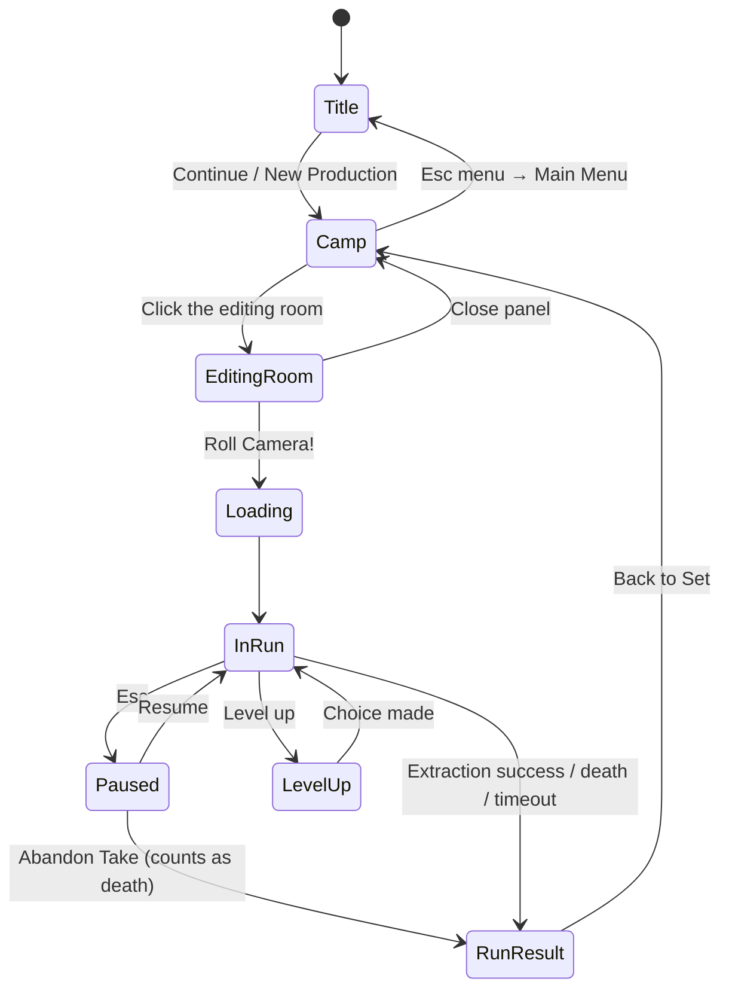

# Game Flow & Save

> **Status**: Designed
> **Author**: The developer + Claude
> **Last Updated**: 2026-11-12
> **Last Verified**: 2026-11-12
> **Implements Pillar**: P3 Short takes, visible growth

## Summary

Defines all the states of the game from launch to quit, how states switch, and how meta progress is saved. It is the skeleton of every other system: each system is active only in specific states.

> **Quick reference** — Layer: `Foundation` · Priority: `MVP` · Key deps: `None`

## Overview

The game has only two "scenes": Camp and the in-run map (Run). In camp the player upgrades, goes to the editing room to pick cards, and departs; in a run they mow down enemies, loot, and extract or die; then they return to camp. All meta progress lives in a single auto-saved save slot, so the player never needs to save manually.

## Player Fantasy

"I am the director of this movie." Camp is backstage at the set, departing is starting a take (Take), extracting is "Cut! Print that one", and dying is an NG. Every time I return to camp, the set looks better than the last time.

## Detailed Design

### Core Rules

1. The game has two levels: `L_Camp` (camp) and `L_Run` (in-run map). The title screen is overlaid on camp and is not a separate level.
2. Flow state is held by a single global flow manager; every system queries it for "which state are we in" and must not decide this on its own.
3. **One run = one Take**. Take numbers start at 1, increase by 1 on each departure, are stored in the save, and are shown on the loading card and the results screen ("Take 7").
4. **Departure**: only possible by clicking "Roll Camera!" in the editing room panel. On departure, this run's footage card combination and payout multiplier are locked and cannot be changed during the run.
5. **Returning to camp**: after the run ends (extraction success, death, timeout), the results screen is shown first, and camp loads after the player clicks "Back to Set".
6. **Auto-save** triggers (meta data only):
   - After returning to camp, once the settlement has been written
   - After each building upgrade, salvage, or unlock
   - After changing the editing room's card slot configuration
   - When quitting the game
7. **No saving during a run**. A forced quit or crash mid-run voids that run: nothing is deducted and nothing is granted. The pre-departure state is fully preserved.
8. **New game/reset**: the title screen offers "New Production" (new save). When a save exists it requires a second confirmation, and after confirming all meta progress is cleared.

### States and Transitions

| State | Does time flow | Input | Description |
|---|---|---|---|
| Title | — | UI | Continue / New Production / Settings / Quit |
| Camp | Yes (ambient animation) | Mouse point-and-click | Camp scene, click a building to open its panel |
| EditingRoom | Yes | UI | Editing room panel (a sub-panel of camp) |
| Loading | — | None | Shows a clapperboard loading card: "Take N — <card combination name>" |
| InRun | Yes | Combat controls | Normal play |
| LevelUp | **Paused** | UI | Level-up pick one of three |
| Paused | **Paused** | UI | Resume / Settings / Abandon Take |
| RunResult | Paused | UI | Success shows "That's a Wrap!", failure shows "NG" |

The bag panel opens within the InRun state and slows time rather than pausing it; see `loot-inventory-heat.md` for details.

### Interactions with Other Systems

| System | What the flow requires of it |
|---|---|
| `directors-cut-editing.md` | On departure, hands this run's card combination and payout multiplier to the in-run systems |
| `extraction-death.md` | It decides how a run ends, and enters RunResult carrying the result (success/death/timeout + item list) |
| `camp-meta.md` | On RunResult → Camp, writes the carried-out items into the stash, then auto-saves |
| `run-progression.md` | On level-up, requests entering the LevelUp state |
| `ui-hud.md` | The screen for each state |

## Formulas

No numeric formulas. Take number: `TakeNumber = departures so far + 1`.

## Edge Cases

| Situation | Handling |
|---|---|
| Crash or forced quit mid-run | The run is void; the save stays at its pre-departure state |
| Corrupted or version-incompatible save file | Shows "Save data could not be loaded" and offers "Start New Production"; the old file is not deleted automatically but renamed as a backup |
| Level-up and extraction completion on the same frame | Extraction takes priority; this level-up is void (the run is over) |
| Level-up and death on the same frame | Death takes priority |
| Choosing Abandon Take while Paused | Settles as death (bag fully lost, NG Film granted), to stop players from using quitting to dodge losses |
| Forced quit on the results screen | The settlement was already written to the save on entering RunResult, so a forced quit does not affect the result |

## Dependencies

- Upstream: none.
- Downstream: all other systems depend on the current state provided by this system, with direct interaction for `directors-cut-editing` (departure), `extraction-death` (ending a run), `camp-meta` (saving meta data), `run-progression` (LevelUp state), and `ui-hud` (screen switching). `player-combat`, `enemies-spawning`, and `loot-inventory-heat` run only in the InRun state.

## Tuning Knobs

| Parameter | Default | Range | Description |
|---|---|---|---|
| Minimum loading card display time | 1.5 s | 0-3 s | Too short and the Take number can't be read |
| Minimum results screen dwell time | 1.0 s | 0-3 s | Prevents accidental skipping by mis-click |

## Visual/Audio Requirements

- Loading card: clapperboard style, clap sound effect + "Take N".
- Extraction success: "Cut! That's a Wrap!", applause or a short fanfare.
- Death: the screen turns black and white with film scratches, plus an "NG" stamp sound effect.

## Game Feel

State switches should be fast, with total time from camp to run start under 5 seconds (excluding player actions). Judges have limited time, and any waiting costs points.

## UI Requirements

See `ui-hud.md`: the four screens Title, Loading, Pause, and RunResult.

## Cross-References

- `design/prd/master-prd.md` Section 3 (core loop)
- `design/gdd/extraction-death.md` (how a run ends)
- `design/gdd/camp-meta.md` (which meta data lives in the save)

## Acceptance Criteria

- **AC1 (Must)**: After launching with a new save, the player can play two consecutive loops of camp → editing room → run → extraction → results → camp without restarting.
- **AC2 (Must)**: After a successful extraction, quitting and relaunching the game, camp materials and building levels match what they were before quitting.
- **AC3 (Must)**: After a forced quit mid-run and relaunch, the save is identical to before departure.
- **AC4 (Should)**: Choosing Abandon Take while Paused settles as death.
- **AC5 (Should)**: After the "New Production" second confirmation, all meta progress is reset to zero.
- **AC6 (Must)**: In the LevelUp and Paused states, enemies, timers, and the extraction bar all stop.

## Open Questions

- Should judges get a "skip tutorial" or "quick start" entry point? (Default is no; the first run's hint text is enough.)
