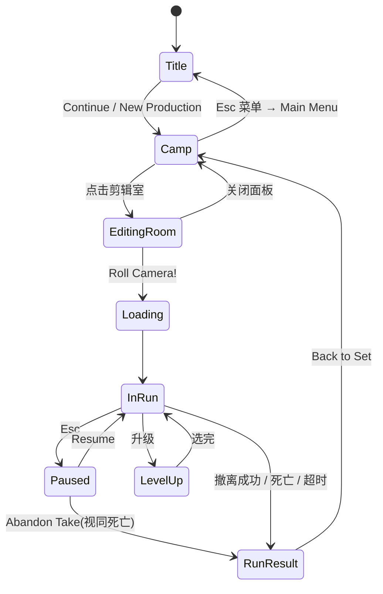

# Game Flow & Save

> **Status**: Designed
> **Author**: 开发者本人 + Claude
> **Last Updated**: 2026-11-12
> **Last Verified**: 2026-11-12
> **Implements Pillar**: P3 Short takes, visible growth

## Summary

定义游戏从启动到退出的全部状态、状态之间如何切换,以及局外进度如何保存。它是其他所有系统的骨架:每个系统只在特定状态下生效。

> **Quick reference** — Layer: `Foundation` · Priority: `MVP` · Key deps: `None`

## Overview

游戏只有两个"场景":营地(Camp)和局内地图(Run)。玩家在营地里升级、进剪辑室选卡、出发;在局内割草、搜刮、撤离或死亡;然后回到营地。全部局外进度存在一个自动保存的单存档里,玩家永远不需要手动存档。

## Player Fantasy

"我是这部电影的导演。"营地是片场后台,出发是一次开拍(Take),撤离是"Cut! 这条过",死亡是 NG。每一次回到营地,片场都比上一次更像样。

## Detailed Design

### Core Rules

1. 游戏有两个关卡(Level):`L_Camp`(营地)和 `L_Run`(局内地图)。标题画面叠加在营地上,不单独做关卡。
2. 流程状态由一个全局的流程管理器统一持有,任何系统都通过它查询"当前处于哪个状态",不能自己判断。
3. **一局 = 一个 Take**。Take 编号从 1 开始,每出发一次 +1,存进存档,显示在加载卡和结算画面("Take 7")。
4. **出发**:只能在剪辑室面板点击 "Roll Camera!" 出发。出发时锁定本局的片段卡组合和收益倍率,局内不能再改。
5. **回营地**:局内结束(撤离成功、死亡、超时)后,先显示结算画面,玩家点 "Back to Set" 后加载营地。
6. **自动保存**的触发时机(只存局外数据):
   - 回到营地、结算写入之后
   - 每次建筑升级、分解、解锁之后
   - 修改剪辑室的卡槽配置之后
   - 退出游戏时
7. **局内不存档**。局内强退或崩溃,视为本局作废:不扣东西,也不给东西。出发前的状态完整保留。
8. **新游戏/重置**:标题画面提供 "New Production"(新存档)。已有存档时需要二次确认,确认后清空全部局外进度。

### States and Transitions

| 状态 | 时间是否流动 | 输入 | 说明 |
|---|---|---|---|
| Title | — | UI | Continue / New Production / Settings / Quit |
| Camp | 是(环境动画) | 鼠标点选 | 营地场景,点建筑开面板 |
| EditingRoom | 是 | UI | 剪辑室面板(营地的一个子面板) |
| Loading | — | 无 | 显示场记板加载卡:"Take N — <卡组合名>" |
| InRun | 是 | 战斗操作 | 正常游玩 |
| LevelUp | **暂停** | UI | 升级三选一 |
| Paused | **暂停** | UI | Resume / Settings / Abandon Take |
| RunResult | 暂停 | UI | 成功显示 "That's a Wrap!",失败显示 "NG" |

背包面板在 InRun 状态里打开,时间放慢而不暂停,详见 `loot-inventory-heat.md`。

### Interactions with Other Systems

| 系统 | 流程对它的要求 |
|---|---|
| `directors-cut-editing.md` | 出发时把本局卡组合和收益倍率交给局内各系统 |
| `extraction-death.md` | 局内结束由它判定,带着结果(成功/死亡/超时 + 物品清单)进入 RunResult |
| `camp-meta.md` | RunResult → Camp 时,把带出的物品写进仓库,再自动保存 |
| `run-progression.md` | 升级时请求进入 LevelUp 状态 |
| `ui-hud.md` | 每个状态对应的界面 |

## Formulas

无数值公式。Take 编号:`TakeNumber = 已出发次数 + 1`。

## Edge Cases

| 情况 | 处理 |
|---|---|
| 局内崩溃或强退 | 本局作废,存档停留在出发前的状态 |
| 存档文件损坏或版本不兼容 | 提示 "Save data could not be loaded",提供 "Start New Production";不自动删除旧文件,把它改名备份 |
| 升级和撤离完成发生在同一帧 | 撤离优先,本次升级作废(局已经结束) |
| 升级和死亡发生在同一帧 | 死亡优先 |
| Paused 状态下选 Abandon Take | 按死亡结算(背包全丢,得 NG 胶片),防止玩家用退出来逃避损失 |
| 结算画面强退 | 结算在进入 RunResult 时就已写入存档,强退不影响结果 |

## Dependencies

- 上游:无。
- 下游:所有其他系统都依赖本系统提供的当前状态,其中直接交互的有 `directors-cut-editing`(出发)、`extraction-death`(结束一局)、`camp-meta`(保存局外数据)、`run-progression`(LevelUp 状态)、`ui-hud`(界面切换)。`player-combat`、`enemies-spawning`、`loot-inventory-heat` 只在 InRun 状态下运行。

## Tuning Knobs

| 参数 | 默认值 | 范围 | 说明 |
|---|---|---|---|
| 加载卡最短显示时间 | 1.5 s | 0–3 s | 太短看不清 Take 编号 |
| 结算画面最短停留时间 | 1.0 s | 0–3 s | 防止误点跳过 |

## Visual/Audio Requirements

- 加载卡:场记板(clapperboard)样式,打板音效 + "Take N"。
- 撤离成功:"Cut! That's a Wrap!",掌声或一声短促的号角。
- 死亡:画面变黑白、出现胶片划痕,配 "NG" 印章音效。

## Game Feel

状态切换要快,营地到开局总时长 < 5 秒(不含玩家操作)。评委时间有限,任何等待都是在扣分。

## UI Requirements

见 `ui-hud.md`:Title、Loading、Pause、RunResult 四个界面。

## Cross-References

- `design/prd/master-prd.md` 第 3 节(核心循环)
- `design/gdd/extraction-death.md`(局内如何结束)
- `design/gdd/camp-meta.md`(存档里有哪些局外数据)

## Acceptance Criteria

- **AC1(Must)**:新存档启动后,能从营地 → 剪辑室 → 局内 → 撤离 → 结算 → 营地,连续跑完两圈,中途不需要重启。
- **AC2(Must)**:撤离成功后退出游戏、重新启动,营地材料和建筑等级与退出前一致。
- **AC3(Must)**:局内强退后重新启动,存档与出发前完全一致。
- **AC4(Should)**:在 Paused 状态下选 Abandon Take,按死亡结算。
- **AC5(Should)**:"New Production" 二次确认后,所有局外进度归零。
- **AC6(Must)**:LevelUp 和 Paused 状态下,敌人、计时器、撤离读条全部停止。

## Open Questions

- 是否给评委一个"跳过教程"或"快速开始"的入口?(默认不做,第一局的提示文字已经足够)
