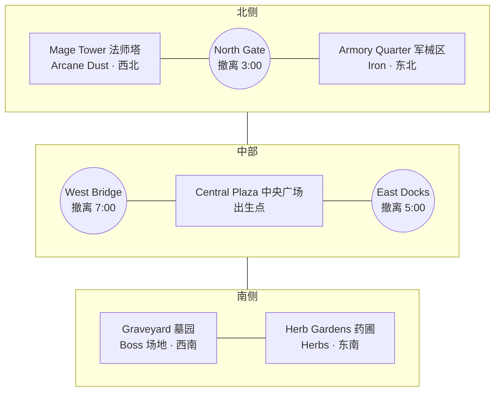

# Map & Level Design

> **Status**: Designed
> **Author**: 开发者本人 + Claude
> **Last Updated**: 2026-11-12
> **Last Verified**: 2026-11-12
> **Implements Pillar**: P1(按需规划路线),P2(变化来自剪辑而非随机地图)

## Summary

只有一张手工搭建的固定地图 "The Ruined Set":一座被剪烂的奇幻小城片场。地图分 5 个区域,每个区域固定产一种材料,物资点和撤离点位置固定。每一局的变化全部来自片段卡和玩家选的路线,而不是随机生成。

> **Quick reference** — Layer: `Feature` · Priority: `MVP` · Key deps: `loot-inventory-heat`, `extraction-death`, `enemies-spawning`

## Overview

地图约 180 m × 180 m,从中心走到边缘约 15 s。玩家从中央广场出发,向四周的区域搜刮,再走到地图边缘的撤离点。区域划分让"我要什么材料就去哪儿"成为第一个决策,撤离点的位置和开放时间决定第二个决策:搜到一半往哪边撤。

## Player Fantasy

"我认得这座城。"几局之后,玩家脑子里会有一张地图:军械区东北、法师塔在西北、宝库在最里面、北门最早开。熟悉地形本身就是一种成长。

## Detailed Design

### Core Rules

**尺寸与坐标**

- 可玩区域 18000 × 18000 cm,原点在地图中心,+X 为东,+Y 为北。
- 地图边界是片场的墙和撕裂的胶片边缘,不可穿越。
- 地面基本平坦(斜俯视镜头下高差会影响可读性),高差只用于装饰。

**区域与点位**



| 区域 | 位置(中心坐标,m) | 材料 | 补给箱 | 贮藏箱 | 宝库 | 特点 |
|---|---|---|---|---|---|---|
| Central Plaza | (0, 0) | Iron | 2 | 0 | 0 | 出生点;开阔,适合放风筝 |
| Armory Quarter | (+55, +50) | Iron | 4 | 2 | 1 | 狭窄街道,宝库在区域最深处 |
| Herb Gardens | (+50, −50) | Herbs | 4 | 1 | 0 | 开阔田地,适合大范围走位 |
| Mage Tower | (−50, +55) | Arcane Dust | 2 | 1 | 1 | 地标高塔,宝库在塔底 |
| Graveyard | (−50, −50) | 混合 | 0 | 1 | 0 | Boss 场地,围墙圈出的竞技场 |
| **合计** | | | **12** | **5** | **2** | |

- Must 档:灰盒地图包含 5 个区域的大致布局、12 个补给箱、2 个宝库、2 个撤离点(North Gate、East Docks),所有点位都产 Iron。
- Should 档:加入 5 个贮藏箱、West Bridge,按区域区分材料,替换为正式美术。

**撤离点**

| 撤离点 | 坐标(m) | 位置说明 | 默认开放 |
|---|---|---|---|
| North Gate | (0, +85) | 北侧城门,法师塔和军械区之间 | 3:00 |
| East Docks | (+85, 0) | 东侧码头,军械区和药圃之间 | 5:00 |
| West Bridge | (−85, 0) | 西侧桥头,法师塔和墓园之间 | 7:00 |

撤离点周围 10 m 内保持开阔(没有障碍物),给读条时的走位留出空间。

**路线设计原则**

1. 从出生点到任何区域的入口 ≤ 10 s 步行。
2. 宝库永远放在区域最深处:拿宝库就意味着要穿过整个区域再出来。
3. 每个撤离点至少有两条路可以到达,防止被一条路堵死。
4. 主路宽 8–12 m,小巷宽 4–6 m(小巷是捷径,也是被围的风险)。
5. 每个区域至少有一个从远处就能认出的地标(法师塔、军械区的大烟囱、墓园尖塔、药圃风车、广场喷泉)。
6. 物资点在 HUD 上有方向标记(见 `ui-hud.md`),所以不需要小地图。

**刷怪相关**

- 地图上均匀分布 16 个预设刷怪点,供刷怪导演在找不到合法刷新位置时使用(见 `enemies-spawning.md`)。
- 封闭建筑内部标记为不可刷怪区。
- 全图覆盖导航网格,包括所有街道和开阔地。

**片场主题装饰(Could)**

- 建筑立面背后露出脚手架和木支架,看得出是"布景"。
- 地图边缘的墙上挂着片场灯和摄影机轨道。
- 区域之间的过渡处散落着胶片卷和场记板。

### States and Transitions

地图本身没有状态。物资点和撤离点的状态分别见 `loot-inventory-heat.md` 和 `extraction-death.md`。

### Interactions with Other Systems

| 系统 | 交互 |
|---|---|
| `loot-inventory-heat.md` | 物资点的位置、类型、所属区域 |
| `extraction-death.md` | 撤离点的位置 |
| `enemies-spawning.md` | 预设刷怪点、不可刷怪区、Boss 场地(墓园) |
| `player-combat.md` | 碰撞、闪避不能穿墙 |
| `art-audio-direction.md` | 各区域的视觉主题 |

## Formulas

**步行时间校验**

```
WalkTime = Distance / MoveSpeed
```

例:中心到 North Gate 85 m,移速 6 m/s → 约 14 s;从军械区宝库(约 (+65, +60))到 North Gate 约 65 m → 约 11 s。保证一局 5 分钟内能搜两个区域并撤离。

## Edge Cases

| 情况 | 处理 |
|---|---|
| 玩家被怪堵在小巷尽头 | 小巷不做死胡同,两端都通 |
| 物资产出掉在墙里 | 掉落位置投影到最近的可走点 |
| 撤离点附近被尸潮淹没 | 设计上允许;每个撤离点有两条以上的路,玩家可以绕行或改去别的撤离点 |
| Boss 离开墓园追玩家 | 允许;墓园只是登场位置 |

## Dependencies

- 上游:无(地图是静态内容)。
- 下游:`loot-inventory-heat`、`extraction-death`、`enemies-spawning`、`art-audio-direction`。

## Tuning Knobs

| 参数 | 默认值 | 安全范围 | 影响 |
|---|---|---|---|
| 地图尺寸 | 180 m | 140–240 m | 一局能搜多少 |
| 各区域点位数量 | 见区域表 | ±50% | 单局收益(会影响 `camp-meta.md` 的节奏校验) |
| 撤离点周围的开阔半径 | 10 m | 6–15 m | 读条时的走位空间 |
| 主路 / 小巷宽度 | 8–12 m / 4–6 m | — | 被围的风险 |

## Visual/Audio Requirements

- 各区域有不同的主色调,让玩家一眼知道自己在哪(详见 `art-audio-direction.md`)。
- 每个区域有自己的环境音:军械区的铁匠锤声、药圃的风声和虫鸣、法师塔的低沉嗡鸣、墓园的乌鸦。

## Game Feel

开阔地是"爽区"(大范围割草),小巷和宝库深处是"紧张区"。路线上要交替出现这两种空间。

## UI Requirements

不做小地图。物资点和撤离点用 HUD 边缘的方向标记表示。见 `ui-hud.md`。

## Cross-References

- `design/gdd/loot-inventory-heat.md`(物资点类型)
- `design/gdd/extraction-death.md`(撤离点规则)
- `design/gdd/enemies-spawning.md`(刷怪点、Boss)

## Acceptance Criteria

- **AC1(Must)**:灰盒地图上能找到 12 个补给箱、2 个宝库、2 个撤离点,位置与本文件的区域表一致。
- **AC2(Must)**:从出生点走到 North Gate 用时在 12–18 s 之间。
- **AC3(Must)**:全图任何可走位置都能到达所有撤离点(导航网格连通)。
- **AC4(Must)**:不存在死胡同小巷。
- **AC5(Should)**:每个区域的物资点只产本区域的材料(Graveyard 除外)。
- **AC6(Should)**:从地图任何位置,都能在屏幕上或 HUD 方向标记中找到至少一个区域地标。

## Open Questions

- 灰盒阶段地图尺寸可能需要按实际手感缩放(140–240 m);缩放后需要重新校验步行时间和单局收益。
