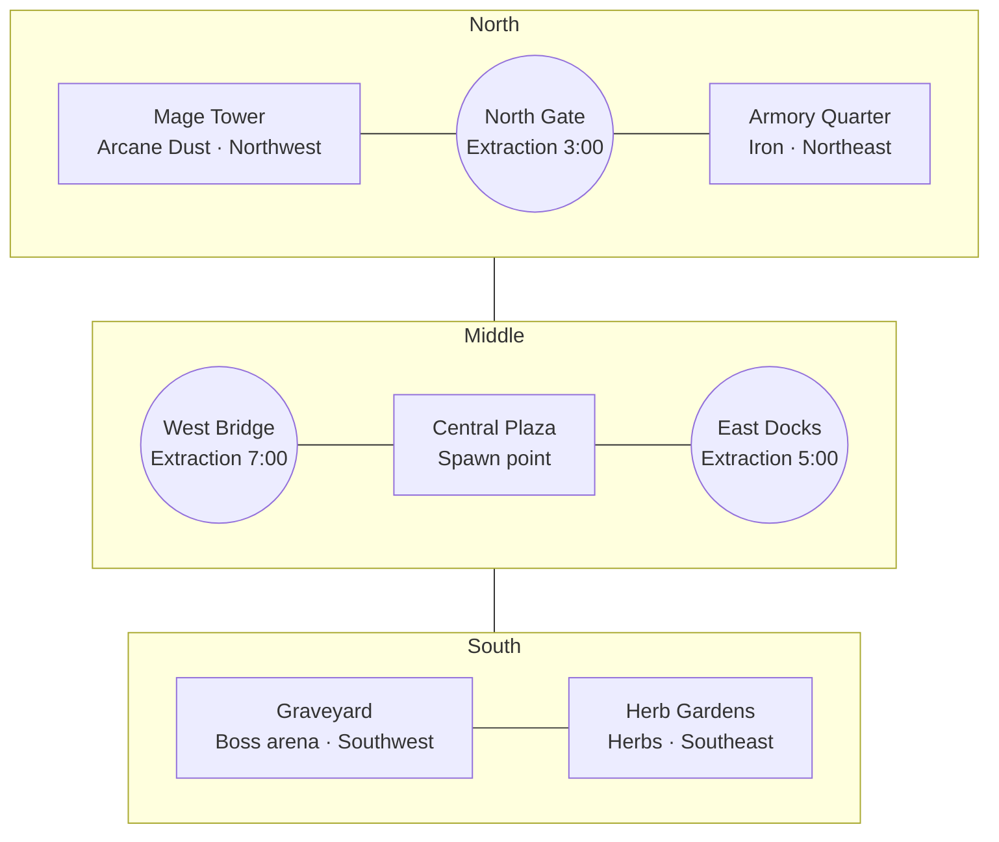

# Map & Level Design

> **Status**: Designed
> **Author**: The developer + Claude
> **Last Updated**: 2026-11-12
> **Last Verified**: 2026-11-12
> **Implements Pillar**: P1 (plan routes on demand), P2 (variation comes from editing, not from a random map)

## Summary

There is only one hand-built fixed map, "The Ruined Set": a small fantasy town film set that has been cut to shreds. The map is divided into 5 areas; each area yields one fixed material, and supply point and extraction point positions are fixed. All variation from run to run comes from the clip cards and the route the player chooses, not from random generation.

> **Quick reference** — Layer: `Feature` · Priority: `MVP` · Key deps: `loot-inventory-heat`, `extraction-death`, `enemies-spawning`

## Overview

The map is about 180 m × 180 m, and walking from the center to the edge takes about 15 s. The player starts in the Central Plaza, loots the surrounding areas, then walks to an extraction point at the map edge. The area layout makes "go wherever the material I want is" the first decision; the position and opening time of the extraction points make the second: which way to extract when halfway through a search.

## Player Fantasy

"I know this town." After a few runs, the player has a map in their head: the Armory Quarter in the northeast, the Mage Tower in the northwest, the vault at the very back, the north gate opening first. Knowing the terrain is itself a form of growth.

## Detailed Design

### Core Rules

**Size and coordinates**

- The playable area is 18000 × 18000 cm, with the origin at the map center, +X east and +Y north.
- The map boundary is the film set's walls and torn film edges, and cannot be crossed.
- The ground is essentially flat (height differences would hurt readability under the angled top-down camera); height differences are used for decoration only.

**Areas and points**



| Area | Position (center coordinates, m) | Material | Supply Crates | Caches | Vaults | Notes |
|---|---|---|---|---|---|---|
| Central Plaza | (0, 0) | Iron | 2 | 0 | 0 | Spawn point; open, good for kiting |
| Armory Quarter | (+55, +50) | Iron | 4 | 2 | 1 | Narrow streets; the vault is at the deepest point of the area |
| Herb Gardens | (+50, −50) | Herbs | 4 | 1 | 0 | Open fields, good for wide-ranging movement |
| Mage Tower | (−50, +55) | Arcane Dust | 2 | 1 | 1 | Landmark tall tower; the vault is at the tower base |
| Graveyard | (−50, −50) | Mixed | 0 | 1 | 0 | Boss arena; an arena enclosed by walls |
| **Total** | | | **12** | **5** | **2** | |

- Must tier: the graybox map contains the rough layout of the 5 areas, 12 Supply Crates, 2 Vaults and 2 extraction points (North Gate, East Docks), and every point yields Iron.
- Should tier: add the 5 Caches and West Bridge, distinguish materials by area, and replace with final art.

**Extraction points**

| Extraction Point | Coordinates (m) | Location Notes | Opens By Default |
|---|---|---|---|
| North Gate | (0, +85) | The north city gate, between the Mage Tower and the Armory Quarter | 3:00 |
| East Docks | (+85, 0) | The east dock, between the Armory Quarter and the Herb Gardens | 5:00 |
| West Bridge | (−85, 0) | The west bridgehead, between the Mage Tower and the Graveyard | 7:00 |

The area within 10 m of an extraction point is kept open (no obstacles), leaving room to move during the channel.

**Route design principles**

1. From the spawn point to the entrance of any area is ≤ 10 s on foot.
2. The vault is always placed at the deepest point of an area: taking the vault means crossing the whole area and coming back out.
3. Every extraction point can be reached by at least two routes, so it cannot be blocked by a single road.
4. Main roads are 8–12 m wide and alleys are 4–6 m wide (alleys are shortcuts, and also a risk of being surrounded).
5. Every area has at least one landmark recognizable from far away (the Mage Tower, the Armory Quarter's big chimney, the Graveyard spire, the Herb Gardens windmill, the plaza fountain).
6. Supply points have direction markers on the HUD (see `ui-hud.md`), so no minimap is needed.

**Spawn-related**

- 16 preset spawn points are spread evenly across the map, for the spawn director to use when it cannot find a legal spawn position (see `enemies-spawning.md`).
- The interiors of enclosed buildings are marked as no-spawn zones.
- The navigation mesh covers the whole map, including all streets and open ground.

**Film set theme decoration (Could)**

- Scaffolding and wooden braces show behind building facades, making it clear they are "sets".
- Set lights and camera tracks hang on the walls at the map edge.
- Film reels and clapperboards are scattered at the transitions between areas.

### States and Transitions

The map itself has no state. For the states of supply points and extraction points, see `loot-inventory-heat.md` and `extraction-death.md` respectively.

### Interactions with Other Systems

| System | Interaction |
|---|---|
| `loot-inventory-heat.md` | Supply point positions, types and owning areas |
| `extraction-death.md` | Extraction point positions |
| `enemies-spawning.md` | Preset spawn points, no-spawn zones, Boss arena (Graveyard) |
| `player-combat.md` | Collision; dodging cannot pass through walls |
| `art-audio-direction.md` | Visual theme of each area |

## Formulas

**Walk time check**

```
WalkTime = Distance / MoveSpeed
```

Example: center to North Gate is 85 m, at a move speed of 6 m/s → about 14 s; from the Armory Quarter vault (about (+65, +60)) to North Gate is about 65 m → about 11 s. This ensures that within a 5-minute run the player can search two areas and extract.

## Edge Cases

| Situation | Handling |
|---|---|
| The player is cornered by monsters at the end of an alley | Alleys are not dead ends; both ends are open |
| A supply yield drops inside a wall | The drop position is projected to the nearest walkable point |
| The area near an extraction point is flooded by a horde | Allowed by design; each extraction point has more than two routes, so the player can go around or switch to another extraction point |
| The Boss leaves the Graveyard to chase the player | Allowed; the Graveyard is only the spawn location |

## Dependencies

- Upstream: none (the map is static content).
- Downstream: `loot-inventory-heat`, `extraction-death`, `enemies-spawning`, `art-audio-direction`.

## Tuning Knobs

| Parameter | Default | Safe Range | Affects |
|---|---|---|---|
| Map size | 180 m | 140–240 m | How much can be searched in a run |
| Point counts per area | See the area table | ±50% | Yield per run (affects the pacing check in `camp-meta.md`) |
| Open radius around extraction points | 10 m | 6–15 m | Room to move during the channel |
| Main road / alley width | 8–12 m / 4–6 m | — | Risk of being surrounded |

## Visual/Audio Requirements

- Each area has a different dominant color tone, so the player knows at a glance where they are (details in `art-audio-direction.md`).
- Each area has its own ambient sound: the Armory Quarter's blacksmith hammering, the Herb Gardens' wind and insects, the Mage Tower's low hum, the Graveyard's crows.

## Game Feel

Open ground is the "fun zone" (mowing down enemies over a wide area), while alleys and the depths of the vaults are the "tension zone". These two kinds of space should alternate along a route.

## UI Requirements

No minimap. Supply points and extraction points are shown with direction markers at the HUD edge. See `ui-hud.md`.

## Cross-References

- `design/gdd/loot-inventory-heat.md` (supply point types)
- `design/gdd/extraction-death.md` (extraction point rules)
- `design/gdd/enemies-spawning.md` (spawn points, Boss)

## Acceptance Criteria

- **AC1 (Must)**: On the graybox map, 12 Supply Crates, 2 Vaults and 2 extraction points can be found, with positions matching the area table in this file.
- **AC2 (Must)**: Walking from the spawn point to North Gate takes between 12 and 18 s.
- **AC3 (Must)**: From any walkable position on the map, all extraction points can be reached (the navigation mesh is connected).
- **AC4 (Must)**: There are no dead-end alleys.
- **AC5 (Should)**: The supply points of each area yield only that area's material (except the Graveyard).
- **AC6 (Should)**: From any position on the map, at least one area landmark can be found on screen or in a HUD direction marker.

## Open Questions

- During the graybox stage, the map size may need to be scaled based on actual feel (140–240 m); after scaling, walk times and per-run yield need to be re-validated.
