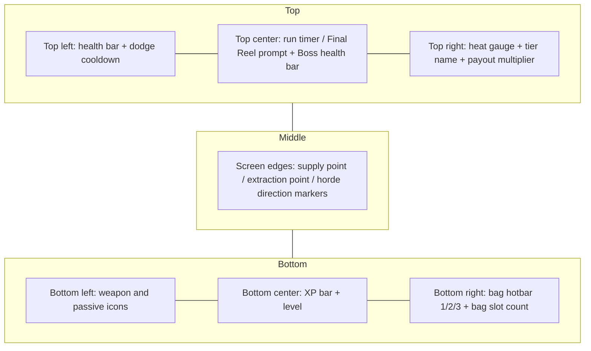
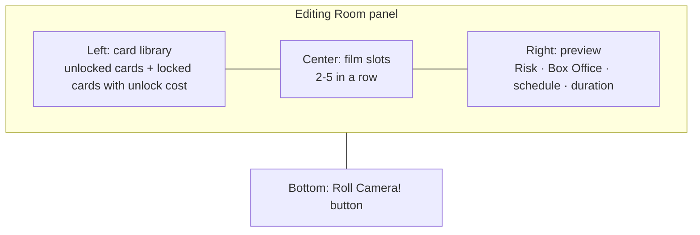

# UI & HUD

> **Status**: Designed
> **Author**: The developer + Claude
> **Last Updated**: 2026-11-12
> **Last Verified**: 2026-11-12
> **Implements Pillar**: All (the UI makes the three pillars "visible")

## Summary

Lists every screen in the game: what each shows, how it is laid out, how it is operated, and what its copy says. All in-game text is English; this file describes things in English too, and in-game copy is marked in code format.

> **Quick reference** — Layer: `Presentation` · Priority: `MVP` · Key deps: all gameplay systems

## Overview

There are three kinds of UI:
1. **In-run HUD**: always on during combat; information density must be low and readable at a glance.
2. **In-run pop-up screens**: level-up choice, bag, pause.
3. **Out-of-run screens**: title, camp, building panel, warehouse, Editing Room, loading card, results.

The unified visual language is "film set": clapperboards, film strips, set lighting, and a typewriter font for titles.

## Player Fantasy

"All the information feels as natural as props on a film set." The heat gauge is a set warning light, the film slots are real film, and the results screen looks like a crew call sheet.

## Detailed Design

### Core Rules

**General rules**

1. Reference resolution is 1920×1080, scaled proportionally by height; safe-area margin is 48 px.
2. Body font size >= 22 px (at 1080p), key numbers >= 32 px.
3. Color semantics: health red, XP blue, heat from yellow to red, materials colored by type (Iron gray-blue, Herbs green, Arcane Dust purple), relics gold.
4. Every interactive element has a hover state and a click sound.
5. All copy is kept in a single string table, not hardcoded in screens.

**In-run HUD (Must)**



| Element | Content | Tier |
|---|---|---|
| Health bar | Current / max, flashes below 30% | Must |
| Dodge cooldown | Circular cooldown icon | Must |
| Timer | Elapsed run time `04:12`; shows remaining time when there is a time limit | Must |
| Heat gauge | Vertical light bar + tier name `CALM` / `NOTICED` / `HUNTED` / `INFAMOUS` + value; flashes on tier change | Must |
| Payout multiplier | `Box Office ×2.25` | Must |
| XP bar | Bottom horizontal bar + `LV 7` | Must |
| Weapons and passives | Icon + level dots | Must |
| Bag hotbar | Icons and keys `1` `2` `3` for the first 3 relics; `Bag 6/8` shown beside it | Must |
| Supply point marker | Screen-edge arrow, icon distinguishes type, color distinguishes material; searched ones are not shown; only those within 40 m are shown | Must |
| Extraction point marker | Screen-edge arrow + name + open countdown `North Gate 0:48` or `OPEN` | Must |
| Horde warning | Red flash on the screen edge in the incoming direction + `HORDE INCOMING` | Must |
| Boss health bar | Top center, with name `THE CUT KNIGHT` | Must |
| Search progress | Circular progress bar above the supply point | Must |
| Extraction channel | Ground halo at the extraction point + `EXTRACTING 18s` at screen center | Must |
| Hint text | `Bag Full`, `Press E to search`, etc., lower-middle of the screen, disappears after 2 s | Must |

**Level-up choice (Must)**

- Full-screen dimming, 3 cards in a horizontal row in the center.
- Each card: icon, name, `NEW!` or `LV 2 → 3`, a one-line effect description (e.g. `Damage 13 → 16`).
- Controls: mouse click, or press 1 / 2 / 3 to choose.

**Bag panel (Must)**

- Opens with Tab, slides out from the right side of the screen; time slows to 30% (the picture is slightly desaturated to signal slowed time).
- Grid of slots, showing material icons and counts, and relic icons.
- Hovering a relic: shows name, use effect, value (heat), salvage yield.
- Right-click a relic or click `Use`: use it; click `Drop`: discard it.
- The top shows current heat and tier, and `If used: Heat 60 → 30` (a heat preview after use).

**Pause menu (Should)**

`Resume` / `Settings` / `Abandon Take` (double confirmation: `Abandon this take? Everything in your bag will be lost.`)

**Title screen (Should)**

Game name + `Continue` / `New Production` / `Settings` / `Quit`. The background is a slow camera push through the camp scene.

**Camp HUD (Must)**

- Top right: material counts (Must tier has only Iron).
- Building hover: a name tag.
- Bottom-left hint: `Click a building to upgrade · Open the Editing Room to roll camera`.

**Building panel (Must)**

- A panel at screen center, titled with the building name.
- One row per stat: icon, name, level dots (e.g. ●●○○○), `+10% → +15%`, cost (material icon + number), `Upgrade` button.
- Not enough materials: button grayed out, cost number turns red, hover shows `Need 8 more Iron`.
- At max level: shows `MAX`.

**Warehouse panel (Must)**

- A list of material counts + a relic list.
- Each relic: icon, name, salvage yield, `Salvage` button (confirmation: `Salvage Warlord's Sigil for 10 Iron?`).

**Editing Room panel (Must)**



- Click a card in the library -> it is inserted into the first empty slot; click a card in a slot -> it is removed.
- When a card cannot be inserted it dims, and hover shows the reason (e.g. `Only one runtime card per take`).
- Should tier: locked cards show their unlock cost and a `Restore` button right here (this is the Editing Room's unlock).

**Loading card (Must)**

A clapperboard screen: `TAKE 7`, the card combination name (e.g. `Horde Night + The Cut Knight`), `Box Office ×2.25`. Shown for at least 1.5 s.

**Results screen (Must)**

- Success: `CUT! THAT'S A WRAP!`; lists Take number, survival time, kill count, in-run level, a table of items carried out (quantity × multiplier = banked), and a `Back to Set` button.
- Failure: black-and-white picture + `NG` stamp + `TAKE 7`; lists survival time, kill count, lost items (struck through), NG compensation (Should), and a `Back to Set` button.
- The button is clickable only after at least 1 s.

**Settings (Should)**

Master volume, music volume, SFX volume, fullscreen/windowed, resolution. Saved to the local config, not to the out-of-run save.

**First-run tutorial hints (Should)**

In the first run of a new save, each is shown once at the matching moment (lower-middle of the screen, 4 s):
1. Run start: `WASD to move. Your weapons fire automatically.`
2. First time approaching a supply point: `Hold E to search.`
3. First time getting a relic: `Relics are powerful. Use now (1/2/3) or extract them for big rewards.`
4. First time heat rises a tier: `The more valuable your bag, the more the extras want you.`
5. First extraction point opens: `North Gate is open. Stand in it to extract.`

First time the Editing Room is opened in camp: `Add scene cards for more Box Office.`

### States and Transitions

Each screen maps one-to-one to a state in `game-flow.md`: Title -> title screen; Camp -> camp HUD, building panel, warehouse panel; EditingRoom -> Editing Room panel; Loading -> loading card; InRun -> HUD, bag panel; LevelUp -> level-up choice; Paused -> pause menu; RunResult -> results screen.

### Interactions with Other Systems

This system only displays and forwards input, and holds no gameplay data. Data sources:

| Screen | Data source |
|---|---|
| HUD health, dodge | `player-combat.md` |
| HUD XP, weapons, level-up choice | `run-progression.md` |
| HUD heat, bag, search | `loot-inventory-heat.md` |
| HUD extraction, results | `extraction-death.md` |
| HUD horde, Boss | `enemies-spawning.md` |
| Editing Room, loading card | `directors-cut-editing.md` |
| Camp, buildings, warehouse | `camp-meta.md` |
| State switching | `game-flow.md` |

## Formulas

**Display range of supply point markers**

```
Show condition: supply point not yet searched AND distance to player <= 4000 cm
```

Extraction point markers are always shown.

## Edge Cases

| Situation | Handling |
|---|---|
| Screen-edge markers overlap | Markers in the same direction are sorted by distance and stacked, at most 4 |
| LevelUp is entered while the bag panel is open | Close the bag first, then pop up the level-up screen |
| Text too long (relic description) | At most 2 lines; the overflow wraps into the hover tooltip |
| Very small resolution in windowed mode | Minimum supported is 1280×720; layout is not guaranteed below that size |
| Hotkey pressed for a slot with no relic when the bag is full | No reaction; play one "invalid" sound effect |

## Dependencies

- Upstream: all gameplay systems (data sources in the table above).
- Downstream: none.

## Tuning Knobs

| Parameter | Default | Safe range | Affects |
|---|---|---|---|
| Supply marker display distance | 4000 cm | 2000-8000 | Amount of information |
| Hint text duration | 2 s (normal) / 4 s (tutorial) | 1-6 s | Whether it can be read clearly |
| Bag panel time scale | 30% | 0-50% | See `loot-inventory-heat.md` |
| Overall HUD scale | 1.0 | 0.8-1.3 | Readability (adjustable in settings, Could) |

## Visual/Audio Requirements

- Fonts: titles use a typewriter or old-movie-poster style font; body uses a clear sans-serif font. Fonts must be licensed for free commercial use.
- Buttons scale up slightly on hover; clicks make a film "click" sound.
- Heat tier changes, Boss entrance, and extraction opening use a full-screen subtitle bar (letterbox-style black bars + white text), 1.5 s.

## Game Feel

The HUD must stay "quiet" while mowing: only things that change flash. Important events (heat tier up, horde, Boss, extraction opening) interrupt attention briefly with a full-screen subtitle bar, and the rest of the time nothing disturbs the player.

## UI Requirements

This file itself.

## Cross-References

- `design/gdd/game-flow.md` (mapping between screens and states)
- The UI Requirements section of each gameplay system

## Acceptance Criteria

- **AC1 (Must)**: The in-run HUD shows health, timer, heat tier and value, payout multiplier, XP and level, weapon icons, bag hotbar, and extraction point markers at the same time; every screen has screenshot evidence saved in `production/qa/evidence/`.
- **AC2 (Must)**: The level-up screen can be operated with both the mouse and the number keys 1/2/3.
- **AC3 (Must)**: While the bag panel is open the game speed slows, the `If used` heat preview is shown, and relics can be used and dropped.
- **AC4 (Must)**: After inserting and removing cards in the Editing Room panel, the previewed Risk, Box Office and schedule update immediately.
- **AC5 (Must)**: The building panel grays out the button when materials are insufficient, and shows how many more are needed.
- **AC6 (Must)**: The two results screens correctly show the items carried out or lost.
- **AC7 (Must)**: All text appearing in the game is English.
- **AC8 (Should)**: In the first run of a new save the 5 tutorial hints appear in order, and do not appear in the second run.

## Open Questions

- Do we need a full map opened with M? Default is no, using edge markers instead; if players get lost in playtests, add a static full map.
