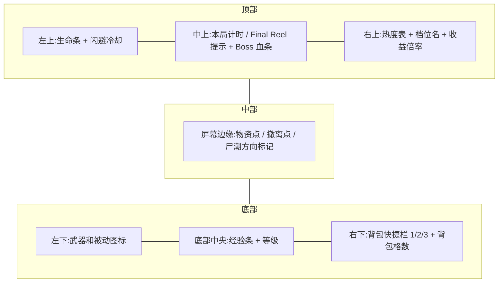

# UI & HUD

> **Status**: Designed
> **Author**: 开发者本人 + Claude
> **Last Updated**: 2026-11-12
> **Last Verified**: 2026-11-12
> **Implements Pillar**: 全部(UI 负责让三个支柱"看得见")

## Summary

列出游戏所有界面:每个界面显示什么、按什么布局、怎么操作、文案是什么。游戏内文字全部英文;本文件用中文描述,英文文案用代码格式标出。

> **Quick reference** — Layer: `Presentation` · Priority: `MVP` · Key deps: 所有玩法系统

## Overview

UI 有三类:
1. **局内 HUD**:战斗中常驻,信息密度要低,一眼能读。
2. **局内弹出界面**:升级选择、背包、暂停。
3. **局外界面**:标题、营地、建筑面板、仓库、剪辑室、加载卡、结算。

统一的视觉语言是"电影片场":场记板、胶片条、片场灯光、打字机字体做标题。

## Player Fantasy

"所有信息都像片场的道具一样自然。"热度表是一盏片场警示灯,胶片槽就是真的胶片,结算画面像一张剧组场记单。

## Detailed Design

### Core Rules

**通用规则**

1. 分辨率基准 1920×1080,按高度等比缩放;安全区边距 48 px。
2. 正文字号 ≥ 22 px(1080p),关键数字 ≥ 32 px。
3. 颜色语义:生命红、经验蓝、热度从黄到红、材料按种类上色(Iron 灰蓝、Herbs 绿、Arcane Dust 紫)、遗物金。
4. 所有可交互元素都有悬停状态和点击音效。
5. 所有文案集中在一张字符串表里,不写死在界面中。

**局内 HUD(Must)**



| 元素 | 内容 | 档位 |
|---|---|---|
| 生命条 | 当前 / 上限,低于 30% 闪烁 | Must |
| 闪避冷却 | 圆形冷却图标 | Must |
| 计时 | 本局已进行时间 `04:12`;有时长上限时显示剩余时间 | Must |
| 热度表 | 竖向灯条 + 档位名 `CALM` / `NOTICED` / `HUNTED` / `INFAMOUS` + 数值;档位变化时闪烁 | Must |
| 收益倍率 | `Box Office ×2.25` | Must |
| 经验条 | 底部横条 + `LV 7` | Must |
| 武器和被动 | 图标 + 等级点 | Must |
| 背包快捷栏 | 前 3 件遗物的图标和按键 `1` `2` `3`;旁边显示 `Bag 6/8` | Must |
| 物资点标记 | 屏幕边缘箭头,图标区分类型,颜色区分材料;已搜过的不显示;只显示 40 m 内的 | Must |
| 撤离点标记 | 屏幕边缘箭头 + 名字 + 开放倒计时 `North Gate 0:48` 或 `OPEN` | Must |
| 尸潮警告 | 来袭方向的屏幕边缘红色闪光 + `HORDE INCOMING` | Must |
| Boss 血条 | 中上方,带名字 `THE CUT KNIGHT` | Must |
| 搜索进度 | 物资点上方的环形进度条 | Must |
| 撤离读条 | 撤离点地面光环 + 屏幕中央 `EXTRACTING 18s` | Must |
| 提示文字 | `Bag Full`、`Press E to search` 等,屏幕中下方 2 s 后消失 | Must |

**升级选择(Must)**

- 全屏暗化,中央横排 3 张卡。
- 每张卡:图标、名字、`NEW!` 或 `LV 2 → 3`、一行效果说明(如 `Damage 13 → 16`)。
- 操作:鼠标点击,或按 1 / 2 / 3 选择。

**背包面板(Must)**

- 按 Tab 打开,屏幕右侧滑出;时间放慢到 30%(画面略微去色,提示时间变慢)。
- 格子网格,显示材料图标和数量、遗物图标。
- 悬停遗物:显示名字、使用效果、价值(热度)、分解产出。
- 右键遗物或点 `Use`:使用;点 `Drop`:丢弃。
- 顶部显示当前热度和档位,以及 `If used: Heat 60 → 30`(使用后的热度预览)。

**暂停菜单(Should)**

`Resume` / `Settings` / `Abandon Take`(二次确认:`Abandon this take? Everything in your bag will be lost.`)

**标题画面(Should)**

游戏名 + `Continue` / `New Production` / `Settings` / `Quit`。背景是营地场景的镜头缓慢推移。

**营地 HUD(Must)**

- 右上角:材料数量(Must 只有 Iron)。
- 建筑悬停:名字浮标。
- 左下角提示:`Click a building to upgrade · Open the Editing Room to roll camera`。

**建筑面板(Must)**

- 屏幕中央的面板,标题是建筑名。
- 每条属性一行:图标、名字、等级点(如 ●●○○○)、`+10% → +15%`、成本(材料图标 + 数字)、`Upgrade` 按钮。
- 材料不足:按钮置灰,成本数字变红,悬停显示 `Need 8 more Iron`。
- 满级:显示 `MAX`。

**仓库面板(Must)**

- 材料数量列表 + 遗物列表。
- 每件遗物:图标、名字、分解产出、`Salvage` 按钮(确认:`Salvage Warlord's Sigil for 10 Iron?`)。

**剪辑室面板(Must)**


- 点击卡库中的卡 → 插入第一个空槽;点击槽里的卡 → 移出。
- 不可插入时卡片变暗,悬停显示原因(如 `Only one runtime card per take`)。
- Should 档:锁定卡直接在这里显示解锁成本和 `Restore` 按钮(即剪辑室的解锁)。

**加载卡(Must)**

场记板画面:`TAKE 7`、卡组合名(如 `Horde Night + The Cut Knight`)、`Box Office ×2.25`。至少显示 1.5 s。

**结算画面(Must)**

- 成功:`CUT! THAT'S A WRAP!`;列出 Take 编号、存活时间、击杀数、局内等级、带出物品表(数量 × 倍率 = 入库)、`Back to Set` 按钮。
- 失败:黑白画面 + `NG` 印章 + `TAKE 7`;列出存活时间、击杀数、丢失的物品(划线)、NG 补偿(Should)、`Back to Set` 按钮。
- 至少停留 1 s 后按钮才可点。

**设置(Should)**

主音量、音乐音量、音效音量、全屏/窗口、分辨率。存进本地配置,不进局外存档。

**第一局教程提示(Should)**

新存档的第一局,在对应时机各显示一次(屏幕中下方,4 s):
1. 开局:`WASD to move. Your weapons fire automatically.`
2. 第一次靠近物资点:`Hold E to search.`
3. 第一次拿到遗物:`Relics are powerful. Use now (1/2/3) or extract them for big rewards.`
4. 热度第一次升档:`The more valuable your bag, the more the extras want you.`
5. 第一个撤离点开放:`North Gate is open. Stand in it to extract.`

营地第一次打开剪辑室:`Add scene cards for more Box Office.`

### States and Transitions

各界面与 `game-flow.md` 的状态一一对应:Title → 标题画面;Camp → 营地 HUD、建筑面板、仓库面板;EditingRoom → 剪辑室面板;Loading → 加载卡;InRun → HUD、背包面板;LevelUp → 升级选择;Paused → 暂停菜单;RunResult → 结算画面。

### Interactions with Other Systems

本系统只显示和转发输入,不持有任何玩法数据。数据来源:

| 界面 | 数据来源 |
|---|---|
| HUD 生命、闪避 | `player-combat.md` |
| HUD 经验、武器、升级选择 | `run-progression.md` |
| HUD 热度、背包、搜索 | `loot-inventory-heat.md` |
| HUD 撤离、结算 | `extraction-death.md` |
| HUD 尸潮、Boss | `enemies-spawning.md` |
| 剪辑室、加载卡 | `directors-cut-editing.md` |
| 营地、建筑、仓库 | `camp-meta.md` |
| 状态切换 | `game-flow.md` |

## Formulas

**物资点标记的显示范围**

```
显示条件:物资点未搜过 且 与玩家距离 ≤ 4000 cm
```

撤离点标记始终显示。

## Edge Cases

| 情况 | 处理 |
|---|---|
| 屏幕边缘标记重叠 | 同方向的标记按距离排序,堆叠显示,最多 4 个 |
| 背包面板打开时进入 LevelUp | 先关闭背包,再弹出升级界面 |
| 文字过长(遗物说明) | 最多 2 行,超出部分换行到悬停提示 |
| 窗口模式下分辨率很小 | 最小支持 1280×720,低于这个尺寸不保证布局 |
| 背包满时按快捷键对应的格子没有遗物 | 无反应,播放一次"无效"音效 |

## Dependencies

- 上游:所有玩法系统(数据来源见上表)。
- 下游:无。

## Tuning Knobs

| 参数 | 默认值 | 安全范围 | 影响 |
|---|---|---|---|
| 物资点标记显示距离 | 4000 cm | 2000–8000 | 信息量 |
| 提示文字显示时长 | 2 s(普通)/ 4 s(教程) | 1–6 s | 是否看得清 |
| 背包面板时间缩放 | 30% | 0–50% | 见 `loot-inventory-heat.md` |
| HUD 整体缩放 | 1.0 | 0.8–1.3 | 可读性(设置里可调,Could) |

## Visual/Audio Requirements

- 字体:标题用打字机或老电影海报风格的字体;正文用清晰的无衬线字体。字体必须是可免费商用的授权。
- 按钮悬停有轻微放大;点击有胶片"咔哒"声。
- 热度档位变化、Boss 登场、撤离开放使用全屏字幕条(letterbox 式黑边 + 白字),1.5 s。

## Game Feel

HUD 在割草时要"安静":只有变化的东西才闪烁。重要事件(热度升档、尸潮、Boss、撤离开放)用全屏字幕条打断一下注意力,其他时间不打扰。

## UI Requirements

即本文件。

## Cross-References

- `design/gdd/game-flow.md`(界面与状态的对应)
- 各玩法系统的 UI Requirements 小节

## Acceptance Criteria

- **AC1(Must)**:局内 HUD 同时显示生命、计时、热度档位和数值、收益倍率、经验和等级、武器图标、背包快捷栏、撤离点标记;每个界面都有截图证据保存在 `production/qa/evidence/`。
- **AC2(Must)**:升级界面用鼠标和数字键 1/2/3 都能选择。
- **AC3(Must)**:背包面板打开时游戏速度变慢,显示 `If used` 热度预览,能使用和丢弃遗物。
- **AC4(Must)**:剪辑室面板插卡、移出卡后,预览的 Risk、Box Office 和时间表立即更新。
- **AC5(Must)**:建筑面板在材料不足时按钮置灰,并显示还差多少。
- **AC6(Must)**:两种结算画面分别正确显示带出或丢失的物品。
- **AC7(Must)**:游戏中出现的所有文字都是英文。
- **AC8(Should)**:新存档的第一局依次出现 5 条教程提示,第二局不再出现。

## Open Questions

- 是否需要一张按 M 打开的全图?默认不做,用边缘标记代替;如果试玩时玩家迷路,再加一张静态的全图。
