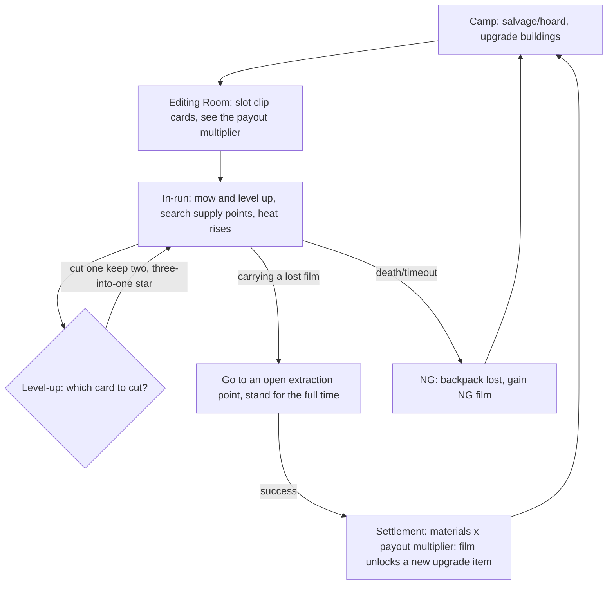

# Director's Cut — Master PRD

> **Status**: Approved (scope baseline)
> **Author**: The developer + Claude
> **Last Updated**: 2026-11-13 (v2: the theme moves into the level-up step, see `design/game-brief.md`)
> **Source**: `docs/plans/2026-11-12-1143-feat-directors-cut-extraction-survivors-plan.md` (requirements plan, R1-R21)
> **Working title**: *Director's Cut* (in-game display name, can change)

This file is the **single gate on scope**. The details of every sub-PRD (`design/gdd/*.md`) must fit inside the tiers and constraints defined here. Any new feature changes this file first, then the sub-PRD.

---

## 1. Sticky Note

> Fantasy top-down mower. On level-up, cut one of three cards and take the other two; three identical copies merge into a star upgrade. Carry a lost film out alive and the upgrade pool permanently gains one item.

Any idea that does not fit on this sticky note goes into Section 9, "Later".

## 2. Design Pillars

| # | Pillar | Meaning | What it vetoes |
|---|---|---|---|
| P1 | **Every level-up is a cut** | On level-up, cut one and keep two; the cut card leaves the pool permanently, which makes it easier to gather three copies for a star upgrade | Upgrades with no trade-off, pickups unrelated to the build |
| P2 | **You direct the cut** | Difficulty and variation come from the player's cut choices before departure, not from randomness | Pure random events, difficulty jumps the player cannot foresee |
| P3 | **Short takes, visible growth** | A run lasts 3-10 minutes, and every successful extraction makes the camp visibly stronger | Long runs, growth that takes many runs to feel |

## 3. Core Loop

One full loop (from leaving camp to returning to camp) targets 4-11 minutes, with 3-10 minutes in-run.

## 4. Target Players and Judging Scenario

- **The main audience is the judges**: one person, keyboard and mouse, has not played the game, plays for about 10-20 minutes, and also watches a 30-60 second video and the devlog.
- **Experiences the judging scenario must include** (success criteria, see Section 10):
  1. Complete at least 2 runs.
  2. At least once, a pre-run cut changes the Boss / elite / horde.
  3. At least one star upgrade and at least one permanent cut; after carrying out a film, see the new upgrade item in the next run.
  4. See at least one camp building change.
- Of the seven scoring categories, this design aims hardest at **Theme** (two layers of cutting), **Innovation Ambition** (cut one keep two + three-into-one star upgrade + film unlocks), and **Fun/Gameplay** (the mowing feel). Visuals, level design and audio rely on free assets in a unified style plus dedicated polish time.

## 5. Global Constraints

| Constraint | Value | Source |
|---|---|---|
| Staffing | One person + AI agents | PLAN.md |
| Schedule | 11/12 05:00 - 11/16 01:59 (UK time); features freeze on the evening of Day 3 | PLAN.md |
| Engine | Unreal Engine 5.8, gameplay mainly in C++, Blueprint for data setup and presentation | PLAN.md risk #3 |
| Platform | Windows 64-bit, keyboard and mouse | This file |
| Build size | < 1 GB | Official rules |
| Language | All in-game text, audio and video in English | Official rules |
| Content | 13+; no trademarks/logos; all external assets listed | Official rules |
| Performance | >= 60 FPS (1080p) with 150 enemies on screen on the dev machine | This file |
| Data-driven | All values live in data tables/config, not hardcoded | `.claude/docs/coding-standards.md` |
| Art | Block-out greybox first; assets are hooked up only after the core loop takes shape | PLAN.md, requirements plan |

## 6. System List and Tiers

Tier definitions:
- **Must (MVP)**: a fully playable loop before the end of Day 2. Missing any item means the game does not hold up.
- **Should (Alpha)**: Day 3 daytime. Content that makes the game "complete".
- **Could (Full Vision)**: only if there is spare capacity; cut anything unfinished at the Day 3 evening freeze.

| # | System | Sub-PRD | Must | Should | Could |
|---|---|---|---|---|---|
| 1 | Game flow and save | `design/gdd/game-flow.md` | Camp -> Editing -> In-run -> Settlement -> Camp; single save slot with autosave | Title screen, new game/reset save, pause menu | Opening "title card" subtitles |
| 2 | Character control and combat | `design/gdd/player-combat.md` | WASD, dodge, interact key, 1 starting weapon, taking damage and death | 5 weapons total | Gamepad |
| 3 | In-run progression | `design/gdd/run-progression.md` | XP, level-up **cut one keep two** (permanent cuts available = pool size - 4), **three-into-one star upgrade** (3 copies for two stars, 9 for three stars), 3 weapons + 4 passives | 3 film-unlocked upgrade items (2 passives + 1 weapon) | Cutting Knight uses what was cut this run |
| 4 | Enemies and spawning | `design/gdd/enemies-spawning.md` | 1 grunt type, spawn scheduling, heat influence, horde, Boss | 3 grunt types total, elite | Boss second phase |
| 5 | Loot, backpack and heat | `design/gdd/loot-inventory-heat.md` | 1 material (Iron), supply crates and vault, backpack limit, heat; relics become **lost film** (no use in-run; carrying it out permanently unlocks one upgrade item; cannot be used or salvaged) | — | Backpack organizing |
| 6 | Extraction and death | `design/gdd/extraction-death.md` | 2 extraction points, point channeling, settlement on success, lose everything on death | 3 extraction points, NG film, timeout | Boss chases during extraction |
| 7 | Pre-run editing | `design/gdd/directors-cut-editing.md` | 2 film slots, 2 cards (Horde Night, The Cut Knight), payout multiplier | 7 cards total, slots raised to 5 | Card combo easter eggs |
| 8 | Camp and meta progression | `design/gdd/camp-meta.md` | 3D camp, click-to-select buildings, Blacksmith and Clinic, exponential costs, storage panel (view materials and unlocked items) | Storage and Editing Room buildings and their stats, Editing Room unlocks, Amount and Revival | Staged building appearance changes |
| 9 | Map and level | `design/gdd/map-level.md` | 1 fixed greybox map with points and 2 extraction points | 5 zones, full points, art replacement | Film-set themed decoration |
| 10 | UI and HUD | `design/gdd/ui-hud.md` | HUD, level-up choice, backpack, search/extraction progress bars, settlement, camp panel, editing panel | Title, pause, settings, tutorial hints | Motion polish |
| 11 | Art and audio direction | `design/gdd/art-audio-direction.md` | Greybox readability spec | Free asset replacement, core sound effects, 2 music tracks | Music that layers with heat |

## 7. Timeline

| Time | Goal | Exit criteria |
|---|---|---|
| Day 1 (11/12) | Greybox: control, auto-attack, 1 enemy type, supply points, heat, relic use, extraction | "Keep it or use it" is playable; feedback from 1-2 people |
| Day 2 (11/13) | Fill in all **Must** items: in-run level-up, 2 camp buildings, 2 editing cards, Boss, save, all Must UI | A new save can leave camp and complete two full loops with level-ups |
| Day 3 (11/14) | **Should**: art and audio replacement, 3 materials, 4 buildings, more cards and enemies; **freeze features in the evening** | Content complete, no blocking bugs |
| Day 4 (11/15) | Fix bugs, tune values, package, record video, write the log, upload | Build runs in a clean environment, materials ready |
| Evening of 11/15 - 11/16 01:59 | Developer submits in person | Submission succeeds |

## 8. Cut Rules

Check in order; execute when triggered, no haggling:

1. **Evening of Day 1**: (Expired. v1's "keep it or use it" was replaced on Day 2 by v2's cut one keep two.)
2. **Evening of Day 2**: if Must still cannot run a whole loop, cut all "new content" in the Should tier (cards, enemies, materials, buildings); Day 3 only completes Must and art.
3. **Day 3 18:00**: cut every Should item that has not started; Could items no longer begin.
4. **Day 3 23:00**: feature freeze. After that, only fix bugs, tune values and replace assets.
5. **At any time**: if a single feature takes 2x the estimated time, drop it to the next tier or cut it.

## 9. Out of Scope

**Later (post-jam/sequel)**: zone, loot and atmosphere clip cards; random maps or multiple maps; online co-op; local party mode; collection showcase; safe box; draggable timeline editor; walkable camp; platforms beyond gamepad; multiple languages.

**Not part of this game's identity**: gacha, microtransactions, forced online play.

## 10. Success Criteria

- The 4 required experiences of the judging scenario (Section 4) all appear in one 15-minute cold-start playthrough.
- In the first 2 runs of a new save (starting cards only, both extracted successfully), at least 2 building upgrades can be completed.
- The packaged Windows build runs in a clean environment, is < 1 GB, and holds >= 60 FPS with 150 enemies on screen.
- Every sub-PRD's Must acceptance criteria all pass, with screenshot evidence saved in `production/qa/evidence/`.

## 11. Global Risks

| Risk | Response |
|---|---|
| Cut one keep two doubles growth speed and star upgrades multiply it again, so values can easily run away | Retune the XP curve, monster health and heat together; star multipliers live in Director Tuning's StarTuning, not hardcoded |
| The upgrade pool has only 7 items, so cutting too much permanently leaves nothing to choose | Permanent cuts available = pool size - 4; each film unlocked adds 1 to both the pool and the permanent cuts available |
| Spawn counts blow the performance budget | On-screen cap + simple meshes + no complex per-enemy AI (see `enemies-spawning.md`) |
| Free assets are unavailable or inconsistent in style | Verify availability on Day 2; backup packs are listed in `art-audio-direction.md` |
| A solo developer neglects level design and audio (5 points each) | Dedicated time reserved on Day 3 |
| MCP hangs or the editor crashes | Save often, commit in small steps |

## 12. Change Rules

- To add or expand any feature: first assign it a tier in Section 6 of this file, then write it into the sub-PRD.
- Values in sub-PRDs are **defaults** and can be tuned freely without changing this file; changing tiers, adding systems or changing pillars requires changing this file.
- When a sub-PRD conflicts with this file, this file wins.

## 13. Open Questions

- After v2, the details in `design/gdd/run-progression.md`, `loot-inventory-heat.md` and `camp-meta.md` are still written the v1 way; where they conflict with this file, this file wins, and they will be updated when work reaches the corresponding system.
- Directions that were discussed but not taken (split scenes + gold shop, CUT screen clear, gray-to-color restore item, scene-chain multiplier) are recorded in `docs/devlog/day-2-2026-11-13.md`.
- `engine.language` in `project.yaml` says "Blueprint", but this project has decided on C++ as primary. When the UE project is created, update this item and the project path in `commands` together.
- The game's official name is undecided; *Director's Cut* is the working title.
