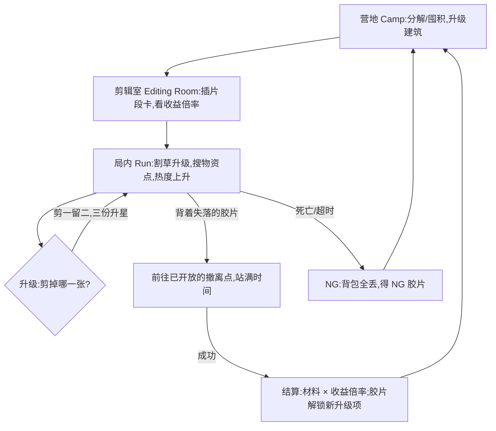

# Director's Cut — Master PRD

> **Status**: Approved (scope baseline)
> **Author**: 开发者本人 + Claude
> **Last Updated**: 2026-11-13(v2:主题搬进升级环节,见 `design/game-brief.md`)
> **Source**: `docs/plans/2026-11-12-1143-feat-directors-cut-extraction-survivors-plan.md`(需求计划,R1–R21)
> **Working title**: *Director's Cut*(游戏内显示名,可改)

本文件是**规模的唯一闸门**。所有分 PRD(`design/gdd/*.md`)的细节都必须落在这里定义的档位和约束之内;任何新增功能先改本文件,再改分 PRD。

---

## 1. 便利贴

> 奇幻斜俯视割草。升级时三张里剪掉一张、另外两张都拿,三份相同的合成升星。把失落的胶片活着带出去,升级池就永久多一样。

写不进这张便利贴的想法,一律进第 9 节"以后再做"。

## 2. 设计支柱

| # | 支柱 | 含义 | 用来否决什么 |
|---|---|---|---|
| P1 | **Every level-up is a cut** 每次升级都是一次剪辑 | 升级时剪一留二;被剪的永久出池,剩下的更容易凑齐三份升星 | 不需要取舍的升级、和构筑无关的拾取物 |
| P2 | **You direct the cut** 你来剪这一局 | 难度和变化来自玩家出发前的剪辑选择,不是随机 | 纯随机事件、玩家无法预见的难度跳变 |
| P3 | **Short takes, visible growth** 短局、看得见的成长 | 一局 3–10 分钟,每次成功撤离都让营地肉眼可见地变强 | 长局、需要很多局才有感觉的成长 |

## 3. 核心循环

一次完整循环(从营地出发到回到营地)目标 4–11 分钟,局内 3–10 分钟。

## 4. 目标玩家与评审场景

- **主要受众是评委**:一个人、键鼠、没玩过,大约试玩 10–20 分钟,同时还要看 30–60 秒视频和开发日志。
- **评审场景的必经体验**(成功标准,见第 10 节):
  1. 至少完成 2 局。
  2. 至少一次局前剪辑改变了 Boss / 精英 / 尸潮。
  3. 至少一次升星,至少一次永久剪掉;带出一卷胶片后,在下一局看到新升级项。
  4. 至少看到一次营地建筑变化。
- 评分七项中,本设计重点打:**主题**(两层剪辑)、**创新野心**(剪一留二 + 三合一升星 + 胶片解锁)、**乐趣/玩法**(割草爽感)。画面、关卡、音频靠统一风格的免费资产 + 专门预留的打磨时间。

## 5. 全局约束

| 约束 | 值 | 来源 |
|---|---|---|
| 人员 | 单人 + AI agent | PLAN.md |
| 工期 | 11/12 05:00 – 11/16 01:59(英国时间);Day 3 晚冻结功能 | PLAN.md |
| 引擎 | Unreal Engine 5.8,玩法以 C++ 为主,Blueprint 做数据配置和表现 | PLAN.md 风险 #3 |
| 平台 | Windows 64 位,键鼠 | 本文件 |
| 构建体积 | < 1 GB | 官方规则 |
| 语言 | 游戏内所有文字、音频、视频英文 | 官方规则 |
| 内容 | 13+;无商标/logo;外部资产全部列明 | 官方规则 |
| 性能 | 开发机上 150 只同屏敌人时 ≥ 60 FPS(1080p) | 本文件 |
| 数据驱动 | 所有数值放数据表/配置,不写死在代码里 | `.claude/docs/coding-standards.md` |
| 美术 | 先方块灰盒,核心循环成型后才接资产 | PLAN.md、需求计划 |

## 6. 系统清单与分档

档位定义:
- **Must(MVP)**:Day 2 结束前必须完整可玩的一圈。缺任何一项,游戏不成立。
- **Should(Alpha)**:Day 3 白天。让游戏"完整"的内容。
- **Could(Full Vision)**:有余力才做,Day 3 晚冻结时没做完就砍。

| # | 系统 | 分 PRD | Must | Should | Could |
|---|---|---|---|---|---|
| 1 | 游戏流程与存档 | `design/gdd/game-flow.md` | 营地 → 剪辑 → 局内 → 结算 → 营地;单存档自动保存 | 标题画面、新游戏/重置存档、暂停菜单 | 开场"片头"字幕 |
| 2 | 角色操控与战斗 | `design/gdd/player-combat.md` | WASD、闪避、交互键、1 把起始武器、受伤与死亡 | 武器总数 5 | 手柄 |
| 3 | 局内成长 | `design/gdd/run-progression.md` | 经验、升级**剪一留二**(可永久剪次数 = 池子 − 4)、**三合一升星**(3 份二星、9 份三星)、3 把武器 + 4 个被动 | 胶片解锁的 3 个升级项(2 被动 + 1 武器) | 剪辑骑士使用本局被剪掉的东西 |
| 4 | 敌人与刷怪 | `design/gdd/enemies-spawning.md` | 1 种小怪、刷怪调度、热度影响、尸潮、Boss | 共 3 种小怪、精英 | Boss 第二阶段 |
| 5 | 物资、背包与热度 | `design/gdd/loot-inventory-heat.md` | 1 种材料(Iron)、补给箱和宝库、背包上限、热度;遗物改为**失落的胶片**(局内无用途,带出即永久解锁一个升级项,不能使用或分解) | — | 背包整理 |
| 6 | 撤离与死亡 | `design/gdd/extraction-death.md` | 2 个撤离点、站点读条、成功结算、死亡全丢 | 3 个撤离点、NG 胶片、超时 | 撤离时的 Boss 追击 |
| 7 | 局前剪辑 | `design/gdd/directors-cut-editing.md` | 2 个胶片槽、2 张卡(Horde Night、The Cut Knight)、收益倍率 | 共 7 张卡、槽位升到 5 | 卡牌组合彩蛋 |
| 8 | 营地与局外成长 | `design/gdd/camp-meta.md` | 3D 营地、点选建筑、铁匠铺和诊所、指数成本、仓库面板(查看材料和已解锁项) | 仓库和剪辑室两栋建筑及其属性、剪辑室解锁、Amount 和 Revival | 建筑外观分阶段变化 |
| 9 | 地图与关卡 | `design/gdd/map-level.md` | 1 张固定灰盒地图,带点位和 2 个撤离点 | 5 个区域,完整点位,美术替换 | 片场主题装饰 |
| 10 | UI 与 HUD | `design/gdd/ui-hud.md` | HUD、升级选择、背包、搜索/撤离读条、结算、营地面板、剪辑面板 | 标题、暂停、设置、教程提示 | 动效打磨 |
| 11 | 美术与音频方向 | `design/gdd/art-audio-direction.md` | 灰盒可读性规范 | 免费资产替换、核心音效、2 首音乐 | 随热度分层的音乐 |

## 7. 时间线

| 时间 | 目标 | 退出标准 |
|---|---|---|
| Day 1(11/12) | 灰盒:操控、自动攻击、1 种怪、物资点、热度、遗物使用、撤离 | "留着还是用掉"能被试玩;拿到 1–2 人反馈 |
| Day 2(11/13) | 补齐全部 **Must**:局内升级、营地 2 栋建筑、剪辑 2 张卡、Boss、存档、全部 Must UI | 新存档能从营地出发,完整跑两圈并升级 |
| Day 3(11/14) | **Should**:美术和音频替换、3 种材料、4 栋建筑、更多卡和怪;**晚上冻结功能** | 内容完整,无阻断性 bug |
| Day 4(11/15) | 修 bug、调数值、打包、录视频、写日志、上传 | 构建在干净环境能运行,材料齐备 |
| 11/15 晚 – 11/16 01:59 | 本人提交 | 提交成功 |

## 8. 砍功能规则

按顺序检查,触发即执行,不要讨价还价:

1. **Day 1 晚**:(已过期。v1 的"留着还是用掉"在 Day 2 被 v2 的剪一留二取代。)
2. **Day 2 晚**:如果 Must 还跑不完一整圈,砍掉整个 Should 档里的"新内容"(卡、怪、材料、建筑),Day 3 只做补齐 Must 和美术。
3. **Day 3 18:00**:还没开始的 Should 项全部砍掉;Could 项不再开工。
4. **Day 3 晚 23:00**:功能冻结。之后只修 bug、调数值、替换资产。
5. **任何时候**:单个功能比预估多花 2 倍时间,降到下一档或砍掉。

## 9. 范围之外

**以后再做(赛后/续作)**:区域类、物资类、氛围类片段卡;随机地图或多张地图;联机合作;本地派对模式;收藏展示柜;安全箱;可拖拽的时间线剪辑器;可行走的营地;手柄之外的平台;多语言。

**不属于本游戏定位**:抽卡、氪金、强制联网。

## 10. 成功标准

- 评审场景的 4 个必经体验(第 4 节)在一次 15 分钟的冷启动试玩中全部出现。
- 新存档前 2 局(只用起始卡、都成功撤离)至少能完成 2 次建筑升级。
- 打包的 Windows 构建在干净环境能运行,体积 < 1 GB,150 只敌人同屏时 ≥ 60 FPS。
- 每个分 PRD 的 Must 验收标准全部通过,截图证据保存在 `production/qa/evidence/`。

## 11. 全局风险

| 风险 | 应对 |
|---|---|
| 剪一留二让成长速度翻倍,升星再乘一层,数值容易失控 | 经验曲线、怪物血量和热度一起重调;星级倍率放在 Director Tuning 的 StarTuning 里,不写死 |
| 升级池只有 7 样,永久剪太多会没得选 | 可永久剪次数 = 池子大小 − 4;胶片每解锁一样,池子和可剪次数各加 1 |
| 刷怪数量撑爆性能 | 同屏上限 + 简单网格体 + 不做逐个复杂 AI(见 `enemies-spawning.md`) |
| 免费资产不可用或风格不统一 | Day 2 先验证可用性;备选包写在 `art-audio-direction.md` |
| 单人忽视关卡和音频(各占 5 分) | Day 3 专门预留时间 |
| MCP 卡死或编辑器崩溃 | 频繁保存、小步提交 |

## 12. 变更规则

- 新增或扩大任何功能:先在本文件第 6 节给它定档,再写进分 PRD。
- 分 PRD 里的数值都是**默认值**,可以随意调,不需要改本文件;改分档、加系统、改支柱,必须改本文件。
- 分 PRD 与本文件冲突时,以本文件为准。

## 13. Open Questions

- v2 之后,`design/gdd/run-progression.md`、`loot-inventory-heat.md` 和 `camp-meta.md` 的细节还是 v1 的写法;与本文件冲突处以本文件为准,改到对应系统时再更新。
- 讨论过但不做的方向(分场 + 金币商店、CUT 清屏、灰到彩恢复项、连场倍率)记录在 `docs/devlog/day-2-2026-11-13.md`。
- `project.yaml` 里 `engine.language` 写的是 "Blueprint",而本项目决定 C++ 为主。新建 UE 项目时,需要一起更新这一项和 `commands` 里的项目路径。
- 游戏的正式名称待定;*Director's Cut* 是工作名。
