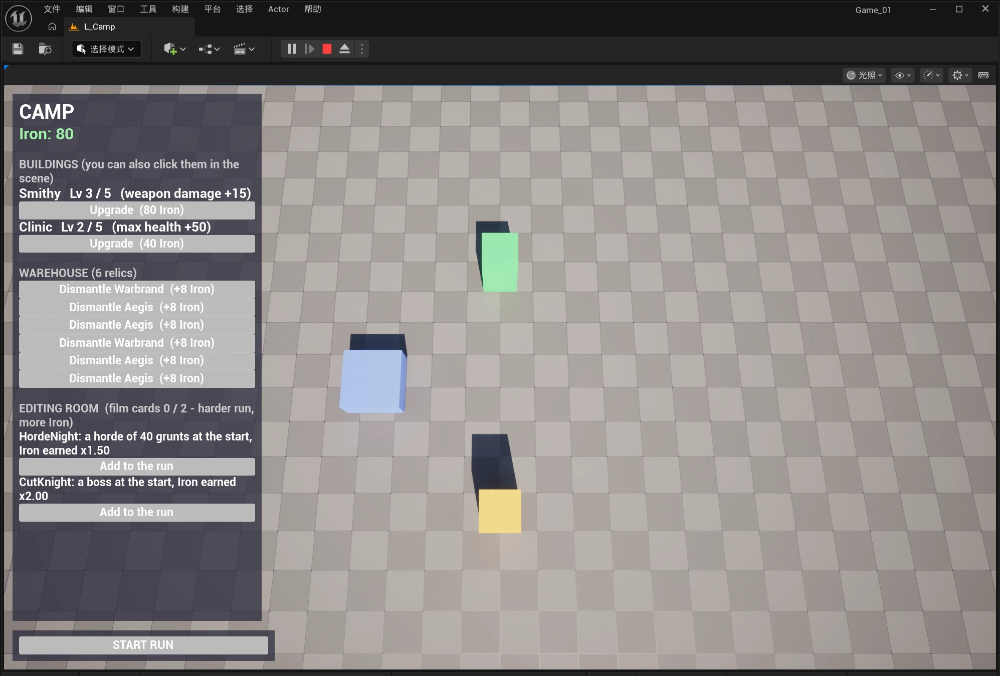
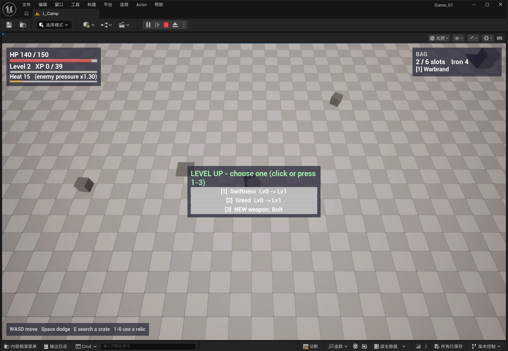
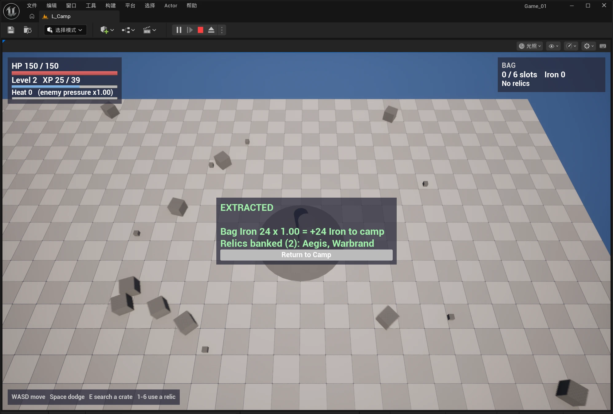

# Day 2 — 13 November: finishing the loop, then admitting the theme was missing

[← Day 1](day-1-2026-11-12.md) · [Dev log index](README.md)

This was two different days. In the first half the first version of the game
came together. In the second half I looked at it the way a judge would, did not
like what I saw, and redesigned its centre while keeping everything already
built. The packaging problems at the end are the third story.

## 1. Finishing the first loop

| Story | Result |
|---|---|
| 004 Run progression | Experience, level-ups with a choice of three, three weapons and four passives. |
| 005 Pre-run editing | Two film slots and two film cards: *Horde Night* (a horde at the start, payout ×1.5) and *The Cut Knight* (a boss at the start, payout ×2). |
| 006 Camp | A 3D camp with a Smithy, a Clinic and a Warehouse. Iron from successful runs buys upgrades. |
| 007 Flow, save and UI | Camp → editing → run → result → camp, auto-save, and every on-screen panel. |







### Bugs found by playing

- **A tint that did nothing.** Heroes, enemies and the camp buildings were meant
  to be coloured, but everything stayed grey. The engine's default material has
  no colour parameter, and setting a missing parameter fails silently. The camp
  was fixed with a different material; the hero, enemies and pickups are still
  grey and it is on the known-issues list.
- **The wrong building.** The Clinic spawned as a Smithy because its type was
  set after `BeginPlay`. The fix was to spawn it deferred, set the type, then
  finish spawning.
- **Messages over the health bar.** Early on-screen messages used the engine's
  debug text, which drew on top of the HP bar. Day 2 replaced it with a real
  message area.
- **Documentation that was wrong.** An early code wiki said one thing about a
  material; the source says the opposite. The rewritten wiki's known-issues page
  lists only problems that were confirmed against the code.

## 2. The moment I stopped

On Day 2 I looked at the build as a stranger would. It worked. It was also
a standard survivors-style game with a camp attached. This is what I told
Claude, translated from my own message:

> What we are making has nothing to do with Director's Cut. It is a very
> traditional Vampire-Survivors-like with nothing new about it. It cannot stand
> out.

The design documents did mention "editing", but the build did not show it. The
director's decisions happened in one menu before the run. During the three to ten
minutes a judge actually spends inside a run, nothing they did was a director's
act. A theme that is only readable in the documents does not score.

## 3. Research: could an open-source game be the base?

A video I came across suggests starting from an existing open-source game
(there is a large catalogue, `Trilarion/opensourcegames`), having the AI map its
structure, then changing theme, art and rules. I asked Claude to read the
catalogue properly instead of guessing.

It cloned the list: about 1,930 entries, 1,801 of them games. Searching it for
the genre's names and keywords found **no survivors-like game and no Unreal
Engine project**. Most entries are C or C++ on SDL or pygame, roughly 12% are
remakes of old games and 45% are inactive. The closest are Crimsonland clones and
Diablo-likes, mostly GPL-3.0.

I did not use it as a base: the jam requires gameplay made during the jam,
nothing in the list runs on my engine, and my loop already worked. What I kept
from the advice is the method: start from something proven and add one small
real innovation. The innovation was the weak part.

## 4. Seven ideas, six thrown away

The redesign did not arrive in one step. This is the real sequence, including
who threw each idea out.

| # | Idea | Outcome |
|---|---|---|
| 1 | **A "CUT!" button during the run.** A film strip on the HUD; one press clears the screen and deletes the current scene's payout. | Dropped by Claude's own review: see section 5. |
| 2 | **An "unfinished build".** Start grey and silent; restore colour, sound and features in the camp. | Dropped by the same review: the judge's first minute would be the worst version of the game. |
| 3 | **Reel-order multiplier.** Weapons fire in film order, slot *n* deals ×*n*. | Dropped by me. |
| 4 | **A scene-number chain.** Upgrades carry numbers 0 to 4 and must be played in order. | Dropped by me. |
| 5 | **Waves plus a gold shop**, as in Brotato. | Dropped by me, for time. |
| 6 | **Remove heat, relics and extraction** to simplify. | Dropped by me. They work and were verified by playing. |
| 7 | **Cut one, keep two.** | Kept. |

My reasons for the two I rejected on design grounds, translated:

- On #3: *if the order is fixed, it triggers its multiplier every time. A card
  game is fun because you have to decide what to play; here there is nothing to
  decide.*
- On #4: *that only fits a card game. In a survivors-like the attacks are
  automatic, so look at Brotato instead: free upgrades in the level, a shop
  between levels, and merging duplicates.*

On #5 and #6 my answer was about the project, not the idea:

> We do not need to start from scratch. Fuse the new idea with what we already
> have. Ideally 1+1 is more than 2; at worst it is 2; it must never be less
> than 2.

## 5. Asking the agent to attack its own plan

Before building ideas 1 and 2 I asked Claude to check its own draft brief. It did
it against the actual code, and found six problems. The three that sank the
draft:

1. **"The current scene" did not exist.** The film cards fire at second zero and
   the code has no run timer. A film-strip HUD and a "cut the current scene"
   button had nothing to attach to.
2. **A bad first minute.** If the game started grey, silent and missing its
   dodge, and a death on the first run loses everything, a judge could play
   fifteen minutes and never see the game get better.
3. **The button had a loophole.** With no scene playing it cost nothing, so it was
   a free screen-clear, and "clear only non-boss enemies" contradicted "cut the
   boss scene".

It also noticed that the draft had no audio work of its own, and that the code
contains no line that plays a sound. Reading the document would not have shown
any of that; reading the code did.

## 6. The question that fixed it

I told Claude the design still felt strange, to think again from zero while
keeping the genre and the code. It reframed the problem as one question:
**what does the player already do in a survivors game that could be a
director's cut?**

There is one real decision in the genre: the level-up pick. Moving and
auto-attacking are feel; the pick is a choice. So the theme went there, and the
official text, "decide what makes the cut", became the mechanic.

## 7. The design

- **Cut one, keep two.** A level-up shows three options. You cut one; you take
  the other two.
- **Three of a kind merge.** Three copies make a two-star version and nine make
  a three-star version. Stars multiply a weapon's damage and widen its reach, and
  make a passive stronger.
- **What you cut is gone for the run**, up to *pool size minus four* times, so
  the pool never drops below four. The jam build has seven options, so three
  permanent cuts. I kept that rule in a small demo and made it a formula: more
  content later means more cuts automatically, and nothing needs rewriting.
- **Relics become lost reels** (decided, not built yet). During a run they do
  nothing. Carry one out alive and a new upgrade joins the pool for every later
  run. I took this from *Vampire Crawlers*, where, according to reviews, relics
  unlock new content instead of being collected
  ([review](https://videogameschronicle.com/review/vampire-crawlers-review)).
  It gives extraction a reason and gives the pool a way to grow.

Film cards, heat, extraction and the camp keep working as they were; relics are
the one other change. Almost everything lands in the level-up, which is why it
fits in the time left.

## 8. Building it, and how I know it works

Claude implemented the cut and the star merge, then verified three ways:

1. **Four automated tests** for the rules: where the star thresholds fall, how
   multipliers grow, and how many permanent cuts a pool allows.
2. **An in-game probe.** A command-line flag forces level-ups, cuts the first
   option each time, takes screenshots and logs the state. It exists because
   playing the UI by hand cannot be repeated exactly.
3. **The same probe against the packaged build**, not only the editor.


Probe log from the editor run (trimmed):

```
OFFERPROBE first-offer level=2 cutsLeft=3 cutSoFar=0 loadout=[Blade Lv1*]
BOLT is now 2-STAR!
OFFERPROBE after-level-ups level=8 cutsLeft=0 cutSoFar=7 loadout=[Blade Lv4** Bolt Lv3** Nova Lv4** ...]
```

## 9. Packaging, in five attempts

The jam's own tips say to package early. I had not packaged once, so I did it
on Day 2. It took five tries, and the last two failures were silent ones.

| # | What happened | Cause |
|---|---|---|
| 1 | The cook crashed with "Failed to delete oplog on the ZenServer". | A setting in the project config, `AutoLaunch=False` for the Zen storage server, had been added during the camp story as an editor fix. Nothing recorded why. |
| 2 | Overriding it on the command line let the cook finish. The staging step then failed to launch the server. | Apparently the staging step reads the config file itself and does not see the override. |
| 3 | Passing the override to the pack steps as well changed nothing. | Same. |
| 4 | With my approval, Claude removed the config line. Packaging succeeded. The packaged game **could not load the run map**. | Only the start map had been cooked. |
| 5 | After adding both maps to the cook list it ran. | I also added the data folder as a precaution: the tuning tables are loaded through soft pointers in a settings file, which the cooker does not follow by itself, and the game falls back to built-in defaults without an error if a table is missing. I did not test a package without that line, so I cannot say it was needed. |

The packaged game now loads both maps and runs the level-up probe. The package
folder is 1.1 GB, but 356 MB of that is a debug-symbol file that is not part of
what I will submit, which leaves about 0.75 GB against a 1 GB limit.

## 10. Honest status at the end of Day 2

- **Built and checked:** cut one, keep two; star merge; the new level-up panel;
  the packaged build running the probe.
- **Decided, not built:** relics as lost reels, three unlockable upgrades.
- **Not checked:**
  - whether it is fun. That needs a person playing it, and I have not had one
    play it yet;
  - the full camp → run → camp loop inside the packaged build;
  - enemy strength and the experience curve. Growth is now roughly twice as fast
    and the enemies have not been rebalanced.
- **Known gaps:** weapon attacks are drawn as debug lines, which a final
  Shipping build would not show, so they need real effects. There is no audio
  yet. The hero and enemies are still grey.

My goal for the rest of the jam, in my own words: *the first aim is simply to
finish the game and submit it.* Day 3 is for the lost reels, rebalancing, art,
audio and feel, and the feature freeze that night.

## Evidence

- [First-loop screenshots (story 007)](../../production/qa/evidence/story-007-flow-save-ui/)
- [Cut one, keep two: editor probe](../../production/qa/evidence/v2-cut-one-keep-two/)
- [Same probe, packaged build](../../production/qa/evidence/v2-packaged-build/)
