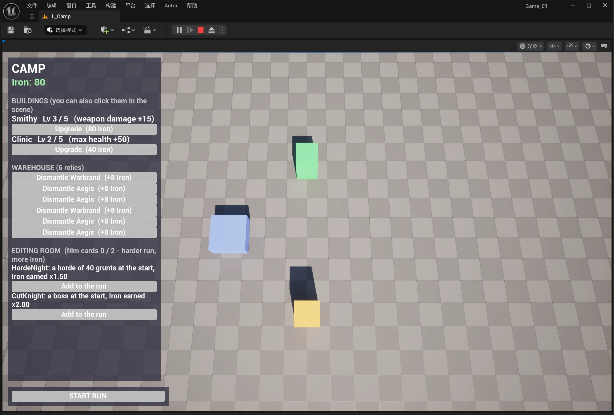
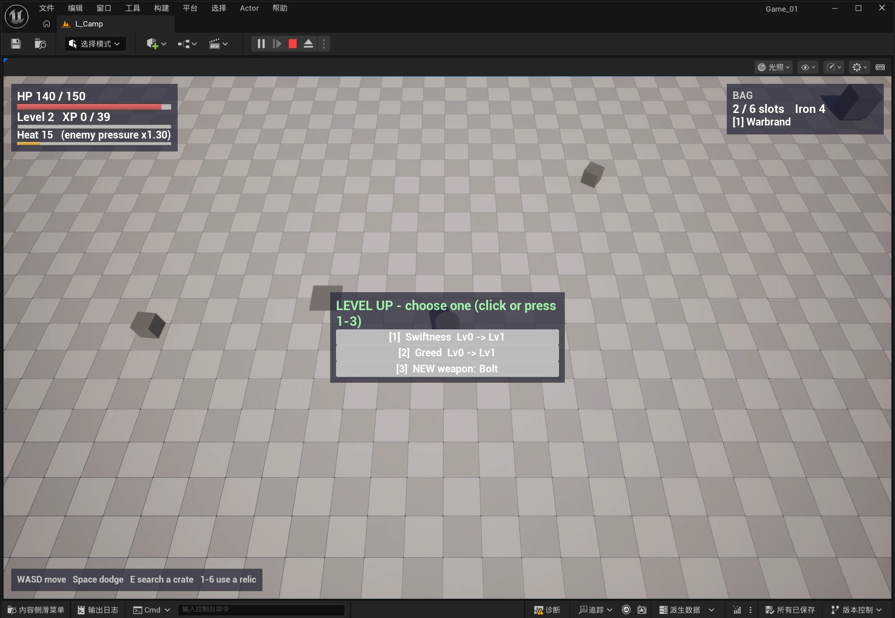
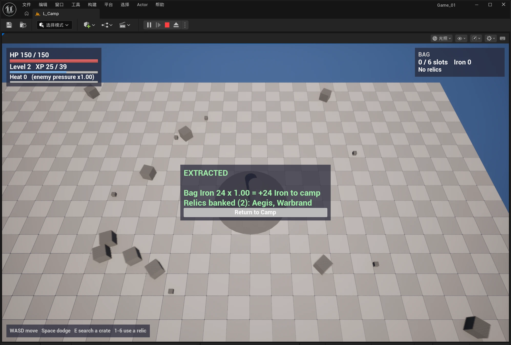

# Day 2 (13 Nov) · Finishing the first loop

[Dev log index](../README.md) · [next →](02-the-moment-i-stopped.md)

Day 2 was three different days. In the first half the first version of the game
came together. In the second half I looked at it the way a judge would, did not
like what I saw, and redesigned its centre while keeping everything already
built. The packaging problems and the housekeeping at the end are the rest.

## The first loop

| Story | Result |
|---|---|
| 004 Run progression | Experience, level-ups with a choice of three, three weapons and four passives. |
| 005 Pre-run editing | Two film slots and two film cards: *Horde Night* (a horde at the start, payout ×1.5) and *The Cut Knight* (a boss at the start, payout ×2). |
| 006 Camp | A 3D camp with a Smithy, a Clinic and a Warehouse. Iron from successful runs buys upgrades. |
| 007 Flow, save and UI | Camp → editing → run → result → camp, auto-save, and every on-screen panel. |

### Bugs found by playing

- **A tint that did nothing.** Heroes, enemies and the camp buildings were meant
  to be coloured, but everything stayed grey. The engine's default material has
  no colour parameter, and setting a missing parameter fails silently. The camp
  was fixed with a different material; the hero, enemies and pickups are still
  grey and it is on the known-issues list.
- **The wrong building.** The Clinic spawned as a Smithy because its type was
  set after `BeginPlay`. The fix was to spawn it deferred, set the type, then
  finish spawning.
- **Messages over the health bar.** Early on-screen messages used the engine's
  debug text, which drew on top of the HP bar. Day 2 replaced it with a real
  message area.
- **Documentation that was wrong.** An early code wiki said one thing about a
  material; the source says the opposite. The rewritten wiki's known-issues page
  lists only problems that were confirmed against the code.
