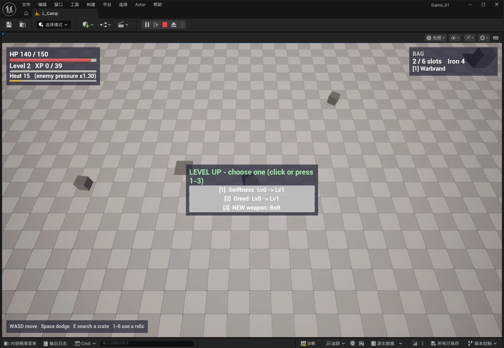

# Day 2 (13 Nov) · The redesign, and how I know it works

[Dev log index](../README.md) · [← previous](03-seven-ideas-and-the-agent-review.md) · [next →](05-packaging-in-five-attempts.md)

## The question that fixed it

I told Claude the design still felt strange, to think again from zero while
keeping the genre and the code. It reframed the problem as one question:
**what does the player already do in a survivors game that could be a
director's cut?**

There is one real decision in the genre: the level-up pick. Moving and
auto-attacking are feel; the pick is a choice. So the theme went there, and the
official text, "decide what makes the cut", became the mechanic.

## The design

- **Cut one, keep two.** A level-up shows three options. You cut one; you take
  the other two.
- **Three of a kind merge.** Three copies make a two-star version and nine make
  a three-star version. Stars multiply a weapon's damage and widen its reach, and
  make a passive stronger.
- **What you cut is gone for the run**, up to *pool size minus four* times, so
  the pool never drops below four. The jam build has seven options, so three
  permanent cuts. I kept that rule in a small demo and made it a formula: more
  content later means more cuts automatically, and nothing needs rewriting.
- **Relics become lost reels** (decided, not built yet). During a run they do
  nothing. Carry one out alive and a new upgrade joins the pool for every later
  run. I took this from *Vampire Crawlers*, where, according to reviews, relics
  unlock new content instead of being collected
  ([review](https://videogameschronicle.com/review/vampire-crawlers-review)).
  It gives extraction a reason and gives the pool a way to grow.

Film cards, heat, extraction and the camp keep working as they were; relics are
the one other change. Almost everything lands in the level-up, which is why it
fits in the time left.

## Building it, and how I know it works

Claude implemented the cut and the star merge, then verified three ways:

1. **Four automated tests** for the rules: where the star thresholds fall, how
   multipliers grow, and how many permanent cuts a pool allows.
2. **An in-game probe.** A command-line flag forces level-ups, cuts the first
   option each time, takes screenshots and logs the state. It exists because
   playing the UI by hand cannot be repeated exactly.
3. **The same probe against the packaged build**, not only the editor.




Probe log from the editor run (trimmed):

```
OFFERPROBE first-offer level=2 cutsLeft=3 cutSoFar=0 loadout=[Blade Lv1*]
BOLT is now 2-STAR!
OFFERPROBE after-level-ups level=8 cutsLeft=0 cutSoFar=7 loadout=[Blade Lv4** Bolt Lv3** Nova Lv4** ...]
```
