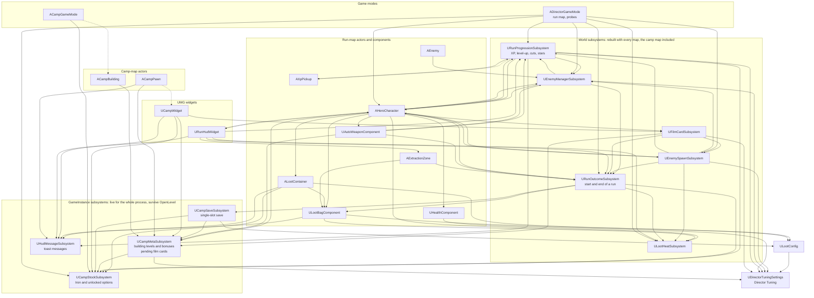
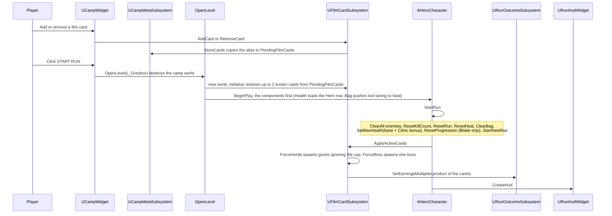
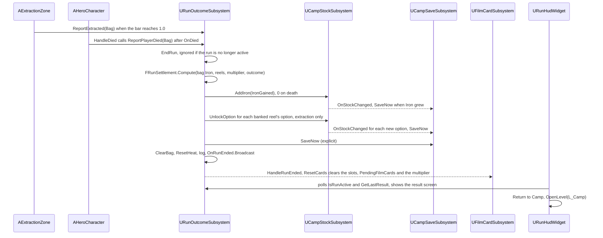
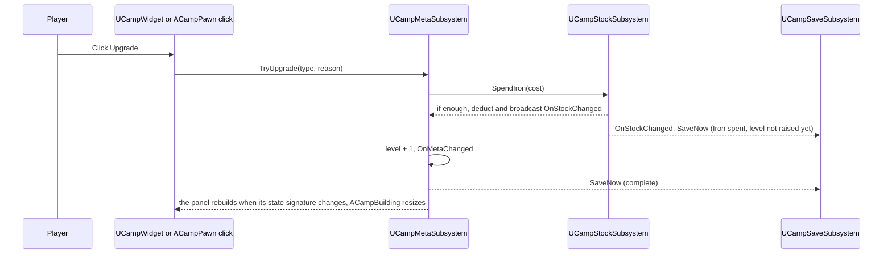

# Overall Architecture

Corresponds to commit `3177f1d` on the `main` branch (2026-11-14, stories 001-008 done) plus the story 009 changes (locked options, Chain, Haste, Magnet, the NEW marker) that were in the working tree, not yet committed, when this page was updated. Source root: [`Game_01 5.8/Source/Game_01/`](../../Game_01%205.8/Source/Game_01/), referred to below as `Source/`.

## 1. Tech stack

| Layer | Choice | Location |
|---|---|---|
| Engine | Unreal Engine 5.8 (5.8.4 on this machine) | [Game_01.uproject](../../Game_01%205.8/Game_01.uproject) |
| Language | C++20 (the engine 5.8 minimum); all gameplay and UI are C++, no Blueprint classes | [Source/](../../Game_01%205.8/Source/Game_01/) |
| UI | UMG; the widget tree is built in C++ inside `RebuildWidget`, no widget Blueprints | [Public/UI](../../Game_01%205.8/Source/Game_01/Public/UI/) |
| Data | 12 DataTables (`Content/Data/`), set in the project settings page `Director Tuning`; the same page also holds the `StarTuning` struct (not a table; the ini does not set it, so the C++ defaults apply) | [DirectorTuningSettings.h](../../Game_01%205.8/Source/Game_01/Public/Game/DirectorTuningSettings.h), [DefaultGame.ini](../../Game_01%205.8/Config/DefaultGame.ini) |
| Save | `USaveGame`, single slot `CampSave` (another slot name with `-SaveSlot=Name`) | [CampSaveGame.h](../../Game_01%205.8/Source/Game_01/Public/Flow/CampSaveGame.h) |
| Input | Raw key bindings (`BindKey`, `IsInputKeyDown`), no input assets; the `EnhancedInput` module is declared but unused | [HeroCharacter.cpp](../../Game_01%205.8/Source/Game_01/Private/Player/HeroCharacter.cpp) |
| AI collaboration | Editor/engine plugins `ModelContextProtocol`, `AllToolsets`, `Terminal` (enabled for all targets) | [.uproject](../../Game_01%205.8/Game_01.uproject) |

The game is a fantasy angled-top-down "mow-down x search-and-extract x thin camp" game: on the run map you loot, fight and level up (at each level-up you take one of three options, and may first cut one so it goes to the boss), then extract with your bag; extracted Iron goes into camp, where buildings are upgraded and take effect from the next run. Lost film reels carried out alive unlock upgrade options by name for every later run (story 009: the options are Chain, Haste and Magnet, which start locked in the level-up pool).

## 2. Two maps, two game modes

| Map | Game mode | Default Pawn | Role |
|---|---|---|---|
| `L_Camp` (default startup map, also the editor startup map) | [`ACampGameMode`](../../Game_01%205.8/Source/Game_01/Private/Camp/CampGameMode.cpp) | [`ACampPawn`](../../Game_01%205.8/Source/Game_01/Private/Camp/CampPawn.cpp) | Camp: not walkable; the game mode spawns the two buildings and a decorative warehouse cube if the level has none; click a building or use the left panel |
| `L_Greybox` | [`ADirectorGameMode`](../../Game_01%205.8/Source/Game_01/Private/Game/DirectorGameMode.cpp) | [`AHeroCharacter`](../../Game_01%205.8/Source/Game_01/Private/Player/HeroCharacter.cpp) | Run: move, auto-attack, loot, extract |

The game mode is not set in an ini; it is stored in each map's World Settings (the binary `.umap` files reference `CampGameMode` and `DirectorGameMode`; `AStandInGameMode` is referenced by no map). `DefaultEngine.ini` sets `GameDefaultMap` and `EditorStartupMap` to `L_Camp`; `DefaultGame.ini` cooks both maps and always cooks `/Game/Data`.
The map names `L_Camp` and `L_Greybox` are hardcoded: in the `Start` action of [`CampWidget.cpp`](../../Game_01%205.8/Source/Game_01/Private/UI/CampWidget.cpp) and the `Camp` action of [`RunHudWidget.cpp`](../../Game_01%205.8/Source/Game_01/Private/UI/RunHudWidget.cpp).

## 3. Layers and dependency graph

The graph is by class and shows only edges that exist in the code (an arrow means "calls or reads", checked against the `#include`s and `GetSubsystem<>` calls). Dotted arrows mean "creates".



Dependencies are not checked automatically (there are no architecture tests and no lint rules); the direction is kept by convention:

- `Loot/` is close to the bottom layer but not a pure one: besides sending messages to `UHudMessageSubsystem` (`LootBagComponent`, `LootContainer`) and reading the loot tables from `UDirectorTuningSettings` (`ULootConfig`), `ALootContainer` reads the unlocked options from `UCampStockSubsystem` (to decide which reels can still drop), and `Extraction/` includes `Loot/LootTypes.h` in return. `Combat/` is not a bottom layer: the weapon component reads progression, the enemy manager, the run state and camp bonuses (see the tally in [dependencies.md](dependencies.md#1-how-modules-depend-on-each-other)).
- The UI only reads subsystems and components; all state changes go through the subsystems' public functions (`TryUpgrade`, `AddCard`/`RemoveCard`, `ChooseOption`, `CutFromOffer`) and `OpenLevel`.
- Camp state (Iron, unlocked upgrade options, building levels, the slotted film cards) lives in a GameInstance subsystem because `OpenLevel` destroys the whole World; per-run state (enemies, heat, XP, the run result) lives in World subsystems and is naturally cleared on a map change.
- Most events are not listened to. The C++ listeners that exist are: `UCampStockSubsystem::OnStockChanged` and `UCampMetaSubsystem::OnMetaChanged` (the save subsystem; `OnMetaChanged` also drives `ACampBuilding`), `UEnemyManagerSubsystem::OnEnemyKilled` (progression), `URunOutcomeSubsystem::OnRunEnded` (film cards) and `UHealthComponent::OnDied` (the hero). The other delegates (`OnBagChanged`, `OnPickupRefused`, `OnHeatChanged`, `OnSearched`, `OnDamaged`, `OnExtractionProgress`, `OnExtractionInterrupted`) have no listener; the HUD polls the state every frame instead.

## 4. Runtime structure

| Object | Lifetime | Notes |
|---|---|---|
| GameInstance subsystems | The whole process | `CampStock`, `CampMeta`, `CampSave` (loads the save in `Initialize`), `HudMessage` (messages expire on real time) |
| World subsystems | One map | `RunOutcome`, `LootHeat`, `RunProgression` (can Tick), `EnemySpawn` (can Tick), `EnemyManager` (can Tick), `FilmCard`. They are created in the camp world too: the camp panel drives that world's `UFilmCardSubsystem` and nothing else there does anything (there is no hero, so the Ticks return at once) |
| Enemies | One run | [`AEnemy`](../../Game_01%205.8/Source/Game_01/Private/Enemies/Enemy.cpp) does not Tick and has no collision or movement component; [`UEnemyManagerSubsystem`](../../Game_01%205.8/Source/Game_01/Private/Enemies/EnemyManagerSubsystem.cpp) moves all enemies in a single loop |
| XP gems | One run | [`AXpPickup`](../../Game_01%205.8/Source/Game_01/Private/Progression/XpPickup.cpp) does not Tick or collide; `URunProgressionSubsystem::Tick` pulls and collects them |
| Extraction zone | One run | Placed in the map; ticks only while a bag is inside or the bar is draining |
| UMG widgets | One map | Created by `AHeroCharacter::CreateHud` or `ACampPawn::BeginPlay` |

What survives `OpenLevel` (camp to run and back): the four GameInstance subsystems, so Iron, unlocked options, building levels and the toast messages; and the film cards, because `UFilmCardSubsystem` copies its slots into `UCampMetaSubsystem::PendingFilmCards` on every change and restores them in its own `Initialize` (they are cleared again when a run ends). Everything else (enemies, heat, XP, weapons, the bag, the run result, widgets) is rebuilt with the new world.

"Soft pause": while the three-option level-up choice is shown, the Ticks of `UEnemyManagerSubsystem`, `UEnemySpawnSubsystem`, `UAutoWeaponComponent` and `URunProgressionSubsystem` all check `IsOfferPending()` and return immediately, and the hero's `CanAct()` also returns false. Engine time is not paused, and two things keep going: the extraction bar (`AExtractionZone::Tick` does not check it) and a dodge already in progress (see [known-issues.md](known-issues.md#4-architecture-and-robustness)).

## 5. Key data flows

### 5.1 Camp to run: how a run starts



- The earnings multiplier is a property of the run subsystem, not of the card subsystem, so it is set again in every `StartRun`; it is reset to 1.0 when the run ends.
- Camp bonuses do not accumulate: every `StartRun` sets max health to `GetBaseMaxHealth() + Clinic bonus` (the base is captured once from the tuning table in `UHealthComponent::BeginPlay`); the Smithy bonus is read live on every shot (`UAutoWeaponComponent::FireWeapon`) and is added to the weapon damage before the multipliers.
- If a card id is no longer in the card table it is dropped on restore; if the table is unset there are no cards at all (silently).

### 5.2 Kill to level-up: take one of three, optional cut

```mermaid
sequenceDiagram
  participant W as UAutoWeaponComponent
  participant E as AEnemy
  participant M as UEnemyManagerSubsystem
  participant G as URunProgressionSubsystem
  participant X as AXpPickup
  participant HUD as URunHudWidget
  participant P as Player
  W->>E: ApplyDamage (each owned weapon on its own interval)
  E->>M: NotifyEnemyKilled when health reaches 0 (KillCount++)
  M-->>G: OnEnemyKilled(kind, location)
  E->>E: Destroy, EndPlay unregisters from the manager
  G->>X: spawn a gem, value = XpPerKill, x10 for a Boss
  G->>X: Tick pulls it in within the magnet radius, collects it inside the collect radius
  G->>G: GrantXp(value x Greed), CheckLevelUp
  G->>G: GenerateOffer, bOfferPending = true (soft pause)
  HUD->>G: polls GetOfferDescriptions and shows 3 buttons
  P->>G: press 1-3 (take) or 4-6 (cut), ChooseOption / CutFromOffer
  G->>G: a cut only records the option and removes it from the pool; ChooseOption applies the taken one, then CheckLevelUp again
```

- `CheckLevelUp`: when `Xp >= XpToNext` it subtracts the threshold, increments the level and sets `XpToNext = BaseXp * Growth^(Level-1)`.
- `GenerateOffer` builds the pool from the 5 weapons and 8 passives of the base pool plus the three unlockable ones (Chain, Haste, Magnet), leaving out options that are still locked (`bStartsLocked` and the camp has not unlocked the id equal to the row name: Chain, Haste, Magnet), options that were cut for good and options that already hold the maximum number of copies; it shuffles (Fisher-Yates). With fewer than three left there is nothing to cut: the remaining options are applied at once and no panel is shown. Otherwise it asks `UCampStockSubsystem::TakeNewOptions()` for the options unlocked since the player last saw an offer, marks those in the pool `bIsNewUnlock` and swaps them to the front, then takes three: a freshly unlocked option is always in the first offer of the next run, and the panel prefixes it `NEW! `.
- `CutFromOffer`: the cut option is appended to `CuttingRoomFloor`; `PermanentCutsLeft` (set at run start to pool size minus `MinPoolSize`: 13 - 4 = 9 on a new save, one more for each unlocked option, 12 at most) goes down by one and the option is removed from the pool for the rest of the run. One cut per level-up. `UBossRejectsSubsystem` reads the floor and gives the cut to the Cut Knight boss. `ChooseOption` applies the taken option and leaves the other offered options in the pool.
- The weapons and passives read their results from this subsystem: `UAutoWeaponComponent` divides each weapon interval by `GetAttackSpeedMultiplier()` (Haste) and the gem pull in `Tick` uses `GetMagnetRadius()` (Magnet). The Chain weapon picks its whole path before it deals damage.
- `ApplyOption` adds one copy. Copies are the level; two stars at 3 copies and three stars at 9 (`FStarTuning`, damage and reach multipliers for weapons, a total-effect multiplier for passives). A Vitality pick raises the hero's max health and heals by however much the passive total grew, including the jump from a star-up. A star-up posts a toast.
- Kills while an offer is pending drop no gem (`HandleEnemyKilled` returns early), but nothing can be killed then anyway.

### 5.3 Extraction or death: settlement and save



- Settlement happens only once: [`URunOutcomeSubsystem::EndRun`](../../Game_01%205.8/Source/Game_01/Private/Extraction/RunOutcomeSubsystem.cpp) checks `bRunActive` at the start, so if extraction and death happen in the same frame, first come first served.
- `AExtractionZone` calls `ReportExtracted`; the hero calls only `ReportPlayerDied`. The zone empties the bar when the run ends and only ticks while someone stands in it or the bar drains.
- The save is also written explicitly in `EndRun`, because when the player dies, or extracts with no Iron and no new option, nothing changes in the stock and `OnStockChanged` would not trigger the save listener. A normal extraction therefore writes the file several times (see [known-issues.md](known-issues.md#12-a-save-is-written-several-times-per-event-and-an-early-write-can-be-an-intermediate-state)).
- Lost film reels do nothing during a run. Only a run that ends by extraction unlocks the options its reels name (`UCampStockSubsystem::UnlockOption`, the option names come from the reel rows, `FReelUnlocks::OptionsForReels`); dying loses the reels and unlocks nothing. `UnlockOption` also records the option in `NewOptions`, which the next run's first level-up offer takes (section 5.2). The save stores the options and the NEW markers by name in save version 2.
- The result screen is not event driven: the HUD notices `!IsRunActive()` in its `NativeTick` and reads `GetLastResult()`.

### 5.4 Camp upgrade



Cost is `floor(BaseCost * CostGrowth^Level)`; a failed spend changes nothing and returns a reason text. A click in the scene shows the result as a toast (`UHudMessageSubsystem`); a click on the panel button shows it in the panel's own message line.

## 6. Design principles

1. **Data-driven, with code as the fallback**: gameplay numbers come from the DataTables referenced by `Director Tuning` (and `StarTuning`); when a table or row is missing, the C++ member initial values are silently used and the game still runs (only the loot config logs where it came from). Example: [`UEnemySpawnSubsystem::Initialize`](../../Game_01%205.8/Source/Game_01/Private/Enemies/EnemySpawnSubsystem.cpp). Not every number is in a table yet, see [known-issues.md](known-issues.md#16-gameplay-numbers-still-hardcoded-in-c).
2. **The row key is the identity**: the `Kind` / `BuildingType` / `WeaponType` / `PassiveType` fields of a table row are overwritten by the row name, to stop a forgotten cell from turning a Boss into a Grunt (`BossTuning.Kind = EEnemyKind::Boss`, and so on). The reel and container rows keep their own `RelicType` / `ContainerType` field as the key.
3. **One loop manages all enemies**: enemies do not Tick; the manager does chasing, grid-based push-apart and contact damage in a single loop, built for 150 enemies at 60 FPS (the PRD budget); for the story 003 measurements see [build-and-run.md](build-and-run.md#6-performance-probe--perfprobe).
4. **Difficulty comes only from the player's choices**: film cards force a horde or a Boss before the run, and heat (raised only by picking up a reel) raises spawn pressure; the base spawn rate depends only on run time.
5. **The UI owns no game state**: the HUD and camp panel read the subsystems every frame (they hold only presentation state such as the last signature and the last message), and the camp panel uses a "state signature" to detect changes before rebuilding rows.
6. **Camp state in the GameInstance, run state in the World**: the split decides what survives `OpenLevel` (section 4).
7. **Greybox first**: all geometry is the engine's built-in cubes and cylinders, and visual distinction relies on the material's `Color` parameter (which has a defect, see [known-issues.md](known-issues.md#21-the-hero-enemies-and-xp-gems-are-gray-and-tinting-has-no-effect)).

## 7. Repository tree

```
2026-epic-ai-megajam/
├── CLAUDE.md, project.yaml      # AI collaboration config and machine-readable project config
├── README.md, PLAN.md           # Project intro, competition timeline
├── .mcp.json, .trae/, .obsidian/, .worktreeinclude   # Tool configuration (not part of the build)
├── Game_01 5.8/                 # The only UE project currently in use
│   ├── Game_01.uproject
│   ├── .mcp.json                # MCP connection for the editor
│   ├── Config/                  # DefaultEngine / DefaultGame / DefaultInput / DefaultEditor (+ a local per-user ini, gitignored)
│   ├── Content/Data/            # 12 DataTables, DT_*.uasset (LFS)
│   ├── Content/Maps/            # L_Camp, L_Greybox, and a leftover Test_Map_01_HLOD0_Instancing.uasset
│   └── Source/
│       ├── Game_01.Target.cs, Game_01Editor.Target.cs
│       └── Game_01/             # Game_01.Build.cs, Game_01.cpp/.h, then {Public,Private}/
│           ├── Camp/ Combat/ Editing/ Enemies/ Extraction/ Flow/ Game/
│           ├── Loot/ Player/ Progression/ StandIn/ UI/   (12 directories, each with Public/ and Private/ halves)
│           └── Private/Tests/   # 12 automation tests (StarTuningTest.cpp, ReelUnlockTest.cpp, UnlockableOptionsTest.cpp)
├── design/                      # game-brief.md (v2), prd/master-prd.md (scope gate), gdd/ (per-system docs, partly still v1)
├── docs/                        # wiki/ (this wiki), devlog/ (one folder per day), plans/, architecture/, registry/, engine-reference/, workflow guides
├── production/                  # epics/directors-cut (stories 001-013), qa/evidence (screenshots, probe logs), stage.txt
├── .claude/                     # agents, skills, hooks, scripts (not part of the build)
└── Game_Jam_01/                 # Pre-contest warm-up project, gitignored, not in the repository
```

Generated or local folders under `Game_01 5.8/` (`Binaries`, `Intermediate`, `Saved`, `DerivedDataCache`, `Build`, the `.sln` files) are gitignored.
