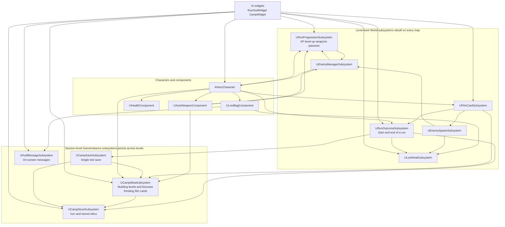
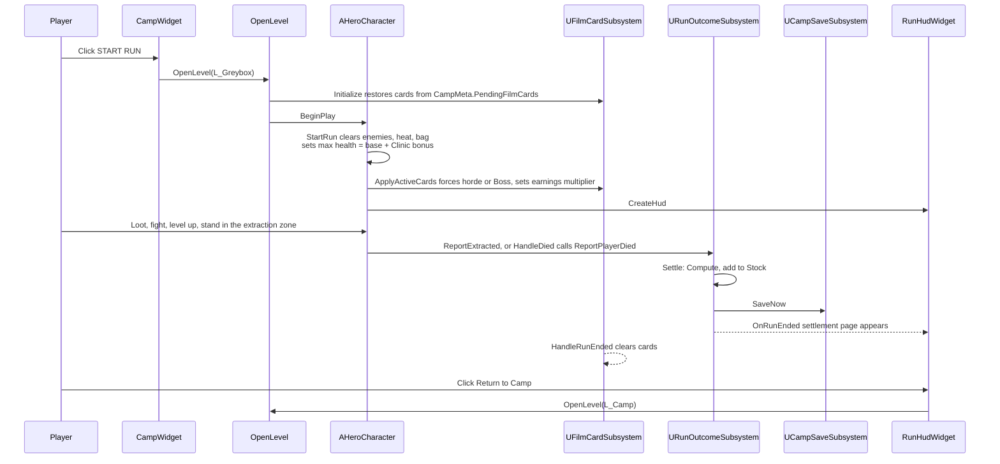

# Overall Architecture

Corresponds to commit `cd44b7f` on the `main` branch (2026-11-13, stories 001-007 all done). Source root: [`Game_01 5.8/Source/Game_01/`](../../Game_01%205.8/Source/Game_01/), referred to below as `Source/`.

## 1. Tech stack

| Layer | Choice | Location |
|---|---|---|
| Engine | Unreal Engine 5.8 (5.8.4 on this machine) | [Game_01.uproject](../../Game_01%205.8/Game_01.uproject) |
| Language | C++20 (the engine 5.8 minimum); all gameplay and UI are C++, no Blueprint classes | [Source/](../../Game_01%205.8/Source/Game_01/) |
| UI | UMG; the widget tree is built in C++ inside `RebuildWidget`, no widget Blueprints | [Public/UI](../../Game_01%205.8/Source/Game_01/Public/UI/) |
| Data | 9 DataTables (`Content/Data/`), referenced by the project setting `Director Tuning` | [DirectorTuningSettings.h](../../Game_01%205.8/Source/Game_01/Public/Game/DirectorTuningSettings.h) |
| Save | `USaveGame`, single slot `CampSave` | [CampSaveGame.h](../../Game_01%205.8/Source/Game_01/Public/Flow/CampSaveGame.h) |
| Input | Raw key bindings (`BindKey`), no input assets | [HeroCharacter.cpp](../../Game_01%205.8/Source/Game_01/Private/Player/HeroCharacter.cpp) |
| AI collaboration | Unreal MCP plugins (`ModelContextProtocol`, `AllToolsets`) | [.uproject](../../Game_01%205.8/Game_01.uproject) |

The game is a fantasy angled-top-down "mow-down x search-and-extract x thin camp" game: on the run map you loot, fight and level up, then extract with your bag; extracted Iron and relics go into camp, where buildings are upgraded and take effect from the next run.

## 2. Two maps, two game modes

| Map | Game mode | Default Pawn | Role |
|---|---|---|---|
| `L_Camp` (default startup map) | [`ACampGameMode`](../../Game_01%205.8/Source/Game_01/Private/Camp/CampGameMode.cpp) | [`ACampPawn`](../../Game_01%205.8/Source/Game_01/Private/Camp/CampPawn.cpp) | Camp: not walkable, click buildings with the mouse, operate from the left panel |
| `L_Greybox` | [`ADirectorGameMode`](../../Game_01%205.8/Source/Game_01/Private/Game/DirectorGameMode.cpp) | [`AHeroCharacter`](../../Game_01%205.8/Source/Game_01/Private/Player/HeroCharacter.cpp) | Run: move, auto-attack, loot, extract |

The game mode is not set in an ini; it is specified in each map's World Settings (the PIE log shows `Game class is 'DirectorGameMode'`).
The map names `L_Camp` and `L_Greybox` are hardcoded: in the `Start` action of [`CampWidget.cpp`](../../Game_01%205.8/Source/Game_01/Private/UI/CampWidget.cpp) and the `Camp` action of [`RunHudWidget.cpp`](../../Game_01%205.8/Source/Game_01/Private/UI/RunHudWidget.cpp).

## 3. Layers and dependency graph



Dependencies are not checked automatically (there are no architecture tests and no lint rules); the direction is kept by convention:

- `Loot/` is the lowest layer: apart from sending messages to `UHudMessageSubsystem` (`LootBagComponent`, `LootContainer`), it references no other gameplay directory and exposes events upward only through delegates. `Combat/` is not a bottom layer: the weapon component has to read progression, the enemy manager and camp bonuses (see the tally in [dependencies.md](dependencies.md#1-how-modules-depend-on-each-other)).
- The UI only reads subsystems and components; all state changes go through the subsystems' public functions (upgrade, dismantle, pick a card, pick a level-up option).
- Camp state (Iron, relics, building levels) lives in a GameInstance subsystem because `OpenLevel` destroys the whole World; per-run state (enemies, heat, XP) lives in World subsystems and is naturally cleared on a map change.

## 4. Runtime structure

| Object | Lifetime | Notes |
|---|---|---|
| GameInstance subsystems | The whole process | `CampStock`, `CampMeta`, `CampSave`, `HudMessage` |
| World subsystems | One map | `RunOutcome`, `LootHeat`, `RunProgression` (can Tick), `EnemySpawn` (can Tick), `EnemyManager` (can Tick), `FilmCard` |
| Enemies | One run | [`AEnemy`](../../Game_01%205.8/Source/Game_01/Private/Enemies/Enemy.cpp) does not Tick and has no collision or movement component; [`UEnemyManagerSubsystem`](../../Game_01%205.8/Source/Game_01/Private/Enemies/EnemyManagerSubsystem.cpp) moves all enemies in a single loop |
| UMG widgets | One map | Created by `AHeroCharacter::CreateHud` or `ACampPawn::BeginPlay` |

"Soft pause": while the three-way level-up choice is shown, the Ticks of `UEnemyManagerSubsystem`, `UEnemySpawnSubsystem`, `UAutoWeaponComponent` and `URunProgressionSubsystem` all check `IsOfferPending()` and return immediately, and the hero's `CanAct()` also returns false. Engine time is not paused.

## 5. Key data flows

### 5.1 One run: from leaving camp to returning to camp



Key points:

- Settlement happens only once: [`URunOutcomeSubsystem::EndRun`](../../Game_01%205.8/Source/Game_01/Private/Extraction/RunOutcomeSubsystem.cpp) checks `bRunActive` at the start, so if extraction and death happen in the same frame, first come first served.
- The save is written explicitly in `EndRun`, because when the player dies with no Iron in the bag the stock does not change and `OnStockChanged` would not trigger the save listener.
- Camp bonuses do not accumulate: every run's `StartRun` resets the value to `GetBaseMaxHealth() + Clinic bonus`; the Smithy bonus is read live on every shot.

### 5.2 Camp upgrade

```mermaid
sequenceDiagram
  participant P as Player
  participant W as CampWidget
  participant M as UCampMetaSubsystem
  participant S as UCampStockSubsystem
  participant V as UCampSaveSubsystem
  P->>W: Click Upgrade
  W->>M: TryUpgrade(type, reason)
  M->>S: SpendIron(cost)
  S-->>M: If enough, deduct and broadcast OnStockChanged
  M-->>V: OnMetaChanged
  S-->>V: OnStockChanged
  V->>V: SaveNow
  M-->>W: Level changes; panel rebuilds when its signature changes
```

### 5.3 Three-way level-up choice

Kill -> `UEnemyManagerSubsystem::OnEnemyKilled` -> `URunProgressionSubsystem::HandleEnemyKilled` spawns an `AXpPickup` -> magnet and pickup every frame -> `GrantXp` -> `CheckLevelUp` -> `GenerateOffer` (Fisher-Yates shuffle, take the first three) -> `RunHudWidget` reads `GetOfferDescriptions()` to show buttons -> `PickOffer(Index)` -> `ApplyOption`.

## 6. Design principles

1. **Data-driven, with code as the fallback**: all values come from the DataTables referenced by `Director Tuning`; when a table or row is missing, the C++ member initial values are silently used and the game still runs. Example: [`UEnemySpawnSubsystem::Initialize`](../../Game_01%205.8/Source/Game_01/Private/Enemies/EnemySpawnSubsystem.cpp).
2. **The row key is the identity**: the `Kind` / `BuildingType` / `WeaponType` fields of a table row are overwritten by the row name, to stop a forgotten cell from turning a Boss into a Grunt (`BossTuning.Kind = EEnemyKind::Boss`, and so on).
3. **One loop manages all enemies**: enemies do not Tick; the manager does chasing, grid-based push-apart and contact damage in a single loop, targeting a frame rate with 150 enemies; for the story 003 measurements see [build-and-run.md](build-and-run.md#6-performance-probe--perfprobe).
4. **Difficulty comes only from the cards the player picks**: film cards force a horde or a Boss; the spawn rate depends only on time and heat, with no random difficulty.
5. **The UI owns no state**: the HUD and camp panel read the subsystems every frame, and the camp panel uses a "state signature" to detect changes before rebuilding rows.
6. **Greybox first**: all geometry is the engine's built-in cubes and cylinders, and visual distinction relies on the material's `Color` parameter (which has a defect, see [known-issues.md](known-issues.md)).

## 7. Repository tree

```
2026-epic-ai-megajam/
├── CLAUDE.md, project.yaml      # AI collaboration config and machine-readable project config
├── README.md, PLAN.md           # Project intro, competition timeline
├── Game_01 5.8/                 # The only UE project currently in use
│   ├── Game_01.uproject
│   ├── Config/                  # DefaultEngine / DefaultGame / DefaultInput ...
│   ├── Content/Data/            # 9 DataTables (LFS)
│   ├── Content/Maps/            # L_Camp, L_Greybox
│   └── Source/Game_01/{Public,Private}/
│       ├── Camp/ Combat/ Editing/ Enemies/ Extraction/
│       ├── Flow/ Game/ Loot/ Player/ Progression/ StandIn/ UI/
├── design/                      # Game brief, PRD, GDDs
├── docs/                        # This wiki, planning docs, engine reference, workflow guides
├── production/                  # Epics/stories, QA evidence, session state
├── .claude/                     # agents, skills, hooks, scripts (not part of the build)
└── Game_Jam_01/                 # Pre-contest warm-up project, gitignored, not in the repository
```
