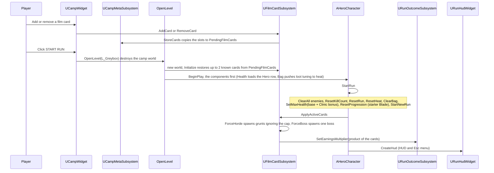
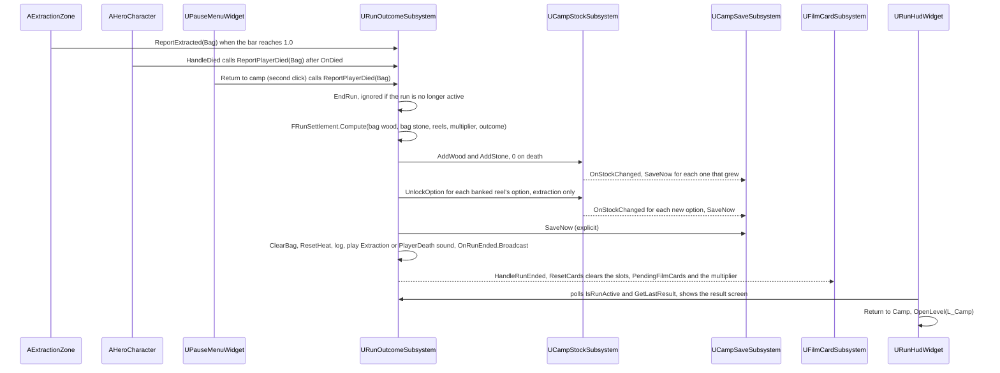
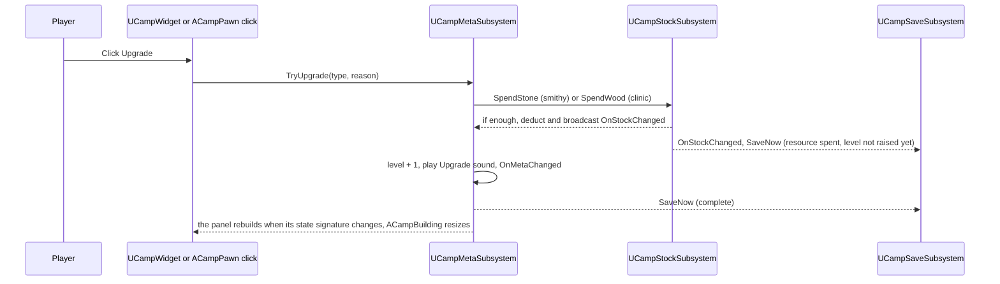
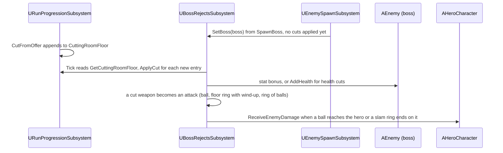

# Overall Architecture

Corresponds to commit `ad6174d` on the `main` branch (2026-11-16, stories 001-012 complete and 013 in progress, the later look-and-feel work: Fab art, audio, the Esc menu, wood and stone, the camp layout, the command-line probes moved to `Dev/`, the progression split into pure structs). Source root: [`Game_01 5.8/Source/Game_01/`](../../Game_01%205.8/Source/Game_01/), referred to below as `Source/`. It holds 9,254 lines of C++ in 13 directories (47 headers, 42 `.cpp`, 2 module files), plus 968 lines of automation tests in `Private/Tests` (8 files).

## 1. Tech stack

| Layer | Choice | Location |
|---|---|---|
| Engine | Unreal Engine 5.8 (5.8.4 on this machine, see [VERSION.md](../engine-reference/unreal/VERSION.md)) | [Game_01.uproject](../../Game_01%205.8/Game_01.uproject) |
| Language | C++ (UE 5.8 builds with C++20). All gameplay and UI are C++; the tracked `Content/` holds only data tables, two maps and one material, so there are no Blueprint classes in git | [Source/](../../Game_01%205.8/Source/Game_01/) |
| Module | One runtime module `Game_01`. Dependencies in [Game_01.Build.cs](../../Game_01%205.8/Source/Game_01/Game_01.Build.cs): `Core`, `CoreUObject`, `Engine`, `InputCore`, `DeveloperSettings`, `UMG`, `Slate`, `SlateCore` | |
| UI | UMG; every widget tree is built in C++ inside `RebuildWidget`, no widget Blueprints | [Public/UI](../../Game_01%205.8/Source/Game_01/Public/UI/) |
| Data | 12 DataTables (`Content/Data/DT_*.uasset`) set in the project settings page `Director Tuning`. The same page also holds `StarTuning` and `BossRejects` (structs, not tables), the sound map, the two music tracks and the volume levels. `DefaultGame.ini` sets the 12 tables, `Sounds`, `CampMusic` and `RunMusic`; it has no entry for `StarTuning`, `BossRejects` or the volumes, so their C++ defaults apply | [DirectorTuningSettings.h](../../Game_01%205.8/Source/Game_01/Public/Game/DirectorTuningSettings.h), [DefaultGame.ini](../../Game_01%205.8/Config/DefaultGame.ini) |
| Save | `USaveGame`, single slot `CampSave` (another slot name with `-SaveSlot=Name`) | [CampSaveGame.h](../../Game_01%205.8/Source/Game_01/Public/Flow/CampSaveGame.h) |
| Input | Raw key bindings (`BindKey`, `IsInputKeyDown`), no input assets. `EnhancedInput` is no longer in `Build.cs` and no source file includes it | [HeroCharacter.cpp](../../Game_01%205.8/Source/Game_01/Private/Player/HeroCharacter.cpp) |
| Audio | One entry point, `UGameAudioSubsystem`; the sound cues (`Free_Sounds_Pack`) and the two music loops (`PathOfAdventure`) are assigned in `Director Tuning`. `DefaultGame.ini` always cooks those two cue folders because they are only soft references | [GameAudioSubsystem.h](../../Game_01%205.8/Source/Game_01/Public/Audio/GameAudioSubsystem.h) |
| Art | Fab packs under `Content/`, loaded by hard-coded asset paths (see below). They are **not in git**: only `Data`, `Maps` and `Materials` are tracked, the pack folders show up as untracked | |
| AI collaboration | Plugins `ModelContextProtocol`, `AllToolsets`, `Terminal` are restricted to the Editor target (`TargetAllowList: Editor`); `ModelingToolsEditorMode` is editor-only; `GameFeatures` is enabled for all targets but unused | [.uproject](../../Game_01%205.8/Game_01.uproject) |

**The Fab packs and their fallbacks.** Every model is looked up with `ConstructorHelpers::FObjectFinder` in a constructor. If the pack is missing, the lookup fails and the code keeps the engine cube or cylinder, so the game still runs (greybox). A fresh clone has no packs and therefore looks grey.

| Pack folder | Used by | Fallback without it |
|---|---|---|
| `RPGHeroSquad` | `AHeroCharacter`: skeletal mesh, sword, shield, run and walk animations | grey cylinder |
| `MonsterForSurvivalGame` | `UEnemySpawnSubsystem` (constructor): Slime, Mushroom, Cactus, TurtleShell and Beholder for Grunts, ChestMonster for the Boss; applied with `AEnemy::SetVisual` | red and purple cubes |
| `RPGTinyFantasyForest` | `AForestDressing` (land mass, trees, rocks, cliffs, grass, flowers), `ALootContainer` (tree stump for crates, boulder for vaults), `AExtractionZone` (portal arch) | old grey floor, cube containers, no portal (the green disc and beam stay) |
| `WW2Generic` | `ACampBuilding` (smithy: `factory_6`), `ACampWarehouse` (`barracks`) | coloured cubes |
| `LowPolyHouse` | `ACampBuilding` (clinic: five parts, all or none) | green cube |
| `Free_Sounds_Pack`, `PathOfAdventure` | sound and music assets named in `DefaultGame.ini` | silence (counted and logged once) |

Other folders in `Content/` (`BattleWizard*`, `FourEvilDragons*`, `FreeAtmosGameMusic`, `Free_5_Samples`, `SmallSoundKit`, `ZenUV_SciFi_TrimSheet`) are referenced by no source file.

The game is a fantasy angled-top-down "mow-down x search-and-extract x thin camp" game: on the run map you loot, fight and level up (at each level-up you take one of three options, and may first cut one so it goes to the boss), then extract with your bag; extracted **wood and stone** go into camp, where buildings are upgraded (the smithy costs stone, the clinic costs wood) and take effect from the next run. Lost film reels carried out alive unlock upgrade options by name for every later run (the options are Chain, Haste and Magnet, which start locked in the level-up pool). A note on names: the code was renamed from Iron to Wood, so the API now reads `UCampStockSubsystem::Wood`/`AddWood`/`SpendWood` and `ULootBagComponent::WoodCount`/`GetWoodCount`/`TryAddWood`; only the save field `Iron` and the DataTable columns `IronMin`/`IronMax`/`IronPerSlot` keep the old name for compatibility, and stone has its own names.

## 2. Two maps, two game modes

| Map | Game mode | Default Pawn | Role |
|---|---|---|---|
| `L_Camp` (default startup map, also the editor startup map) | [`ACampGameMode`](../../Game_01%205.8/Source/Game_01/Private/Camp/CampGameMode.cpp) | [`ACampPawn`](../../Game_01%205.8/Source/Game_01/Private/Camp/CampPawn.cpp) | Camp: not walkable. The game mode starts the camp music and spawns three buildings on an equilateral triangle (radius 700 cm) for each kind the level does not already contain: the clinic, the smithy and a decorative warehouse. Click a building or use the left panel |
| `L_Greybox` | [`ADirectorGameMode`](../../Game_01%205.8/Source/Game_01/Private/Game/DirectorGameMode.cpp) | [`AHeroCharacter`](../../Game_01%205.8/Source/Game_01/Private/Player/HeroCharacter.cpp) | Run: starts the run music; move, auto-attack, loot, extract |

The game mode is not set in an ini; it is stored in each map's World Settings. The binary `.umap` files contain the class names `CampGameMode` and `DirectorGameMode` (one each). The old `StandIn/` directory was deleted. `DefaultEngine.ini` sets `GameDefaultMap` and `EditorStartupMap` to `L_Camp`; `DefaultGame.ini` cooks both maps and always cooks `/Game/Data`, `/Game/Free_Sounds_Pack/cue` and `/Game/PathOfAdventure/Loop/CUE`.

The map names `L_Camp` and `L_Greybox` are hardcoded in three places: the `Start` action of [`CampWidget.cpp`](../../Game_01%205.8/Source/Game_01/Private/UI/CampWidget.cpp), the `Camp` action of [`RunHudWidget.cpp`](../../Game_01%205.8/Source/Game_01/Private/UI/RunHudWidget.cpp), and `PressReturnToCamp` in [`PauseMenuWidget.cpp`](../../Game_01%205.8/Source/Game_01/Private/UI/PauseMenuWidget.cpp).

What the map files contain beyond that (placed actors, the floor) cannot be read from source. The log lines `PLAYAREA floor x[-4000..4000] y[-4000..4000]` in `Saved/Logs` show an 8000 x 8000 cm floor on the map those runs used. The `L_Camp.umap` binary contains the same strings (`ExtractionZone_0`, `LootContainer_0` ...) as `L_Greybox.umap`, which suggests the camp map was made from a copy of the run map; this was not opened in the editor.

## 3. Layers and dependency graph

The graph is by class and shows only edges that exist in the code (an arrow means "calls or reads", checked against the `#include`s and the `GetSubsystem<>` calls). Dotted arrows mean "creates". Audio is drawn once: every class that plays a sound calls `UGameAudioSubsystem::PlayIn` (or `Play`), which is listed in the arrow group `... --> Audio`. `UDirectorProbeSubsystem` is drawn once, isolated, because it is a world subsystem that creates itself only when a probe flag is on the command line and then reads almost every other subsystem (the probes moved out of the game mode into `Dev/`).

```mermaid
graph TD
  subgraph GI["GameInstance subsystems: live for the whole process, survive OpenLevel"]
    Stock["UCampStockSubsystem<br/>wood, stone, unlocked options"]
    Meta["UCampMetaSubsystem<br/>building levels and bonuses<br/>pending film cards"]
    Save["UCampSaveSubsystem<br/>single-slot save"]
    Msg["UHudMessageSubsystem<br/>toast messages"]
  end
  subgraph WS["World subsystems: rebuilt with every map, the camp map included"]
    Run["URunOutcomeSubsystem<br/>start and end of a run"]
    Heat["ULootHeatSubsystem"]
    Prog["URunProgressionSubsystem<br/>XP, level-up, cuts, stars<br/>(pure logic in FRunLoadout,<br/>FOfferRules, FOfferText)"]
    Spawn["UEnemySpawnSubsystem"]
    Mgr["UEnemyManagerSubsystem"]
    Boss["UBossRejectsSubsystem<br/>cuts become boss attacks"]
    Cards["UFilmCardSubsystem"]
    Area["UPlayAreaSubsystem<br/>keeps units on the floor"]
    Audio["UGameAudioSubsystem<br/>game worlds only"]
    Probe["UDirectorProbeSubsystem<br/>command-line probes, Dev/ only"]
  end
  subgraph AC["Run-map actors and components"]
    Hero["AHeroCharacter"]
    Bag["ULootBagComponent"]
    HP["UHealthComponent"]
    Weapon["UAutoWeaponComponent"]
    Fx["AWeaponEffect, AGunBullet,<br/>AOrbitOrb"]
    Zone["AExtractionZone"]
    Box["ALootContainer"]
    Enemy["AEnemy"]
    Gem["AXpPickup"]
    Forest["AForestDressing"]
  end
  subgraph CA["Camp-map actors"]
    CPawn["ACampPawn"]
    CBuild["ACampBuilding"]
    CWare["ACampWarehouse"]
  end
  subgraph UIG["UMG widgets"]
    HUD["URunHudWidget"]
    CampUI["UCampWidget"]
    Pause["UPauseMenuWidget"]
  end
  subgraph GM["Game modes"]
    DirMode["ADirectorGameMode<br/>run map"]
    CampMode["ACampGameMode"]
  end
  Cfg["ULootConfig"]
  Settings["UDirectorTuningSettings<br/>Director Tuning"]

  Hero --> Bag & HP & Weapon
  Hero --> Run & Cards & Meta & Prog & Mgr & Spawn & Heat & Box & Area
  Hero -.-> HUD & Pause
  Bag --> Heat & Msg & Cfg
  Box --> Bag & Stock & Msg & Cfg
  Weapon --> Prog & Mgr & Meta & Run
  Weapon -.-> Fx
  Fx --> Mgr & Prog
  Enemy --> Mgr
  Mgr --> Hero & Prog & Run & Area
  Spawn --> Heat & Mgr & Prog & Run & Hero & Area & Boss
  Boss --> Hero & Prog & Run & Msg
  Boss -.-> Fx
  Prog --> Mgr & Hero & Msg & Stock
  Prog -.-> Gem
  Gem --> Prog
  Zone --> Run & Bag & Msg
  Run --> Stock & Save & Heat & Bag
  Cards --> Spawn & Run & Meta
  Meta --> Stock
  Save --> Stock & Meta & Cfg
  Cfg --> Settings
  Meta & Spawn & Mgr & Prog & HP & Cards & Boss & Audio --> Settings
  Weapon & Enemy & Prog & Run & Meta & Zone & Box --> Audio
  Area -.-> Forest
  HUD --> Hero & Prog & Heat & Run & Zone & Msg
  CampUI --> Stock & Meta & Cards & Msg & CPawn
  Pause --> Run & Hero & Msg & Audio
  CPawn --> Meta & Msg
  CPawn -.-> CampUI & Pause
  CBuild --> Meta
  CampMode -.-> CBuild & CWare
  CampMode --> Stock & Audio
  DirMode --> Hero & Prog & Spawn & Run & Stock & Heat & Mgr & Meta & Zone & Audio
```



Dependencies are not checked automatically (there are no architecture tests and no lint rules); the direction is kept by convention:

- `Loot/` is close to the bottom layer but not a pure one: besides sending messages to `UHudMessageSubsystem` (`LootBagComponent`, `LootContainer`) and reading the loot tables from `UDirectorTuningSettings` (`ULootConfig`), `ALootContainer` reads the unlocked options from `UCampStockSubsystem` (to decide which reels can still drop), and `Extraction/` includes `Loot/LootTypes.h` in return. `Combat/` is not a bottom layer: the weapon component reads progression, the enemy manager, the run state and camp bonuses (see the tally in [dependencies.md](dependencies.md#1-how-modules-depend-on-each-other)).
- The UI mostly only reads subsystems and components; state changes go through the subsystems' public functions (`TryUpgrade`, `AddCard`/`RemoveCard`, `ChooseOption`, `CutFromOffer`) and `OpenLevel`. The Esc menu is the exception: `UPauseMenuWidget::PressReturnToCamp` itself calls `URunOutcomeSubsystem::ReportPlayerDied` (abandoning a run is a death), `SetGamePaused`, the static `UGameAudioSubsystem::SetBusVolume`, and `RequestExit` for Quit.
- Camp state (wood, stone, unlocked upgrade options, building levels, the slotted film cards) lives in a GameInstance subsystem because `OpenLevel` destroys the whole World; per-run state (enemies, heat, XP, the run result, the boss's attacks) lives in World subsystems and is naturally cleared on a map change.
- Gameplay code asks for sound only through `UGameAudioSubsystem`; no other class touches a sound asset (see [section 5.6](#56-sound)).
- Most events are not listened to. The C++ listeners that exist are: `UCampStockSubsystem::OnStockChanged` and `UCampMetaSubsystem::OnMetaChanged` (the save subsystem; `OnMetaChanged` also drives `ACampBuilding`), `UEnemyManagerSubsystem::OnEnemyKilled` (progression), `URunOutcomeSubsystem::OnRunEnded` (film cards), `UHealthComponent::OnDied` (the hero), and `UAutoWeaponComponent::OnWeaponFired` (only the `-OfferProbe` harness). The other delegates (`OnBagChanged`, `OnPickupRefused`, `OnHeatChanged`, `OnSearched`, `OnDamaged`, `OnExtractionProgress`, `OnExtractionInterrupted`) have no listener; the HUD polls the state every frame instead.

## 4. Runtime structure

| Object | Lifetime | Notes |
|---|---|---|
| GameInstance subsystems | The whole process | `CampStock`, `CampMeta`, `CampSave` (loads the save in `Initialize`), `HudMessage` (messages expire on real time, at most 4 are kept) |
| World subsystems | One map | `RunOutcome`, `LootHeat`, `RunProgression` (ticks), `EnemySpawn` (ticks), `EnemyManager` (ticks), `BossRejects` (ticks), `FilmCard`, `PlayArea`, `GameAudio` (only for game worlds, not editor preview worlds). They are created in the camp world too: the camp panel drives that world's `UFilmCardSubsystem`, `GameAudio` plays the camp music and `PlayArea` dresses the camp floor; the combat subsystems have no hero there, so their ticks return at once |
| Enemies | One run | [`AEnemy`](../../Game_01%205.8/Source/Game_01/Private/Enemies/Enemy.cpp) does not Tick and has no collision or movement component; its root is a cube (the cube mesh is cleared and only the skeletal mesh child is drawn when the monster pack exists). [`UEnemyManagerSubsystem`](../../Game_01%205.8/Source/Game_01/Private/Enemies/EnemyManagerSubsystem.cpp) moves all enemies in a single loop |
| XP gems | One run | [`AXpPickup`](../../Game_01%205.8/Source/Game_01/Private/Progression/XpPickup.cpp) does not Tick or collide; `URunProgressionSubsystem::Tick` pulls and collects them |
| Weapon visuals | Fractions of a second | `AWeaponEffect` (a beam or ring that destroys itself after 0.12-0.3 s, or after the wind-up time for the boss's warning ring) and `AGunBullet` tick themselves; `AOrbitOrb` has no tick and is moved by the weapon component. The boss's balls are `AOrbitOrb`s moved by `UBossRejectsSubsystem` |
| Extraction zone | One run | Placed in the map; ticks only while a bag is inside or the bar is draining |
| Forest dressing | One map | `AForestDressing` is spawned by `UPlayAreaSubsystem::OnWorldBeginPlay` when a floor was found, the game mode is the run or camp one, and the pack exists. It hides the old floor and keeps its collision |
| UMG widgets | One map | Created by `AHeroCharacter::CreateHud` (run HUD and Esc menu) or `ACampPawn::BeginPlay` (camp panel and Esc menu) |

What survives `OpenLevel` (camp to run and back): the four GameInstance subsystems, so wood, stone, unlocked options, building levels and the toast messages; the film cards, because `UFilmCardSubsystem` copies its slots into `UCampMetaSubsystem::PendingFilmCards` on every change and restores them in its own `Initialize` (they are cleared again when a run ends); and the volume levels chosen in the Esc menu, which live in a static array in `GameAudioSubsystem.cpp` (so they also survive across play sessions in the editor). Everything else (enemies, heat, XP, weapons, the bag, the run result, boss attacks, widgets) is rebuilt with the new world.

**Pauses.** There are two different ones.

- *Soft pause* while the three-option level-up choice is shown: `UEnemyManagerSubsystem`, `UEnemySpawnSubsystem`, `UAutoWeaponComponent`, `URunProgressionSubsystem` and `AGunBullet` check `IsOfferPending()` and return immediately; `UBossRejectsSubsystem` still reads new cuts but fires and moves nothing; the hero's `CanAct()` returns false and Regen stops. Engine time keeps running, and three things go on: the extraction bar (`AExtractionZone::Tick` does not check it), a dodge already in progress, and `AWeaponEffect` fading (see [known-issues.md](known-issues.md#4-architecture-and-robustness)).
- *Real pause* while the Esc menu is open **in a run**: `UPauseMenuWidget::Open` calls `UGameplayStatics::SetGamePaused(true)`. The hero's Esc binding has `bExecuteWhenPaused`, so it can close the menu; the menu widget also handles Esc itself when a button has focus. Esc is ignored in a run while a level-up offer is showing. In the camp the menu does not pause anything.

## 5. Key data flows

### 5.1 Camp to run: how a run starts



- Also at world start: `UPlayAreaSubsystem::OnWorldBeginPlay` finds the floor and builds `AForestDressing`; `ADirectorGameMode::BeginPlay` starts the run music.
- The earnings multiplier is a property of the run subsystem, not of the card subsystem, so it is set again in every `StartRun`; it is reset to 1.0 when the run ends.
- Camp bonuses do not accumulate: every `StartRun` sets max health to `GetBaseMaxHealth() + Clinic bonus` (the base is captured once from the tuning table in `UHealthComponent::BeginPlay`); the Smithy bonus is read live on every shot (`UAutoWeaponComponent::FireWeapon`, and the Orbit tick) and is added to the weapon damage before the multipliers and the crit roll.
- If a card id is no longer in the card table it is dropped on restore; if the table is unset there are no cards at all (silently).
- The `CutKnight` card is a `ForceBoss` card: `SpawnBoss` also registers the boss with `UBossRejectsSubsystem` (section 5.5). The row contents of `DT_FilmCards` are in a binary asset and were not read here.

### 5.2 Kill to level-up: take one of three, optional cut

```mermaid
sequenceDiagram
  participant W as UAutoWeaponComponent
  participant E as AEnemy
  participant M as UEnemyManagerSubsystem
  participant G as URunProgressionSubsystem
  participant X as AXpPickup
  participant HUD as URunHudWidget
  participant P as Player
  W->>E: ApplyDamage (Blade, Bolt, Nova, Chain on their intervals; Gun bullets and Orbit balls damage on touch)
  E->>M: NotifyEnemyKilled when health reaches 0 (KillCount++)
  M-->>G: OnEnemyKilled(kind, location)
  E->>E: Destroy, EndPlay unregisters from the manager
  G->>X: spawn a gem, value = XpPerKill, x10 for a Boss
  G->>X: Tick pulls it in within the magnet radius, collects it inside the collect radius
  G->>G: GrantXp(value x Greed), CheckLevelUp
  G->>G: GenerateOffer, bOfferPending = true (soft pause)
  HUD->>G: polls GetOfferCards and shows 3 cards with Take and Cut buttons
  P->>G: press 1-3 (take) or 4-6 (cut), ChooseOption / CutFromOffer
  G->>G: a cut records the option, removes it from the pool and from the open offer; ChooseOption applies the taken one, then CheckLevelUp again
```

- `CheckLevelUp`: when `Xp >= XpToNext` it subtracts the threshold, increments the level and sets `XpToNext = BaseXp * Growth^(Level-1)` (defaults 30 and 1.3). It does nothing while an offer is open; leftover XP is checked again after `ChooseOption`.
- `GenerateOffer` builds the pool from every weapon and passive that is available (`FOptionUnlock::IsAvailable`: not `bStartsLocked`, or the camp has unlocked the id equal to the row name), has not been cut, and holds fewer than the maximum number of copies. On a new save that is 5 weapons (Blade, Bolt, Nova, Gun, Orbit) and 8 passives (Swiftness, Might, Vitality, Greed, Reach, Armor, Regen, Crit) = 13 options; Chain, Haste and Magnet start locked, so all unlocked makes 16. It shuffles (Fisher-Yates). With fewer than three left there is nothing to cut: the remaining options are applied at once and no panel is shown. Otherwise it asks `UCampStockSubsystem::TakeNewOptions()` for the options unlocked since the player last saw an offer, marks those in the pool `bIsNewUnlock` and swaps them to the front, then takes three: a freshly unlocked option is always in the first offer of the next run, and the card is prefixed `NEW!`.
- `CutFromOffer(Index)`: allowed once per level-up (`CanCutFromOffer`: an offer is open, no cut yet in this offer, `PermanentCutsLeft > 0`, more than one card). The cut option is appended to `CuttingRoomFloor`, added to the cut set (it leaves the pool for the rest of the run), `PermanentCutsLeft` goes down by one, and the entry is removed from the open offer, so two cards remain and the offer stays open. `PermanentCutsLeft` is set at run start to pool size minus `MinPoolSize`: 13 - 4 = 9 on a new save, one more for each unlocked option, 12 at most. A toast says "CUT: X now belongs to the Boss". `ChooseOption(Index)` applies the taken option and leaves the other offered options in the pool. The player can also take without cutting.
- The cut list is read by `UBossRejectsSubsystem`, so a cut matters only in a run that has a boss (section 5.5); without one it just accumulates.
- Weapons and passives read their results from this subsystem: `UAutoWeaponComponent` divides each interval by `GetAttackSpeedMultiplier()` (Haste), multiplies range and radius by `GetRangeMultiplier()` (Reach) and rolls `GetCritChance()`; `AHeroCharacter::ReceiveEnemyDamage` applies `GetDamageReduction()` (Armor); `AHeroCharacter::Tick` heals `GetRegenPerSecond()`; the gem pull in `Tick` uses `GetMagnetRadius()` (Magnet). The Chain weapon picks its whole path before it deals damage.
- `ApplyOption` adds one copy. Copies are the level; two stars at 3 copies and three stars at 9 (`FStarTuning`, damage and reach multipliers for weapons, a total-effect multiplier for passives). A Vitality pick raises the hero's max health and heals by however much the passive total grew, including the jump from a star-up. A star-up posts a toast and plays the `StarUp` sound.
- Kills while an offer is pending drop no gem (`HandleEnemyKilled` returns early), but nothing can be killed then anyway.

### 5.3 Extraction or death: settlement and save



- Settlement happens only once: [`URunOutcomeSubsystem::EndRun`](../../Game_01%205.8/Source/Game_01/Private/Extraction/RunOutcomeSubsystem.cpp) checks `bRunActive` at the start, so if extraction and death happen in the same frame, first come first served.
- `AExtractionZone` calls `ReportExtracted`; the hero and the Esc menu call only `ReportPlayerDied`. The zone empties the bar when the run ends and only ticks while someone stands in it or the bar drains.
- Extracting yields `floor(bag wood x multiplier)` wood and `floor(bag stone x multiplier)` stone (the film-card multiplier applies to both) and every reel; dying loses the whole bag.
- The save is also written explicitly in `EndRun`, because when the player dies, or extracts with nothing in the bag and no new option, nothing changes in the stock and `OnStockChanged` would not trigger the save listener. A normal extraction therefore writes the file several times (see [known-issues.md](known-issues.md#12-a-save-is-written-several-times-per-event-and-an-early-write-can-be-an-intermediate-state)).
- Lost film reels do nothing during a run. Only a run that ends by extraction unlocks the options its reels name (`UCampStockSubsystem::UnlockOption`, the option names come from the reel rows, `FReelUnlocks::OptionsForReels`); dying loses the reels and unlocks nothing. `UnlockOption` also records the option in `NewOptions`, which the next run's first level-up offer takes (section 5.2). The save stores wood (field `Iron`), stone (field `Stone`, no version bump), the options and the NEW markers by name in save version 2.
- The result screen is not event driven: the HUD notices `!IsRunActive()` in its `NativeTick` and reads `GetLastResult()`.
- Abandoning a run from the Esc menu goes through the same path as dying (the bag is lost, nothing is unlocked), then posts the toast "Run abandoned: the bag was lost" and opens `L_Camp`. If the run has already ended, the menu button goes straight back to the camp.

### 5.4 Camp upgrade



Cost is `floor(BaseCost * CostGrowth^Level)` (defaults 10 and 2.0, max level 5) in `GetCostResource(Type)`: stone for the Smithy, wood for the Clinic. A failed spend changes nothing and returns a reason text. A click in the scene shows the result as a toast (`UHudMessageSubsystem`); a click on the panel button shows it in the panel's own message line. Only `ACampBuilding` actors take clicks: the warehouse has collision but the pawn ignores it.

### 5.5 Cut to boss attack



[`UBossRejectsSubsystem`](../../Game_01%205.8/Source/Game_01/Private/Enemies/BossRejectsSubsystem.cpp) only does anything after `SetBoss`, which is called by `UEnemySpawnSubsystem::SpawnBoss` (the `CutKnight` film card, and the probes). It starts with `Processed = 0`, so cuts made before the boss appeared are applied at once. A cut weapon gives the boss an attack (Blade, Bolt, Chain and Gun a ball, Nova a slam ring with a one-second wind-up, Orbit a ring of eight balls); cutting the same weapon again adds `RepeatDamageStep` (25%) of the base damage. Passives: Swiftness raises move speed, Might contact damage, Haste shortens every attack interval (never below half); Vitality and every other cut add boss health (capped by `MaxBonusHealth`). The numbers are `BossRejects` in `Director Tuning`, with defaults in `FBossRejectTuning`'s constructor. Each cut posts a toast "THE BOSS TAKES X". Attacks need an active run, no pending offer and a live hero; when the boss dies its attacks are cleared and later cuts do nothing.

### 5.6 Sound

`UGameAudioSubsystem::Play(EGameSound)` (or the static `PlayIn(WorldContext, Sound)`) is the only way gameplay asks for a sound. The 11 sounds and their callers: `Attack` (weapon component, when a shot hit something), `EnemyHit` and `EnemyDeath` (`AEnemy::ApplyDamage`), `Pickup` (a gem collected, a container opened), `LevelUp`, `Cut`, `StarUp` (progression), `Extraction` and `PlayerDeath` (`EndRun`), `Upgrade` (`TryUpgrade`), `ExtractStart` (the zone, when a bag enters during an active run). The assets are loaded synchronously in `Initialize` from the `Sounds` map in `Director Tuning`; a sound with no asset is a silent no-op that is counted and logged once (`AUDIO first request`, `AUDIOCFG` at start). `Attack`, `EnemyHit` and `EnemyDeath` are crowd sounds capped at `MaxCrowdSoundsPerSecond` (16) per rolling second of real time. `StartMusic(EMusicTrack)` is called by the two game modes; it fades out the other track and never restarts a track that is already playing. Volumes (master, music, effects) come from `Director Tuning` until the Esc menu overrides them for the session.

## 6. Design principles

1. **Data-driven, with code as the fallback**: gameplay numbers come from the DataTables referenced by `Director Tuning` (and `StarTuning`, `BossRejects`); when a table or row is missing, the C++ member initial values are silently used and the game still runs (only the loot config logs where it came from, and the audio subsystem logs how many sounds are assigned). Example: [`UEnemySpawnSubsystem::Initialize`](../../Game_01%205.8/Source/Game_01/Private/Enemies/EnemySpawnSubsystem.cpp). Not every number is in a table yet, see [known-issues.md](known-issues.md#16-gameplay-numbers-still-hardcoded-in-c).
2. **The row key is the identity**: the `Kind` / `BuildingType` / `WeaponType` / `PassiveType` fields of a table row are overwritten by the row name, to stop a forgotten cell from turning a Boss into a Grunt (`BossTuning.Kind = EEnemyKind::Boss`, and so on). The reel and container rows keep their own `RelicType` / `ContainerType` field as the key. The row name is also the option id that reels unlock and the save stores.
3. **One loop manages all enemies**: enemies do not Tick; the manager does chasing, grid-based push-apart, contact damage and the floor clamp in a single loop, built for 150 enemies at 60 FPS (the PRD budget); for the story 003 measurements see [build-and-run.md](build-and-run.md#6-performance-probe--perfprobe-and-the-other-test-probes).
4. **Difficulty comes from the player's choices**: film cards force a horde or a Boss before the run, heat (raised only by picking up a reel) raises spawn pressure, and what the player cuts makes the boss stronger; the base spawn rate depends only on run time.
5. **The UI owns no game state**: the HUD and camp panel read the subsystems every frame (they hold only presentation state such as the last signature and the last message), and the camp panel uses a "state signature" to detect changes before rebuilding rows. The Esc menu's open state, confirm timer and volume texts are likewise presentation state.
6. **Camp state in the GameInstance, run state in the World**: the split decides what survives `OpenLevel` (section 4).
7. **Models are optional, greybox is the floor**: every pack model is looked up by path and falls back to the engine cube or cylinder, so the project runs without the Fab packs; the cube also stays as the invisible root that carries scale, hit punch, click area and body radius. Visual distinction on the fallback shapes relies on the material's `Color` parameter (the `M_FlatColor` material in `Content/Materials` is used for effects, enemies, gems and the hero's fallback body; see [known-issues.md](known-issues.md#21-the-hero-enemies-and-xp-gems-are-gray-and-tinting-has-no-effect) for the older tinting defect).
8. **Sound has one door**: gameplay never loads or plays a sound asset itself (section 5.6).

## 7. Repository tree

```
2026-epic-ai-megajam/
├── CLAUDE.md, project.yaml      # AI collaboration config and machine-readable project config
├── README.md, PLAN.md           # Project intro, competition timeline
├── .mcp.json, .trae/, .obsidian/, .worktreeinclude   # Tool configuration (not part of the build)
├── Game_01 5.8/                 # The only UE project currently in use
│   ├── Game_01.uproject
│   ├── .mcp.json                # MCP connection for the editor
│   ├── Config/                  # DefaultEngine / DefaultGame / DefaultInput / DefaultEditor (+ a local per-user ini, gitignored)
│   ├── Content/Data/            # 12 DataTables, DT_*.uasset (LFS)
│   ├── Content/Maps/            # L_Camp, L_Greybox, and a leftover Test_Map_01_HLOD0_Instancing.uasset
│   ├── Content/Materials/       # M_FlatColor (flat colour with a Color parameter)
│   ├── Content/<Fab packs>/     # RPGHeroSquad, MonsterForSurvivalGame, RPGTinyFantasyForest, WW2Generic, LowPolyHouse,
│   │                            # Free_Sounds_Pack, PathOfAdventure and others: NOT in git (untracked)
│   └── Source/
│       ├── Game_01.Target.cs, Game_01Editor.Target.cs
│       └── Game_01/             # Game_01.Build.cs, Game_01.cpp/.h, then {Public,Private}/
│           ├── Audio/ Camp/ Combat/ Dev/ Editing/ Enemies/ Extraction/ Flow/ Game/
│           ├── Loot/ Player/ Progression/ UI/   (13 directories, each with Public/ and Private/ halves)
│           └── Private/Tests/   # 46 automation tests in 8 files (StarTuningTest, ReelUnlockTest, UnlockableOptionsTest,
│                                #   OfferTextTest, OfferRulesTest, RunLoadoutTest, RunSettlementTest, CampSaveAndBuildingTest)
├── design/                      # game-brief.md (v2), prd/master-prd.md (scope gate), gdd/ (per-system docs, partly still v1)
├── docs/                        # wiki/ (this wiki), devlog/ (one folder per day), plans/, architecture/, registry/, engine-reference/, workflow guides
├── production/                  # epics/directors-cut (stories 001-013), qa/evidence (screenshots, probe logs), stage.txt
├── .claude/                     # agents, skills, hooks, scripts (not part of the build)
└── Game_Jam_01/                 # Pre-contest warm-up project, gitignored, not in the repository
```

Generated or local folders under `Game_01 5.8/` (`Binaries`, `Intermediate`, `Saved`, `DerivedDataCache`, `Build`, the `.sln` files) are gitignored.
