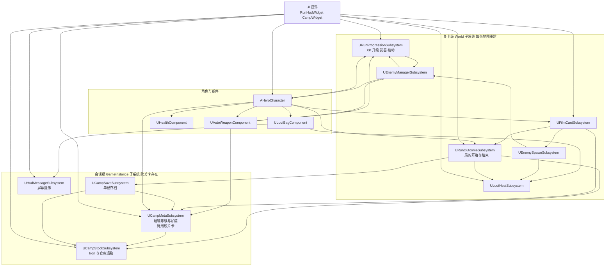
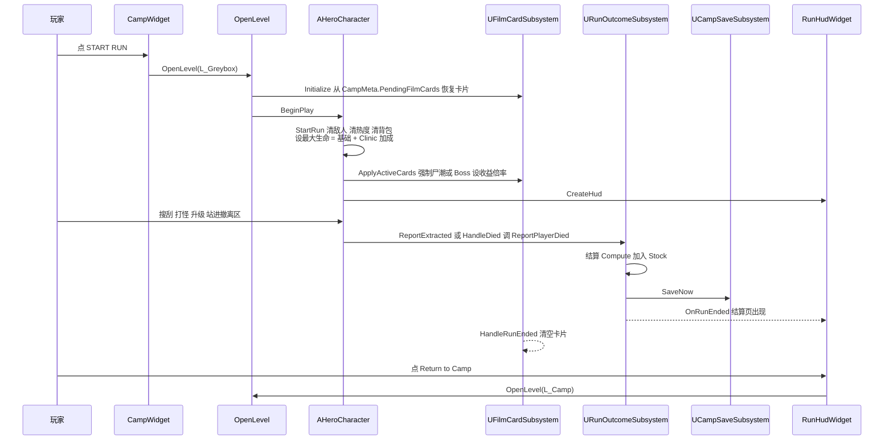
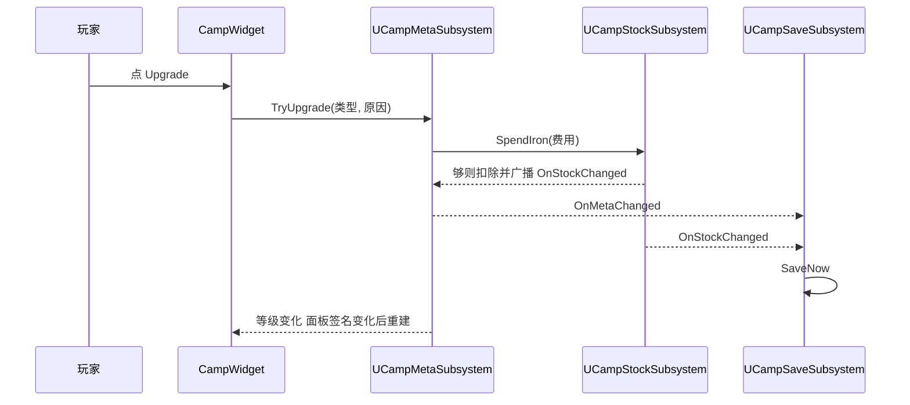

# 整体架构

对应代码：`main` 分支提交 `cd44b7f`（2026-11-13，故事 001–007 全部完成）。源码根目录 [`Game_01 5.8/Source/Game_01/`](../../Game_01%205.8/Source/Game_01/)，下文简称 `Source/`。

## 1. 技术栈

| 层 | 选择 | 位置 |
|---|---|---|
| 引擎 | Unreal Engine 5.8（本机 5.8.4） | [Game_01.uproject](../../Game_01%205.8/Game_01.uproject) |
| 语言 | C++20（引擎 5.8 最低要求），全部玩法和界面都是 C++，没有蓝图类 | [Source/](../../Game_01%205.8/Source/Game_01/) |
| 界面 | UMG，用 C++ 在 `RebuildWidget` 里搭控件树，没有 widget 蓝图 | [Public/UI](../../Game_01%205.8/Source/Game_01/Public/UI/) |
| 数据 | 9 张 DataTable（`Content/Data/`），由项目设置 `Director Tuning` 引用 | [DirectorTuningSettings.h](../../Game_01%205.8/Source/Game_01/Public/Game/DirectorTuningSettings.h) |
| 存档 | `USaveGame`，单槽 `CampSave` | [CampSaveGame.h](../../Game_01%205.8/Source/Game_01/Public/Flow/CampSaveGame.h) |
| 输入 | 原始按键绑定（`BindKey`），没有输入资产 | [HeroCharacter.cpp](../../Game_01%205.8/Source/Game_01/Private/Player/HeroCharacter.cpp) |
| AI 协作 | Unreal MCP 插件（`ModelContextProtocol`、`AllToolsets`） | [.uproject](../../Game_01%205.8/Game_01.uproject) |

游戏是奇幻斜俯视的"割草 × 搜打撤 × 薄营地"：在跑图地图里搜刮、打怪、升级，带着背包撤离；撤离的 Iron 和遗物进营地，营地升级建筑，下一局生效。

## 2. 两张地图，两个游戏模式

| 地图 | 游戏模式 | 默认 Pawn | 作用 |
|---|---|---|---|
| `L_Camp`（默认启动图） | [`ACampGameMode`](../../Game_01%205.8/Source/Game_01/Private/Camp/CampGameMode.cpp) | [`ACampPawn`](../../Game_01%205.8/Source/Game_01/Private/Camp/CampPawn.cpp) | 营地：不可行走，鼠标点击建筑，左侧面板操作 |
| `L_Greybox` | [`ADirectorGameMode`](../../Game_01%205.8/Source/Game_01/Private/Game/DirectorGameMode.cpp) | [`AHeroCharacter`](../../Game_01%205.8/Source/Game_01/Private/Player/HeroCharacter.cpp) | 跑图：移动、自动攻击、搜刮、撤离 |

游戏模式不在 ini 里设置，是每张地图的 World Settings 里指定的（PIE 日志里能看到 `Game class is 'DirectorGameMode'`）。
地图名 `L_Camp`、`L_Greybox` 在代码里写死：[`CampWidget.cpp`](../../Game_01%205.8/Source/Game_01/Private/UI/CampWidget.cpp) 的 `Start` 动作、[`RunHudWidget.cpp`](../../Game_01%205.8/Source/Game_01/Private/UI/RunHudWidget.cpp) 的 `Camp` 动作。

## 3. 分层与依赖图



依赖没有自动检查（没有架构测试，也没有 lint 规则）；方向靠约定：

- `Loot/` 是最底层：除了往 `UHudMessageSubsystem` 发提示（`LootBagComponent`、`LootContainer`），不引用任何其他玩法目录，只通过委托向上暴露事件。`Combat/` 不是底层：武器组件要读成长、敌人管理器和营地加成（统计见 [dependencies.md](dependencies.md#1-模块之间怎么依赖)）。
- 界面只读子系统和组件，改状态一律通过子系统的公开函数（升级、拆解、选卡、选升级项）。
- 营地状态（Iron、遗物、建筑等级）放在 GameInstance 子系统，因为 `OpenLevel` 会销毁整个 World；每局状态（敌人、热度、XP）放在 World 子系统，换图自然清零。

## 4. 运行时结构

| 对象 | 生命周期 | 说明 |
|---|---|---|
| GameInstance 子系统 | 整个进程 | `CampStock`、`CampMeta`、`CampSave`、`HudMessage` |
| World 子系统 | 一张地图 | `RunOutcome`、`LootHeat`、`RunProgression`（可 Tick）、`EnemySpawn`（可 Tick）、`EnemyManager`（可 Tick）、`FilmCard` |
| 敌人 | 一局 | [`AEnemy`](../../Game_01%205.8/Source/Game_01/Private/Enemies/Enemy.cpp) 不 Tick、无碰撞、无移动组件；[`UEnemyManagerSubsystem`](../../Game_01%205.8/Source/Game_01/Private/Enemies/EnemyManagerSubsystem.cpp) 在一个循环里移动全部敌人 |
| UMG 控件 | 一张地图 | 由 `AHeroCharacter::CreateHud` 或 `ACampPawn::BeginPlay` 创建 |

"软暂停"：升级三选一出现时，`UEnemyManagerSubsystem`、`UEnemySpawnSubsystem`、`UAutoWeaponComponent`、`URunProgressionSubsystem` 的 Tick 都检查 `IsOfferPending()` 直接返回，英雄的 `CanAct()` 也返回 false。引擎时间并没有暂停。

## 5. 关键数据流

### 5.1 一局：从营地出发到回到营地



要点：

- 结算只会发生一次：[`URunOutcomeSubsystem::EndRun`](../../Game_01%205.8/Source/Game_01/Private/Extraction/RunOutcomeSubsystem.cpp) 开头检查 `bRunActive`，撤离和死亡同一帧发生时先到先得。
- 存档在 `EndRun` 里显式写一次，因为"死亡且背包没有 Iron"时库存没变，`OnStockChanged` 不会触发存档监听。
- 营地加成不累积：每局 `StartRun` 用 `GetBaseMaxHealth() + Clinic 加成` 重新设值；Smithy 加成在每次开火时实时读取。

### 5.2 营地升级



### 5.3 升级三选一

击杀 → `UEnemyManagerSubsystem::OnEnemyKilled` → `URunProgressionSubsystem::HandleEnemyKilled` 生成 `AXpPickup` → 每帧磁吸和拾取 → `GrantXp` → `CheckLevelUp` → `GenerateOffer`（Fisher-Yates 洗牌取前三）→ `RunHudWidget` 读 `GetOfferDescriptions()` 显示按钮 → `PickOffer(Index)` → `ApplyOption`。

## 6. 设计原则

1. **数据驱动，代码给兜底**：所有数值来自 `Director Tuning` 引用的 DataTable；表或行缺失时静默使用 C++ 成员初始值，游戏照样能跑。例：[`UEnemySpawnSubsystem::Initialize`](../../Game_01%205.8/Source/Game_01/Private/Enemies/EnemySpawnSubsystem.cpp)。
2. **行键是身份**：表里行的 `Kind` / `BuildingType` / `WeaponType` 字段会被行名覆盖，防止漏填的单元格把 Boss 变成 Grunt（`BossTuning.Kind = EEnemyKind::Boss` 等）。
3. **一个循环管全部敌人**：敌人不 Tick，管理器单循环做追击、分格推开、接触伤害，目标 150 敌人帧率；故事 003 实测见 [build-and-run.md](build-and-run.md#6-性能探针--perfprobe)。
4. **难度只来自玩家选的卡**：胶片卡强制尸潮或 Boss；刷怪速率只受时间和热度影响，没有随机难度。
5. **界面不拥有状态**：HUD 和营地面板每帧读子系统，营地面板用"状态签名"检测变化再重建行。
6. **灰盒优先**：全部几何体是引擎自带立方体和圆柱，视觉区分靠材质的 `Color` 参数（有缺陷，见 [known-issues.md](known-issues.md)）。

## 7. 仓库目录树

```
2026-epic-ai-megajam/
├── CLAUDE.md, project.yaml      # AI 协作配置与项目机器配置
├── README.md, PLAN.md           # 项目简介、比赛时间线
├── Game_01 5.8/                 # 当前唯一在用的 UE 工程
│   ├── Game_01.uproject
│   ├── Config/                  # DefaultEngine / DefaultGame / DefaultInput ...
│   ├── Content/Data/            # 9 张 DataTable（LFS）
│   ├── Content/Maps/            # L_Camp、L_Greybox
│   └── Source/Game_01/{Public,Private}/
│       ├── Camp/ Combat/ Editing/ Enemies/ Extraction/
│       ├── Flow/ Game/ Loot/ Player/ Progression/ StandIn/ UI/
├── design/                      # 游戏简报、PRD、GDD
├── docs/                        # 本 wiki、计划文档、引擎参考、工作流指南
├── production/                  # 史诗/故事、QA 证据、会话状态
├── .claude/                     # agent、skill、hook、脚本（不参与构建）
└── Game_Jam_01/                 # 赛前热身工程，gitignore，不在仓库里
```
