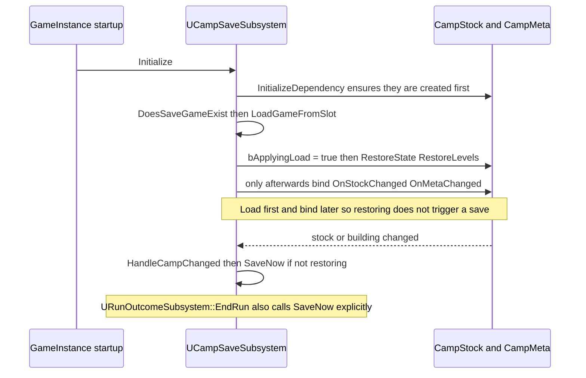

# Data and Storage

Paths omit the prefix `Game_01 5.8/`.

## 1. Save Game

A single save slot named `CampSave`, user slot 0. The command-line argument `-SaveSlot=Name` selects another slot name (`UCampSaveSubsystem::GetSlotName`), so a probe or a clean-save test never touches the real save. Implementation: [CampSaveSubsystem.cpp](../../Game_01%205.8/Source/Game_01/Private/Flow/CampSaveSubsystem.cpp). Data class: [CampSaveGame.h](../../Game_01%205.8/Source/Game_01/Public/Flow/CampSaveGame.h).

File location: `Saved/SaveGames/CampSave.sav` (confirmed to exist, about 2.5 KB). `Saved/` is listed in [.gitignore](../../.gitignore), so the save does not go into the repository.

### 1.1 Contents

| Field | Type | Source | How it is restored |
|---|---|---|---|
| `SaveVersion` | `int32`; the class default is 1 and `SaveNow` writes `CurrentSaveVersion` (2) | `UCampSaveGame::CurrentSaveVersion` | Checked on load: a value below 2 triggers the v1 migration (see 1.3) |
| `Iron` | `int32` | `UCampStockSubsystem::GetIron()` | `RestoreState`, negative values clamped to 0 |
| `UnlockedOptions` | `TArray<FName>` | `UCampStockSubsystem::GetUnlockedOptions()` | `RestoreState(Iron, Options)`; stored by name, not by enum number |
| `WarehouseRelics` | `TArray<ERelicType>` | Never written any more | Read from a v1 save only, to be migrated into `UnlockedOptions` |
| `BuildingLevels` | `TMap<EBuildingType, int32>` | `UCampMetaSubsystem::GetLevels()` | `RestoreLevels`, each entry clamped to 0 through `MaxLevel`, unknown types discarded |

**Not saved**: the film cards chosen before a run (`PendingFilmCards`, which only carry across levels within one session), and any in-run state (bag, heat, XP, weapons). In-run state is reset every run anyway, so quitting the game is the same as abandoning the current run.

### 1.2 When It Is Read and Written

- Events that trigger a save: Iron or unlocked-option changes (`OnStockChanged`), building level changes (`OnMetaChanged`). An upgrade fires twice in a row: `SpendIron` broadcasts `OnStockChanged` first (Iron has been deducted but the level has not yet gone up), then the level is incremented and `OnMetaChanged` is broadcast. So one upgrade writes the file twice. The first write captures the intermediate state "paid but not upgraded", and only the second write is the complete state. If the process is killed between the two writes, the save will have less Iron but no upgrade (see [known-issues.md](known-issues.md)).
- When a run ends, `EndRun` writes once more explicitly, because a death with no Iron in the bag leaves the stock unchanged and no event fires.
- If the save is corrupt or cannot be read: only a warning is logged and the game starts from a fresh camp. The bad file is not deleted, and the next change overwrites it.
- `DeleteSaveAndReset()`: deletes the slot and zeroes the stock and buildings. **Currently no UI or key calls it** (the "New Game" button is Should-tier and out of the current scope).

### 1.3 Version Compatibility

The most recent release tag is `jam-start` (commit `44589d2`, 2026-11-12). It predates the UE project itself (that commit contains no `Game_01` files), so there is no "released version" to compare save formats against. Story 008 changed the save layout, so there are now two formats: version 1 (relics kept in a warehouse, `WarehouseRelics`) and version 2 (unlocked upgrade options, `UnlockedOptions`).

- **Migration**: when `UCampSaveSubsystem` loads a save with `SaveVersion < 2`, it maps each relic in `WarehouseRelics` to the option its reel row names (`FReelUnlocks::OptionsForReels`, using the loot config), adds those options to `UnlockedOptions` and logs a `Migrated a v1 save` line. The next save is written as version 2 and no longer contains `WarehouseRelics`. A relic whose reel has no option yet (only Fast Cut maps to `Haste` for now) is dropped by the migration.
- **Why the default of `SaveVersion` must stay 1**: a `USaveGame` file stores only the properties whose value differs from the class default. A version 1 file therefore has no `SaveVersion` entry at all, and reads back as the class default. If the default were 2, an old file would claim to be version 2 and skip the migration. `SaveNow` sets `CurrentSaveVersion` (2) explicitly, which differs from 1 and so is written.

| Data | Released version | Current code | Consequence |
|---|---|---|---|
| Save format | No release | `SaveVersion = 2` written, 1 migrated on load | The next incompatible change needs a new `CurrentSaveVersion` and another branch in the load code |

## 2. Tuning Data Tables

All value tables live in `Content/Data/` (LFS) and are referenced by the project setting "Director Tuning". The reference paths are recorded under `[/Script/Game_01.DirectorTuningSettings]` in [DefaultGame.ini](../../Game_01%205.8/Config/DefaultGame.ini). If a table or row is missing, the member initial values in C++ work as usual and no error is raised.

| Setting | Table | Row names | Row struct | Used by |
|---|---|---|---|---|
| `EnemyTuningTable` | `DT_EnemyTuning` | `Grunt`, `Boss` | `FEnemyTuning` | `UEnemySpawnSubsystem` |
| `SpawnTuningTable` | `DT_SpawnTuning` | `Spawn` | `FSpawnTuning` | `UEnemySpawnSubsystem` |
| `SwarmTuningTable` | `DT_SwarmTuning` | `Swarm` | `FSwarmTuning` | `UEnemyManagerSubsystem` |
| `HealthTuningTable` | `DT_HealthTuning` | `Hero` | `FHealthTuning` | `UHealthComponent` |
| `ProgressionTable` | `DT_Progression` | `Progression` | `FXpCurveRow` | `URunProgressionSubsystem` |
| `WeaponTable` | `DT_Weapons` | `Blade`, `Bolt`, `Nova` | `FWeaponRow` | `URunProgressionSubsystem` |
| `PassiveTable` | `DT_Passives` | `Swiftness`, `Might`, `Vitality`, `Greed` | `FPassiveRow` | `URunProgressionSubsystem` |
| `FilmCardTable` | `DT_FilmCards` | `HordeNight`, `CutKnight` | `FFilmCardRow` | `UFilmCardSubsystem` (the row key is the card id, and all rows are optional) |
| `BuildingTable` | `DT_Buildings` | `Smithy`, `Clinic` | `FBuildingRow` | `UCampMetaSubsystem` |
| `LootTuningTable` | `DT_LootTuning` | `Default` | `FLootTuning` | `ULootConfig::CreateFromSettings` (bag capacity, Iron per slot, heat per reel, max heat, spawn pressure curve) |
| `LootContainerTable` | `DT_LootContainers` | `SupplyCrate`, `Vault` | `FLootContainerRow` | `ULootConfig` (Iron range, reel chance) |
| `ReelTable` | `DT_Reels` | `FastCut`, `WideShot`, `ChainScene` | `FRelicRow` | `ULootConfig` (reel name, the option it unlocks, drop weight) |

Notes:

- The `Kind`, `BuildingType`, `WeaponType` and `PassiveType` fields in the tables are overwritten by the row name (the row name is the identity).
- Bag, heat, container and reel values now come from the three loot tables above (story 008). `ULootConfig::CreateFromSettings` builds a config from them; a table that is not set keeps the inline defaults in the constructor of [LootConfig.cpp](../../Game_01%205.8/Source/Game_01/Private/Loot/LootConfig.cpp). A `ULootConfig` data asset assigned to the bag's `Config` is still possible but optional, and the project has none. `ULootBagComponent::BeginPlay` logs `LOOTCFG source=table` or `LOOTCFG source=c++ defaults` so a packaged build's log shows which one ran.
- In the default reel rows only Fast Cut is mapped to an option (`Haste`). Wide Shot and Chain Scene have an empty `UnlocksOption` until story 009 adds options, and a reel with no option never drops.
- Dismantling relics for Iron no longer exists, so there is no longer a hardcoded dismantle value.
- These `.uasset` files are binary. This wiki only checked row names and fields (taken from the code) and did not read out the specific values in each table. The values in the editor's tables are authoritative.

## 3. Config Files

| File | Project-relevant content |
|---|---|
| [DefaultEngine.ini](../../Game_01%205.8/Config/DefaultEngine.ini) | `GameDefaultMap` and `EditorStartupMap` are both `/Game/Maps/L_Camp.L_Camp`. Rendering: Lumen (dynamic GI method 1), reflection method 1, Substrate on, ray tracing on, DX12 SM6 |
| [DefaultGame.ini](../../Game_01%205.8/Config/DefaultGame.ini) | The 12 table references of `Director Tuning` |
| `DefaultEditorPerProjectUserSettings.ini` | Listed in .gitignore, stores each developer's local editor settings (such as the MCP port) |

`EditorStartupMap` makes the editor open the camp directly every time. When it is unset, the engine default is `/Engine/Maps/Templates/OpenWorld`, which opens an unnamed template level every time.

## 4. Cross-Module Units and Conventions

| Item | Convention |
|---|---|
| Length | Centimeters. `ContactRange`, `RingMinRadius` and weapon `Range` are all in centimeters |
| Planar math | Chasing, pushing apart and weapon hits are all done in the XY plane, ignoring Z |
| Time | Game logic uses `World->GetTimeSeconds()`. `UHudMessageSubsystem` uses real time |
| Iron and slots | In the bag, every `IronPerSlot` (10) Iron takes 1 slot, rounded up |
| Indexing | Lost film reels in the bag are a plain list; the HUD prints them one per line without numbers |
