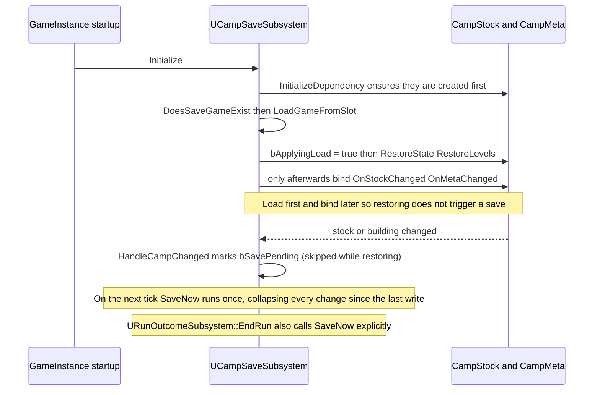

# Data and Storage

Paths omit the prefix `Game_01 5.8/`. Checked against the source on 2026-11-16 (HEAD `ad6174d`). The wiki cannot read the rows of the data tables (they are binary `.uasset` files); where a number comes from a table, the page says so.

## 1. Save Game

A single save slot named `CampSave`, user index 0. The command-line argument `-SaveSlot=Name` selects another slot name (`UCampSaveSubsystem::GetSlotName`, read once per process and cached), so a probe or a clean-save test never touches the real save. Implementation: [CampSaveSubsystem.cpp](../../Game_01%205.8/Source/Game_01/Private/Flow/CampSaveSubsystem.cpp). Data class: [CampSaveGame.h](../../Game_01%205.8/Source/Game_01/Public/Flow/CampSaveGame.h).

File location (a standard `USaveGame` slot, so the file is `<slot>.sav` in the `SaveGames` folder of the project's `Saved` directory):

| Where the game runs | File |
|---|---|
| Editor, `-game` from the editor exe | `Game_01 5.8/Saved/SaveGames/CampSave.sav` (on this machine 2,399 bytes, last written 2026-11-15 04:04) |
| Packaged build | `<package>/Windows/Game_01/Saved/SaveGames/CampSave.sav`; the packages under `Saved/Packages/` each hold their own (for example `story-012e/Windows/Game_01/Saved/SaveGames/CampSave.sav`) |

`Saved/` is ignored by [.gitignore](../../.gitignore) (`Saved/*` and `**/Saved/`), so no save goes into the repository. A slot passed with `-SaveSlot=Name` becomes `Name.sav` in the same folder; the folder on this machine currently holds `CampSave.sav`, `Pace1.sav`, `ReelProbeA.sav`, `ReelProbeB.sav` and three story 009 probe slots (`S009.sav`, `S009C.sav`, `S009E.sav`). The slot name is used as a file name, so keep it free of path characters and spaces (a value with spaces must be quoted on the command line).

### 1.1 Contents

The file is the engine's standard `USaveGame` container (the header of the file starts with `GVAS`), holding tagged properties of `UCampSaveGame`.

| Field | Type | Written from | How it is restored |
|---|---|---|---|
| `SaveVersion` | `int32`; class default is 1, `SaveNow` writes `CurrentSaveVersion` (2) | `UCampSaveGame::CurrentSaveVersion` | `FSaveVersionCheck::Classify` decides on load: below 2 triggers the v1 migration (see 1.3), 2 loads, above 2 returns `TooNew` and the file is backed up and skipped (see 1.3) |
| `Iron` | `int32`. **This is wood**: the field keeps its old name so older saves still load, and their Iron becomes wood | `UCampStockSubsystem::GetWood()` | `RestoreState`, negative values clamped to 0 |
| `Stone` | `int32`, default 0 (added with the wood and stone loot, commit `b364103`) | `UCampStockSubsystem::GetStone()` | Fourth argument of `RestoreState`, clamped to 0; an older file has no entry and reads 0 |
| `UnlockedOptions` | `TArray<FName>` | `UCampStockSubsystem::GetUnlockedOptions()` | `RestoreState`; stored by name, not by enum number; duplicates and `None` are dropped |
| `NewOptions` | `TArray<FName>` (added in commit `a5f6c32`, without a version bump) | `UCampStockSubsystem::GetNewOptions()` | Third argument of `RestoreState`; a marker for an option that is not unlocked is dropped. A version 2 file written before it has none |
| `WarehouseRelics` | `TArray<ERelicType>` | Never written any more | Read from a v1 save only, to be migrated into `UnlockedOptions` |
| `BuildingLevels` | `TMap<EBuildingType, int32>` | `UCampMetaSubsystem::GetLevels()` | `RestoreLevels`: each entry clamped to 0 through that building's `MaxLevel`, entries for building types that no longer exist are discarded |

Enum values inside the file are stored by name. The current `CampSave.sav` contains the strings `EBuildingType::Smithy` and `EBuildingType::Clinic`, and the older v1 files contained `ERelicType::...` names. So renaming or removing an entry of `EBuildingType` or `ERelicType` silently breaks existing saves. This is why the `ERelicType` entries (`Swiftstep`, `Warbrand`, `Aegis`) keep their old names although the player-facing names are Fast Cut, Wide Shot and Chain Scene.

`UnlockedOptions` is displayed (the camp's STORAGE list) and read by the reel drop rules and by the level-up pool: an option whose table row has `bStartsLocked` (`Chain`, `Haste`, `Magnet`) is offered only when its id, which is the table **row name**, is in the list (`FOptionUnlock::IsAvailable`, using `UCampStockSubsystem::GetUnlockedOptions`). An id that matches no row (a typo, or an option from a newer build) changes nothing. `NewOptions` is a subset of it: the options unlocked since the player last saw a level-up offer, taken by `TakeNewOptions()` when the next run's first offer is built. Taking does not write the save, so the file keeps the markers until the next write; after a restart they show once more (harmless).

**Not saved**: the film cards chosen before a run (`UCampMetaSubsystem::PendingFilmCards`, kept in memory for the session only; the world's `UFilmCardSubsystem` copies them back after each level load), the three volume levels of the Esc menu (a file-level array in `GameAudioSubsystem.cpp` that lives as long as the process, so they also survive a PIE restart inside the same editor session), and any in-run state (bag, heat, XP, weapons, level-up offer). In-run state is reset every run anyway, so quitting the game mid-run equals abandoning the run: nothing in the bag is banked (the Esc menu's "Return to camp" does the same on purpose, see [ui.md](ui.md#7-esc-pause-menu-upausemenuwidget)).

A file written with only default values omits those fields: a `USaveGame` file stores just the properties that differ from the class defaults. Evidence on this machine: `ReelProbeB.sav` (a probe run that ended in death) and `Pace1.sav` contain `SaveVersion` and none of the other field names, and the current `CampSave.sav` has no `Stone` and no `NewOptions` entry because both are zero or empty.

### 1.2 When It Is Read and Written

The subsystem lives in the `GameInstance`, so the load happens once per game start (once per PIE session in the editor), not on every level change. Opening `L_Camp` or `L_Greybox` does not re-read the file.

Writes happen in these cases. There is no other write path; `SaveNow` is public but only `URunOutcomeSubsystem::EndRun` calls it from outside the subsystem. The writes are **batched**: `HandleCampChanged` only sets `bSavePending`, and the next tick of the subsystem runs `SaveNow` once if the flag is set (and clears it), so several changes in the same tick collapse into one write. `bApplyingLoad` suppresses the batch while a load is being restored.

| Trigger | Where |
|---|---|
| Wood, stone or unlocked options change (`OnStockChanged`: `AddWood`, `AddStone`, `SpendWood`, `SpendStone`, `UnlockOption`, `RestoreState`) | `HandleCampChanged` |
| A building level changes (`OnMetaChanged`: `TryUpgrade`, `RestoreLevels`, `ResetCamp`) | `HandleCampChanged` |
| A run ends (extraction or death), always | `URunOutcomeSubsystem::EndRun` calls `SaveNow()` explicitly, because a death with nothing in the bag leaves the stock unchanged and fires no event |

- One upgrade fires two change events. `SpendWood` or `SpendStone` (the smithy costs stone, the clinic costs wood, `UCampMetaSubsystem::GetCostResource`) broadcasts `OnStockChanged` first (the cost has been deducted but the level has not yet gone up), then the level is incremented and `OnMetaChanged` is broadcast. Because writes are batched on the next tick, both collapse into one write of the complete state. If the process is killed before that tick, the save still holds the previous state (see [known-issues.md](known-issues.md)).
- One extraction fires one change per addition (wood via `AddWood`, stone via `AddStone`, each newly unlocked option via `UnlockOption`), and `EndRun` calls `SaveNow()` explicitly (a death adds nothing, so the explicit write is the only one). The batched write collapses them into a single write of the complete state.
- If the file does not start with the `GVAS` magic (`SlotFileLooksValid`), or the save is corrupt and cannot be read: the old file is first backed up to `<slot>.sav.unreadable.bak` (`BackupSlot`), then a warning is logged (`LogCampSave: Camp save file is not a valid save; backed up and starting a new camp`, or `Camp save slot exists but could not be loaded; backed up and starting fresh`) and the game starts from a fresh camp. The next change overwrites the original file.
- `DeleteSaveAndReset()`: deletes the slot and zeroes the stock (`RestoreState(0, {})`, stone falls back to its default 0) and the buildings. It suppresses saving while it does so, so the reset state is not written back. **No UI or key calls it** (grep over `Source/` finds no caller). To start over by hand, delete the `.sav` file with the game closed.
- Log lines to look for, all in `LogCampSave`: `No camp save found; starting a new camp`, `Loaded camp save: Iron N, N unlocked options, N building entries` (the number labelled Iron is the wood), `Camp save written: Iron N, N unlocked options` (or `FAILED`), `Migrated a vN save: ...`, and the safety logs `Backup of the save (<reason>): written` and `Camp save is version N, newer than this game (N); backed up and starting a new camp` (reason `newer-version`). Neither line mentions stone.

### 1.3 Version Compatibility

The only git tag is `jam-start` (commit `44589d2`, 12 November, "commits before this tag are tools/config only"). It predates the Unreal project: that commit contains no `Game_01` file. There are **no releases**, so there is no released game version to compare against; the formats below exist only as development builds, identified here by the commit that introduced them.

| Format | Introduced by | What changed |
|---|---|---|
| v1 | `a235325` (13 November, stories 004-006, first `Flow/` files) | `SaveVersion` (default 1, never written), `Iron`, `WarehouseRelics`, `BuildingLevels`. The v1 `SaveNow` never set `SaveVersion`, so v1 files have no `SaveVersion` entry at all |
| v2 | `3177f1d` (14 November, story 008) | `SaveVersion` written as 2, `UnlockedOptions` added, `WarehouseRelics` stops being written, v1 migration added |
| v2 plus `NewOptions` | `a5f6c32` (15 November) | Added field, no version bump |
| v2 plus `Stone`; `Iron` means wood | `b364103` (15 November) | Added field, no version bump; the smithy now costs stone, the clinic wood |

Every change since v1 added a tagged property, so the engine's property serialization does the compatibility work. The behaviour below is derived from the code and the git history; **none of the downgrade rows has been run**.

| Combination | What happens | Consequence |
|---|---|---|
| Current build reads a v1 file (no `SaveVersion`, has `WarehouseRelics`) | `SaveVersion` reads as the class default 1, so it takes the migration branch | Works, see the migration below. Stone is 0 and `Iron` is read as wood |
| Current build reads a v2 file written before `NewOptions` or before `Stone` | The missing fields read as empty or 0 | Works. Old `Iron` becomes wood. Building levels are kept, but the smithy now needs stone, so a player with only wood cannot upgrade it until stone has been carried out |
| Old v2 build (before `b364103`) reads a current file | The old class has no `Stone` property; unknown tagged properties are skipped by the engine | Expected to load with wood (`Iron`), options and buildings. The next save by the old build writes no `Stone`, so the stone is gone |
| Old v2 build before `a5f6c32` reads a current file | `NewOptions` and `Stone` skipped | The NEW! markers and the stone are lost on its next save; the rest is kept |
| v1 build (before `3177f1d`) reads a current file | It loads `Iron` and `BuildingLevels` and ignores the rest. Its `SaveNow` writes no `SaveVersion` and no `UnlockedOptions` | After that write the file looks like a v1 file with an empty warehouse: when a current build opens it again the migration adds nothing, so **the unlocked options and the stone are lost for good** |
| Current build reads a file with `SaveVersion` above 2 (a future format) | `FSaveVersionCheck::Classify` returns `TooNew`; the file is backed up to `<slot>.sav.newer-version.bak` and not loaded | The game starts a fresh camp. The future file is left in place and is not overwritten until a change triggers a save. (Before commit `12121d3` a too-new file loaded as if it were version 2 and the next save dropped the unknown fields) |

- **Migration (1 to 2)**: when `UCampSaveSubsystem` loads a save with `SaveVersion < 2`, it first backs the file up to `<slot>.sav.before-migration.bak` (`BackupSlot`), then maps each relic in `WarehouseRelics` to the option its reel row names (`FReelUnlocks::OptionsForReels`, using the loot config built from `Director Tuning`), adds those options to `UnlockedOptions`, and logs `Migrated a v1 save: N relics [...] -> N unlocked options`. Relics whose reel has no option are dropped; with the default reel rows in `LootConfig.cpp` all three types map (`Swiftstep` to `Haste`, `Warbrand` to `Magnet`, `Aegis` to `Chain`; `DT_Reels` contains the same three row names with the same option names), so nothing is lost today. Migrated options are not marked NEW: the migration passes no `NewOptions`. Iron and building levels carry over unchanged. The migrated state is written to disk as version 2 only when something next triggers a save (any change of wood, stone, options or buildings, or the end of the next run); until then the file on disk is still version 1. Loading a version 1 file and quitting without changes leaves it untouched.
- **What is tested**: `Game_01.Loot.V1SaveRelicsBecomeUnlockedOptions` ([ReelUnlockTest.cpp](../../Game_01%205.8/Source/Game_01/Private/Tests/ReelUnlockTest.cpp)) checks the pure mapping (`FReelUnlocks::OptionsForReels`), that a new `UCampSaveGame` has `SaveVersion` 1, and that `CurrentSaveVersion` is 2. The save and building tests ([CampSaveAndBuildingTest.cpp](../../Game_01%205.8/Source/Game_01/Private/Tests/CampSaveAndBuildingTest.cpp)) check `FSaveVersionCheck::Classify` (load vs migrate vs refuse a too-new file), that only a file starting with `GVAS` is handed to the loader, that the class default stays 1 so old files migrate, that a building upgrade cost grows by the growth factor and rounds down, and that the Smithy and Clinic bonuses are linear in the level. No test loads or writes a real file or runs `UCampSaveSubsystem` end to end.
- **The file on this machine**: the current `CampSave.sav` is a version 2 file written on 2026-11-15; its strings show `SaveVersion`, `Iron`, `UnlockedOptions` (`Chain`, `Magnet`) and `BuildingLevels` (`Smithy`, `Clinic`), no `WarehouseRelics`, no `Stone` entry. The earlier v1 file mentioned in older versions of this page no longer exists.
- **Why the default of `SaveVersion` must stay 1**: a version 1 file has no `SaveVersion` entry at all, and reads back as the class default. If the default were 2, an old file would claim to be version 2 and skip the migration (this bug happened once and was caught by loading a copy of the real save). `SaveNow` sets `CurrentSaveVersion` (2) explicitly, which differs from 1 and so is written.
- **Renames**: see 1.1. A renamed `ERelicType` entry would read back as the first entry (`Swiftstep`, which maps to `Haste`) in a version 1 file; a renamed `EBuildingType` entry loses that building's level. The option ids in `UnlockedOptions` are `FName`s equal to the table row names, so renaming the `Chain`, `Haste` or `Magnet` row in `DT_Weapons` / `DT_Passives` (or the `UnlocksOption` cell of a reel) silently locks that option again for existing saves.
- **Wood was renamed from "Iron"** (commit `12121d3`, the "wood rename"). The C++ API now says wood and stone everywhere (`UCampStockSubsystem::Wood` / `AddWood` / `SpendWood` / `GetWood`, `ULootBagComponent::WoodCount` / `GetWoodCount` / `TryAddWood`, `FRunResult::BagWood` / `WoodGained` / `WoodLost` / `BagStone` / `StoneGained` / `StoneLost`). Three names keep "Iron" for compatibility only, because renaming them would break existing data: the save field `Iron`, and the data table columns `FLootContainerRow::IronMin` / `IronMax` and `FLootTuning::IronPerSlot` (each column keeps its old name so the table keeps its values).

## 2. Tuning Data Tables

Every gameplay number lives either in C++ member initializers or in the tables below. The tables are `.uasset` files in `Content/Data/` (Git LFS) and are referenced by the project setting "Director Tuning" (`UDirectorTuningSettings`, `UCLASS(Config = Game, DefaultConfig)`, so it lives in `DefaultGame.ini`). The class has 21 settings properties: 12 data table references, `StarTuning` and `BossRejects` (plain structs), and the audio settings (`Sounds`, `CampMusic`, `RunMusic`, three volumes, `MaxCrowdSoundsPerSecond`, see 2.1). The table references are under `[/Script/Game_01.DirectorTuningSettings]` in [DefaultGame.ini](../../Game_01%205.8/Config/DefaultGame.ini); all 12 table assets named there exist in `Content/Data/`. If a table or a row is missing, the C++ initial values are used and no error is raised (the exception is the log line `LOOTCFG source=...`, see below).

| Setting | Table asset | Rows the code reads | Row struct | Read by | Read when |
|---|---|---|---|---|---|
| `EnemyTuningTable` | `DT_EnemyTuning` | by name: `Grunt`, `Boss` | `FEnemyTuning` | `UEnemySpawnSubsystem::Initialize` | each level load (world subsystem) |
| `SpawnTuningTable` | `DT_SpawnTuning` | by name: `Spawn` | `FSpawnTuning` | `UEnemySpawnSubsystem::Initialize` | each level load |
| `SwarmTuningTable` | `DT_SwarmTuning` | by name: `Swarm` | `FSwarmTuning` | `UEnemyManagerSubsystem::Initialize` | each level load |
| `HealthTuningTable` | `DT_HealthTuning` | by name: `Hero` | `FHealthTuning` | `UHealthComponent::BeginPlay` | each time a health component begins play |
| `ProgressionTable` | `DT_Progression` | by name: `Progression` | `FXpCurveRow` (`BaseXp`, `Growth`, `XpPerKill`, `BaseMagnetRadius`) | `URunProgressionSubsystem::Initialize` | each level load |
| `WeaponTable` | `DT_Weapons` | the code looks up one row per weapon: `Blade`, `Bolt`, `Nova`, `Chain`, `Gun`, `Orbit`. The asset holds only `Blade`, `Bolt`, `Nova`, `Chain` | `FWeaponRow` | `URunProgressionSubsystem::Initialize` | each level load |
| `PassiveTable` | `DT_Passives` | the code looks up `Swiftness`, `Might`, `Vitality`, `Greed`, `Haste`, `Magnet`, `Reach`, `Armor`, `Regen`, `Crit`. The asset holds only the first six | `FPassiveRow` | `URunProgressionSubsystem::Initialize` | each level load |
| `FilmCardTable` | `DT_FilmCards` | every row: the row name is the card id (`HordeNight`, `CutKnight` exist) | `FFilmCardRow` | `UFilmCardSubsystem::Initialize` (`GetRowNames`, `FindRow`) | each level load |
| `BuildingTable` | `DT_Buildings` | by name: `Smithy`, `Clinic` | `FBuildingRow` | `UCampMetaSubsystem::Initialize` | once per game start (GameInstance subsystem) |
| `LootTuningTable` | `DT_LootTuning` | by name: `Default` (`ULootConfig::TuningRowName`) | `FLootTuning` | `ULootConfig::GetTuning` | when a bag asks for its config (`ULootConfig::CreateFromSettings`) |
| `LootContainerTable` | `DT_LootContainers` | every row, matched by its `ContainerType` field (`SupplyCrate`, `Vault` exist) | `FLootContainerRow` | `ULootConfig::FindContainerRow` | as above |
| `ReelTable` | `DT_Reels` | every row, matched by its `RelicType` field (`FastCut`, `WideShot`, `ChainScene` exist) | `FRelicRow` | `ULootConfig::GetRelicRows` | as above |
| `StarTuning` (struct, not a table) | none | n/a | `FStarTuning` | `URunProgressionSubsystem::Initialize` copies it | each level load |
| `BossRejects` (struct, not a table) | none | n/a | `FBossRejectTuning` | `UBossRejectsSubsystem::ApplyCut` and `RefreshBossStats` read it from the settings object each time | live |

The row names above were read from the strings inside the `.uasset` files (the asset files were last modified between 2026-11-12 and 2026-11-15); the numbers in the rows were not read, so the editor's tables are the authority for values. When a table loads, its row replaces the C++ fallback (`DefaultWeapon` / `DefaultPassive` in [RunLoadout.cpp](../../Game_01%205.8/Source/Game_01/Private/Progression/RunLoadout.cpp)). For the older rows the shipped values differ from the fallbacks: the C++ default `Blade` is damage 15, +8 per level, interval 0.4 s, range 600, while the table was reported (when story 009 was finished, from the editor, not from the asset files) as damage 20, +10, 0.35 s, range 220. Treat the table below as the 2026-11-14 export; the weapon and passive tables were last saved on 2026-11-15 01:15, so values may have moved since.

| Table | Row | Values (story 009 export) |
|---|---|---|
| `DT_Weapons` | `Blade` | damage 20, per level +10, interval 0.35 s, range 220 |
| `DT_Weapons` | `Bolt` | 12, +7, 0.55 s, range 900, half-width 40 |
| `DT_Weapons` | `Nova` | 14, +8, 0.8 s, range 320 |
| `DT_Weapons` | `Chain` | 12, +6, 1.1 s, range 700, `ChainJumps` 3, `ChainRange` 350, `bStartsLocked` |
| `DT_Passives` | `Swiftness`, `Might`, `Vitality`, `Greed` | +0.08 move speed, +0.15 damage, +20 max health, +0.25 XP per stack |
| `DT_Passives` | `Haste`, `Magnet` | +0.12 attack speed, +150 cm magnet radius per stack; both `bStartsLocked` |
| `DT_Progression` | `Progression` | base 30, growth 1.3, 5 XP per kill, `BaseMagnetRadius` 600 |
| `DT_Reels` | `FastCut`, `WideShot`, `ChainScene` | unlock `Haste`, `Magnet`, `Chain` |

The `bStartsLocked` flags and the reel mapping are the part the code depends on; check them in the editor first if a locked option shows up in the first offer of a new save, or a reel never drops. Not verifiable from here: the current numbers of `DT_Buildings` (cost per level is `floor(BaseCost * CostGrowth^level)`, the smithy paying stone and the clinic wood), `DT_LootContainers` (the `IronMin` and `IronMax` columns are the wood amount for a `SupplyCrate`, a tree stump, and the stone amount for a `Vault`, a boulder) and `DT_LootTuning`.

Notes:

- **Identity rules differ**. For enemies, weapons, passives and buildings the row name is the identity: the row's own `Kind`, `WeaponType`, `PassiveType` or `BuildingType` field is overwritten with the type the code looked up. For reels and containers it is the other way round: the code scans all rows and matches on the `RelicType` / `ContainerType` field, so the row name is only a label, and a row with a duplicate type field is shadowed by the first. For film cards every row in the table is offered in the camp.
- When a loot table is unset or has no rows, the inline defaults in the constructor of [LootConfig.cpp](../../Game_01%205.8/Source/Game_01/Private/Loot/LootConfig.cpp) apply (Supply Crate 3 to 6 with a 20 % reel chance; Vault 10 to 20 with a 100 % reel chance; bag 6 slots, 10 units per slot, 15 heat per reel, max heat 100, spawn pressure 1 to 3). A `ULootConfig` data asset assigned to the bag's `Config` is still possible but optional, and the project has none. `ULootBagComponent::BeginPlay` logs `LOOTCFG source=table ...` or `LOOTCFG source=c++ defaults ...` (category `LogLoot`) so a packaged build's log shows which one ran. The check looks only at the `Default` row of `DT_LootTuning`.
- `StarTuning` and `BossRejects` are not in `DefaultGame.ini`, so they always use the C++ defaults. `FStarTuning` ([ProgressionTypes.h](../../Game_01%205.8/Source/Game_01/Public/Progression/ProgressionTypes.h)): two stars at 3 copies, three stars at 9 copies, weapon damage x2 and x4, weapon reach x1.25 and x1.6, passive effect x1.5 and x2.5, minimum level-up pool 4. `FBossRejectTuning` ([BossRejectsSubsystem.h](../../Game_01%205.8/Source/Game_01/Public/Enemies/BossRejectsSubsystem.h)): what each cut gives the Cut Knight boss. Its constructor fills one attack per weapon (`Blade` shot every 3.0 s for 12, `Bolt` shot every 4.0 s for 18, `Chain` shot every 1.8 s for 7, `Gun` shot every 1.3 s for 9, `Nova` slam every 5.0 s for 25 with radius 450 and wind-up 1.0 s, `Orbit` ring of 8 balls every 6.0 s for 8), a repeat-cut step of 0.25 of the base damage, +0.08 move speed per Swiftness cut, +0.15 contact damage per Might cut, attack intervals x0.9 per Haste cut (never below x0.5 in total), +150 health per Vitality cut, +100 health for any other cut, a stat bonus cap of +100 %, a health bonus cap of 1500 and a ball hit radius of 90 cm. Edit both in Project Settings > Game > Director Tuning, which writes them to `DefaultGame.ini`.
- The reel rows (default rows in `LootConfig.cpp`, and the shipped `DT_Reels`) map Fast Cut to `Haste`, Wide Shot to `Magnet` and Chain Scene to `Chain`. The option id is the **row name** of the weapon or passive row it unlocks (`Chain` in `DT_Weapons`; `Haste` and `Magnet` in `DT_Passives`), not an enum value. A reel row with an empty `UnlocksOption` never drops. A row with `bStartsLocked` stays out of the level-up pool until its id is unlocked; a row without it is always in the pool, so clearing the flag in the table makes the option available from the start (and changes the pool size and the number of permanent cuts: pool minus 4).
- Pool arithmetic: 13 options on a new save (5 weapons: `Blade`, `Bolt`, `Nova`, `Gun`, `Orbit`; 8 passives: `Swiftness`, `Might`, `Vitality`, `Greed`, `Reach`, `Armor`, `Regen`, `Crit`), 16 with all three unlocked; permanent cuts = pool - `MinPoolSize` (4), so 9 to 12. `Gun`, `Orbit`, `Reach`, `Armor`, `Regen` and `Crit` have no row in `DT_Weapons` and `DT_Passives`: they run on the C++ defaults, and a table row of the same name would override them.
- Dismantling relics no longer exists, so there is no hardcoded dismantle value.
- Because the tables are read through soft references, packaging must be told to cook them. `DefaultGame.ini` does that with `+DirectoriesToAlwaysCook=(Path="/Game/Data")` under `[/Script/UnrealEd.ProjectPackagingSettings]` (added in commit `c9d3468`); without it the packaged game silently runs on the C++ defaults. The packaged build's log line `LOOTCFG source=table` was seen on 2026-11-14 (evidence in `production/qa/evidence/story-008-lost-film-reels/packaged/`).
- Editing a table in the editor takes effect on the next PIE session or level load, except `DT_Buildings` (read once when the GameInstance is created, so restart PIE).

### 2.1 Audio settings in Director Tuning

Added in commit `a5f6c32`, category "Audio" in the same settings page; read by [GameAudioSubsystem.cpp](../../Game_01%205.8/Source/Game_01/Private/Audio/GameAudioSubsystem.cpp).

| Setting | Type | Value in `DefaultGame.ini` | Behaviour |
|---|---|---|---|
| `Sounds` | `TMap<EGameSound, TSoftObjectPtr<USoundBase>>` | all 11 `EGameSound` entries set: `Attack`, `EnemyHit`, `EnemyDeath`, `Pickup`, `LevelUp`, `Cut`, `StarUp`, `Extraction`, `PlayerDeath`, `Upgrade`, `ExtractStart`, each a Sound Cue under `/Game/Free_Sounds_Pack/cue/` | Loaded synchronously when a game world's `UGameAudioSubsystem` starts. An empty or unloadable entry makes that event silent: the first request logs `AUDIO first request: <name> (no asset assigned, silent)` |
| `CampMusic`, `RunMusic` | `TSoftObjectPtr<USoundBase>` | `/Game/PathOfAdventure/Loop/CUE/CUE_Village_Loop` and `CUE_Battle_Loop` | Loaded when the music starts (`StartMusic`); log line `MUSIC start Camp/Run (asset assigned or silent)` |
| `MasterVolume`, `MusicVolume`, `SfxVolume` | `float`, 0 to 1 | not in the ini, so the C++ defaults 0.8, 0.35 and 0.7 | The starting levels. The Esc menu overrides them for the process (`UGameAudioSubsystem::SetBusVolume`, steps of 0.1, not saved). Effects play at master x effects, music at master x music |
| `MaxCrowdSoundsPerSecond` | `int32`, at least 1 | not in the ini, so 16 | At most this many `Attack`, `EnemyHit` and `EnemyDeath` sounds start per second (real time); requests over the cap are counted and dropped |

The log line `AUDIOCFG sounds assigned=N of 11, master=... music=... sfx=... crowd cap=.../s` shows at world start what actually loaded.

Because the sounds are soft references, packaging must also be told to cook them: `DefaultGame.ini` adds `+DirectoriesToAlwaysCook` for `/Game/Free_Sounds_Pack/cue` and `/Game/PathOfAdventure/Loop/CUE`. All 11 cues named in `Sounds` and the two music cues exist in `Content/` on this machine (the folders are not in git, see section 5).

## 3. Config Files

| File | Project-relevant content |
|---|---|
| [DefaultEngine.ini](../../Game_01%205.8/Config/DefaultEngine.ini) | `GameDefaultMap` and `EditorStartupMap` are both `/Game/Maps/L_Camp.L_Camp`. Rendering: static lighting off, virtual shadow maps on, Lumen for dynamic GI and reflections (`r.DynamicGlobalIlluminationMethod=1`, `r.ReflectionMethod=1`), mesh distance fields, Substrate on, ray tracing on, DX12 as the default RHI with SM6. Hardware class Desktop, graphics Maximum. The `ActiveGameNameRedirects` from `TP_Blank` come from the project template. The editor also wrote an `AndroidFileServerRuntimeSettings` block with a `SecurityToken` (connection type USB only, not in shipping); it is not used by the game. Contains no `[Zen]` section (the `AutoLaunch=False` line was removed on 2026-11-13 because it broke cook and stage) |
| [DefaultGame.ini](../../Game_01%205.8/Config/DefaultGame.ini) | `[/Script/Game_01.DirectorTuningSettings]`: the 12 table references plus `Sounds`, `CampMusic` and `RunMusic` (nothing for `StarTuning`, `BossRejects`, the volumes or the crowd cap). `[/Script/UnrealEd.ProjectPackagingSettings]`: `MapsToCook` for `/Game/Maps/L_Camp` and `/Game/Maps/L_Greybox` (without these only the default map would be cooked and START RUN would fail in a package) and `DirectoriesToAlwaysCook` for `/Game/Data`, `/Game/Free_Sounds_Pack/cue` and `/Game/PathOfAdventure/Loop/CUE`. `ProjectID`, an `AssetManagerSettings` block for maps and primary asset labels, and CommonUI settings and console variables (the CommonUI plugin is not enabled in the `.uproject` and the game code does not use it) |
| [DefaultInput.ini](../../Game_01%205.8/Config/DefaultInput.ini) | Engine template defaults. `DefaultPlayerInputClass` and `DefaultInputComponentClass` point at the Enhanced Input classes, `bCaptureMouseOnLaunch=True`, console key Tilde. The game binds raw keys in code (see [build-and-run.md](build-and-run.md#5-game-controls)), no input mapping assets exist |
| `DefaultEditor.ini` | Present and empty |
| `DefaultEditorPerProjectUserSettings.ini` | Listed in .gitignore (`**/Config/DefaultEditorPerProjectUserSettings.ini`), so not in git; on this machine it holds the MCP server settings (path `/mcp`, port 8000, auto-start, tool search on) |

`EditorStartupMap` makes the editor open the camp directly every time. When it is unset, the engine default is `/Engine/Maps/Templates/OpenWorld`, which opens an unnamed template level every time.

There are no game-specific console variables or `Game.ini` keys beyond the ones above: tuning goes through Director Tuning, and the probes and the save slot use command-line arguments (`-SaveSlot=`, `-ReelProbe`, `-PaceProbe` and the others in `DirectorProbeSubsystem.cpp` and `CampGameMode.cpp`; see [build-and-run.md](build-and-run.md)).

## 4. Cross-Module Units and Conventions

| Item | Convention |
|---|---|
| Length | Centimeters. `ContactRange`, `RingMinRadius` and weapon `Range` are all in centimeters |
| Planar math | Chasing, pushing apart and weapon hits are all done in the XY plane, ignoring Z |
| Time | Game logic uses `World->GetTimeSeconds()`. `UHudMessageSubsystem` and the audio crowd cap use real time |
| Wood, stone and slots | In the bag, wood and stone are counted separately; each takes `ceil(count / IronPerSlot)` slots (`IronPerSlot` 10 by default) and every lost film reel takes 1 more slot; the bag has `BagCapacitySlots` (6) slots. So 1 wood and 1 stone use 2 slots. A stump (`SupplyCrate`) gives wood and a boulder (`Vault`) gives stone. The save field and the `IronPerSlot` column keep the old "Iron" name (see 1.3) |
| Reels in the bag | A plain list of `ERelicType`. The bag itself does not stop duplicates; the drop rule does (`FRelicRow::IsDroppable` refuses a type already in the bag); the HUD prints one `Lost reel: <name>` line per reel |
| Names in saves and tables | Upgrade options are `FName`s equal to a weapon or passive row name (`Chain`, `Haste`, `Magnet`); enum values inside the save file are stored by name |
| Line endings | The working tree of this repo is CRLF on Windows (`core.autocrlf=true`); `.gitattributes` forces LF only for `*.sh`, `*.awk`, `*.tsv`, `.worktreeinclude` and `.claude/**/*.md` |

## 5. Assets That Are Not in Git

The code points at third-party content packs by path. The pack folders sit in `Content/` on the author's machine but are **untracked** (they show as `??` in `git status`, they are not ignored) and the repository tracks only `Content/Data/`, `Content/Maps/` and `Content/Materials/M_FlatColor`. `.gitattributes` would send `.uasset` and `.umap` files to Git LFS if they were added. The data tables hold no reference to the packs. Details of what each pack is used for are in [dependencies.md](dependencies.md#4-third-party-dependencies).

What a checkout without the packs does, from the code (not run): hero, enemy, forest, camp-building and portal models are hard references made with `ConstructorHelpers::FObjectFinder`; each one is checked with `Succeeded()` and the code falls back to engine cubes and cylinders (the hero keeps a cylinder, enemies stay grey cubes, the clinic and smithy stay a cube, a missing portal is hidden). Sounds and music are soft references: a missing asset is a silent no-op. What the engine logs for a missing `FObjectFinder` asset, and how the cook treats a `DirectoriesToAlwaysCook` path that does not exist, was not checked.

The packaged builds under `Saved/Packages/` that were made after the models were added (for example `art-9`) list files from `RPGHeroSquad`, `MonsterForSurvivalGame`, `RPGTinyFantasyForest`, `WW2Generic` and `LowPolyHouse` in their manifests: the hard references pull exactly those assets into the cook. The packs that nothing references (`BattleWizard*`, `FourEvilDragons*`, `FreeAtmosGameMusic`, `Free_5_Samples`, `SmallSoundKit`, `ZenUV_SciFi_TrimSheet`) are absent from that manifest.
