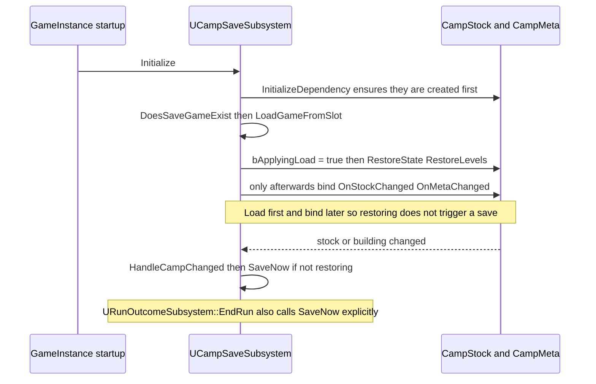

# Data and Storage

Paths omit the prefix `Game_01 5.8/`.

## 1. Save Game

A single save slot named `CampSave`, user index 0. The command-line argument `-SaveSlot=Name` selects another slot name (`UCampSaveSubsystem::GetSlotName`, read once per process and cached), so a probe or a clean-save test never touches the real save. Implementation: [CampSaveSubsystem.cpp](../../Game_01%205.8/Source/Game_01/Private/Flow/CampSaveSubsystem.cpp). Data class: [CampSaveGame.h](../../Game_01%205.8/Source/Game_01/Public/Flow/CampSaveGame.h).

File location (a standard `USaveGame` slot, so the file is `<slot>.sav` in the `SaveGames` folder of the project's `Saved` directory):

| Where the game runs | File |
|---|---|
| Editor, `-game` from the editor exe | `Game_01 5.8/Saved/SaveGames/CampSave.sav` (the file on this machine is 2,582 bytes) |
| Packaged build | `<package>/Windows/Game_01/Saved/SaveGames/CampSave.sav` (seen on this machine in `Saved/Packages/story-008/`, which holds a `PkgReelA.sav` written by a probe) |

`Saved/` is ignored by [.gitignore](../../.gitignore) (`Saved/*` and `**/Saved/`), so no save goes into the repository. A slot passed with `-SaveSlot=Name` becomes `Name.sav` in the same folder; the folder on this machine currently holds `CampSave.sav`, `ReelProbeA.sav`, `ReelProbeB.sav` and three story 009 probe slots (`S009.sav`, `S009C.sav`, `S009E.sav`). The slot name is used as a file name, so keep it free of path characters and spaces (a value with spaces must be quoted on the command line).

### 1.1 Contents

| Field | Type | Written from | How it is restored |
|---|---|---|---|
| `SaveVersion` | `int32`; class default is 1, `SaveNow` writes `CurrentSaveVersion` (2) | `UCampSaveGame::CurrentSaveVersion` | Checked on load: a value below 2 triggers the v1 migration (see 1.3). A value above 2 is not detected (see 1.3) |
| `Iron` | `int32` | `UCampStockSubsystem::GetIron()` | `RestoreState`, negative values clamped to 0 |
| `UnlockedOptions` | `TArray<FName>` | `UCampStockSubsystem::GetUnlockedOptions()` | `RestoreState(Iron, Options)`; stored by name, not by enum number; duplicates and `None` are dropped |
| `NewOptions` | `TArray<FName>` | `UCampStockSubsystem::GetNewOptions()` | Third argument of `RestoreState`; a marker for an option that is not unlocked is dropped. Added in story 009 without a version bump: a version 2 file written before it simply has none (see 1.3) |
| `WarehouseRelics` | `TArray<ERelicType>` | Never written any more | Read from a v1 save only, to be migrated into `UnlockedOptions` |
| `BuildingLevels` | `TMap<EBuildingType, int32>` | `UCampMetaSubsystem::GetLevels()` | `RestoreLevels`: each entry clamped to 0 through that building's `MaxLevel`, entries for building types that no longer exist are discarded |

Enum values inside the file are stored by name (the real v1 file on this machine contains the strings `EBuildingType::Smithy` and `ERelicType::Aegis`). So renaming or removing an entry of `EBuildingType` or `ERelicType` silently breaks existing saves. This is why the `ERelicType` entries (`Swiftstep`, `Warbrand`, `Aegis`) keep their old names although the player-facing names are Fast Cut, Wide Shot and Chain Scene.

`UnlockedOptions` is displayed (the camp's STORAGE list) and read by the reel drop rules and, since story 009, by the level-up pool: an option whose table row has `bStartsLocked` (`Chain`, `Haste`, `Magnet`) is offered only when its id, which is the table **row name**, is in the list (`URunProgressionSubsystem::GetUnlockedOptions`, `FOptionUnlock::IsAvailable`). An id that matches no row (a typo, or an option from a newer build) changes nothing. `NewOptions` is a subset of it: the options unlocked since the player last saw a level-up offer, taken by `TakeNewOptions()` when the next run's first offer is built. Taking does not write the save, so the file keeps the markers until the next write; after a restart they show once more (harmless).

**Not saved**: the film cards chosen before a run (`UCampMetaSubsystem::PendingFilmCards`, kept in memory for the session only; the world's `UFilmCardSubsystem` copies them back after each level load), and any in-run state (bag, heat, XP, weapons, level-up offer). In-run state is reset every run anyway, so quitting the game mid-run equals abandoning the run: nothing in the bag is banked.

A file written with only default values omits those fields: a `USaveGame` file stores just the properties that differ from the class defaults. For example `ReelProbeB.sav` (a probe run that ended in death, Iron 0, nothing unlocked) contains `SaveVersion` and none of the other field names.

### 1.2 When It Is Read and Written

The subsystem lives in the `GameInstance`, so the load happens once per game start (once per PIE session in the editor), not on every level change. Opening `L_Camp` or `L_Greybox` does not re-read the file.

Writes happen in these cases. There is no other write path; `SaveNow` is public but only `URunOutcomeSubsystem::EndRun` calls it from outside the subsystem.

| Trigger | Where |
|---|---|
| Iron or unlocked options change (`OnStockChanged`: `AddIron`, `SpendIron`, `UnlockOption`, `RestoreState`) | `HandleCampChanged` |
| A building level changes (`OnMetaChanged`: `TryUpgrade`, `RestoreLevels`, `ResetCamp`) | `HandleCampChanged` |
| A run ends (extraction or death), always | `URunOutcomeSubsystem::EndRun` calls `SaveNow()` explicitly, because a death with no Iron in the bag leaves the stock unchanged and fires no event |

- One upgrade writes the file twice. `SpendIron` broadcasts `OnStockChanged` first (Iron has been deducted but the level has not yet gone up), then the level is incremented and `OnMetaChanged` is broadcast. The first write captures the intermediate state "paid but not upgraded"; only the second write is complete. If the process is killed between the two writes, the save has less Iron and no upgrade (see [known-issues.md](known-issues.md)).
- One extraction writes the file several times: once for the Iron (`AddIron`), once per newly unlocked option (`UnlockOption`), and once from the explicit `SaveNow` in `EndRun`. The last write is the complete state.
- If the save is corrupt or cannot be read: only a warning is logged (`LogCampSave: Camp save slot exists but could not be loaded; starting fresh`) and the game starts from a fresh camp. The bad file is not deleted, and the next change overwrites it.
- `DeleteSaveAndReset()`: deletes the slot and zeroes the stock and buildings. It suppresses saving while it does so, so the reset state is not written back. **No UI or key calls it** (the "New Game" button is Should-tier and out of the current scope). To start over by hand, delete the `.sav` file with the game closed.
- Log lines to look for, all in `LogCampSave`: `No camp save found; starting a new camp`, `Loaded camp save: Iron N, N unlocked options, N building entries`, `Camp save written: Iron N, N unlocked options` (or `FAILED`), and `Migrated a vN save: ...`.

### 1.3 Version Compatibility

The only release tag is `jam-start` (it predates the UE project: that commit contains no `Game_01` files), so there is no released game version to compare save formats against. There are two save formats inside the repository's own history: version 1 (relics kept in a warehouse, field `WarehouseRelics`) and version 2 (unlocked upgrade options, field `UnlockedOptions`, story 008). Both exist only as development builds.

| Data | Format written by | What the current code does | Consequence |
|---|---|---|---|
| Version 1 file read by the current code | Builds before story 008 (`SaveVersion` is absent from the file) | Reads `SaveVersion` as the class default 1, so it takes the migration branch | Works, see below |
| Version 2 file read by the current code | Current build, or a story 008 build | Loads directly; a file written before story 009 has no `NewOptions`, which reads as empty (no version bump was needed) | Works |
| Version 2 file read by a pre-story-008 build | Current build | Not tested. The old class has no `UnlockedOptions` property, and unknown tagged properties are skipped by the engine | Expected to load with `Iron` and `BuildingLevels` only; `UnlockedOptions` is lost on the next save by the old build, and the options the player unlocked are gone |
| File with `SaveVersion` above 2 (a future format) | A build newer than this one | Not detected: `SaveVersion < 2` is the only check, so the file loads as if it were version 2 | Fields the current class does not know are ignored, and the next save overwrites the file as version 2 and drops them. The first incompatible change must add a check for versions above `CurrentSaveVersion` |

- **Migration (1 to 2)**: when `UCampSaveSubsystem` loads a save with `SaveVersion < 2`, it maps each relic in `WarehouseRelics` to the option its reel row names (`FReelUnlocks::OptionsForReels`, using the loot config built from `Director Tuning`), adds those options to `UnlockedOptions`, and logs `Migrated a v1 save: N relics [...] -> N unlocked options`. Relics whose reel has no option are dropped; with the shipped tables all three types map (`Swiftstep` to `Haste`, `Warbrand` to `Magnet`, `Aegis` to `Chain`), so nothing is lost today (migrated options are not marked NEW: the migration passes no `NewOptions`). Iron and building levels carry over unchanged. The migrated state is written to disk as version 2 only when something next triggers a save (any Iron, option or building change, or the end of the next run); until then the file on disk is still version 1. Loading a version 1 file and quitting without changes leaves it untouched.
- **The file on this machine**: `CampSave.sav` was last written on 2026-11-13, before story 008, and still contains `WarehouseRelics` and no `SaveVersion`. By the story 008 notes it holds 8 relics (Warbrand 3, Aegis 5). Story 008 mapped neither type, so it would have migrated to 0 unlocked options; with the story 009 tables it would migrate to 2 (`Magnet` and `Chain`). Not run against the real file; the migration is covered only by the unit test, not by a real save.
- **Why the default of `SaveVersion` must stay 1**: a version 1 file has no `SaveVersion` entry at all, and reads back as the class default. If the default were 2, an old file would claim to be version 2 and skip the migration (this bug happened once and was caught by loading a copy of the real save). `SaveNow` sets `CurrentSaveVersion` (2) explicitly, which differs from 1 and so is written. The unit test `Game_01.Loot.V1SaveRelicsBecomeUnlockedOptions` asserts both the default of 1 and the written value of 2.
- **Enum renames**: see 1.1. A renamed `ERelicType` entry would read back as the first entry (`Swiftstep`, which maps to `Haste`) in a version 1 file; a renamed `EBuildingType` entry loses that building's level. The option ids in `UnlockedOptions` are `FName`s equal to the table row names, so renaming the `Chain`, `Haste` or `Magnet` row in `DT_Weapons` / `DT_Passives` (or the `UnlocksOption` cell of a reel) silently locks that option again for existing saves.

## 2. Tuning Data Tables

Every gameplay number lives either in C++ member initializers or in the tables below. The tables are `.uasset` files in `Content/Data/` (Git LFS) and are referenced by the project setting "Director Tuning" (`UDirectorTuningSettings`, `UCLASS(Config = Game, DefaultConfig)`, so it lives in `DefaultGame.ini`). The class has 13 settings properties: 12 data table references and one plain struct, `StarTuning`. The reference paths are under `[/Script/Game_01.DirectorTuningSettings]` in [DefaultGame.ini](../../Game_01%205.8/Config/DefaultGame.ini); all 12 table assets named there exist in `Content/Data/`. If a table or a row is missing, the C++ initial values are used and no error is raised (the exception is the log line `LOOTCFG source=...`, see below).

| Setting | Table asset | Rows the code reads | Row struct | Read by | Read when |
|---|---|---|---|---|---|
| `EnemyTuningTable` | `DT_EnemyTuning` | by name: `Grunt`, `Boss` | `FEnemyTuning` | `UEnemySpawnSubsystem::Initialize` | each level load (world subsystem) |
| `SpawnTuningTable` | `DT_SpawnTuning` | by name: `Spawn` | `FSpawnTuning` | `UEnemySpawnSubsystem::Initialize` | each level load |
| `SwarmTuningTable` | `DT_SwarmTuning` | by name: `Swarm` | `FSwarmTuning` | `UEnemyManagerSubsystem::Initialize` | each level load |
| `HealthTuningTable` | `DT_HealthTuning` | by name: `Hero` | `FHealthTuning` | `UHealthComponent::BeginPlay` | each time a health component begins play |
| `ProgressionTable` | `DT_Progression` | by name: `Progression` | `FXpCurveRow` (`BaseXp`, `Growth`, `XpPerKill`, `BaseMagnetRadius`) | `URunProgressionSubsystem::Initialize` | each level load |
| `WeaponTable` | `DT_Weapons` | by name: `Blade`, `Bolt`, `Nova`, `Chain` | `FWeaponRow` | `URunProgressionSubsystem::Initialize` | each level load |
| `PassiveTable` | `DT_Passives` | by name: `Swiftness`, `Might`, `Vitality`, `Greed`, `Haste`, `Magnet` | `FPassiveRow` | `URunProgressionSubsystem::Initialize` | each level load |
| `FilmCardTable` | `DT_FilmCards` | every row: the row name is the card id (`HordeNight`, `CutKnight` exist) | `FFilmCardRow` | `UFilmCardSubsystem::Initialize` (`GetRowNames`, `FindRow`) | each level load |
| `BuildingTable` | `DT_Buildings` | by name: `Smithy`, `Clinic` | `FBuildingRow` | `UCampMetaSubsystem::Initialize` | once per game start (GameInstance subsystem) |
| `LootTuningTable` | `DT_LootTuning` | by name: `Default` (`ULootConfig::TuningRowName`) | `FLootTuning` | `ULootConfig::GetTuning` | when a bag asks for its config (`ULootConfig::CreateFromSettings`) |
| `LootContainerTable` | `DT_LootContainers` | every row, matched by its `ContainerType` field (`SupplyCrate`, `Vault` exist) | `FLootContainerRow` | `ULootConfig::FindContainerRow` | as above |
| `ReelTable` | `DT_Reels` | every row, matched by its `RelicType` field (`FastCut`, `WideShot`, `ChainScene` exist) | `FRelicRow` | `ULootConfig::GetRelicRows` | as above |
| `StarTuning` (struct, not a table) | none | n/a | `FStarTuning` | `URunProgressionSubsystem::Initialize` copies it | each level load |

The row names in the table were read from the strings inside the `.uasset` files; the numbers in the rows were not read (the assets are binary), so the editor's tables are the authority for values. The one place where this matters: when a table loads, its row replaces the C++ fallback (`DefaultWeapon` / `DefaultPassive` in [RunProgressionSubsystem.cpp](../../Game_01%205.8/Source/Game_01/Private/Progression/RunProgressionSubsystem.cpp)), and for the older rows the shipped values differ from the fallbacks.

Values exported from the tables when story 009 was finished (taken from the exported data, not read from the `.uasset` files here):

| Table | Row | Values |
|---|---|---|
| `DT_Weapons` | `Blade` | damage 20, per level +10, interval 0.35 s, range 220 |
| `DT_Weapons` | `Bolt` | 12, +7, 0.55 s, range 900, half-width 40 |
| `DT_Weapons` | `Nova` | 14, +8, 0.8 s, range 320 |
| `DT_Weapons` | `Chain` | 12, +6, 1.1 s, range 700, `ChainJumps` 3, `ChainRange` 350, `bStartsLocked` |
| `DT_Passives` | `Swiftness`, `Might`, `Vitality`, `Greed` | +0.08 move speed, +0.15 damage, +20 max health, +0.25 XP per stack |
| `DT_Passives` | `Haste`, `Magnet` | +0.12 attack speed, +150 cm magnet radius per stack; both `bStartsLocked` |
| `DT_Progression` | `Progression` | base 30, growth 1.3, 5 XP per kill, `BaseMagnetRadius` 600 |
| `DT_Reels` | `FastCut`, `WideShot`, `ChainScene` | unlock `Haste`, `Magnet`, `Chain` |

The `bStartsLocked` flags and the reel mapping are the part the code depends on; check them in the editor first if a locked option shows up in the first offer of a new save, or a reel never drops.

Notes:

- **Identity rules differ**. For enemies, weapons, passives and buildings the row name is the identity: the row's own `Kind`, `WeaponType`, `PassiveType` or `BuildingType` field is overwritten with the type the code looked up. For reels and containers it is the other way round: the code scans all rows and matches on the `RelicType` / `ContainerType` field, so the row name is only a label, and a row with a duplicate type field is shadowed by the first. For film cards every row in the table is offered in the camp.
- When a loot table is unset or has no rows, the inline defaults in the constructor of [LootConfig.cpp](../../Game_01%205.8/Source/Game_01/Private/Loot/LootConfig.cpp) apply (Supply Crate 3 to 6 Iron with a 20 % reel chance; Vault 10 to 20 Iron with a 100 % reel chance; bag 6 slots, 10 Iron per slot, 15 heat per reel, max heat 100, spawn pressure 1 to 3). A `ULootConfig` data asset assigned to the bag's `Config` is still possible but optional, and the project has none. `ULootBagComponent::BeginPlay` logs `LOOTCFG source=table ...` or `LOOTCFG source=c++ defaults ...` (category `LogLoot`) so a packaged build's log shows which one ran.
- `StarTuning` is not in `DefaultGame.ini`, so it always uses the C++ defaults of `FStarTuning` ([ProgressionTypes.h](../../Game_01%205.8/Source/Game_01/Public/Progression/ProgressionTypes.h)): two stars at 3 copies, three stars at 9 copies, weapon damage x2 and x4, weapon reach x1.25 and x1.6, passive effect x1.5 and x2.5, minimum level-up pool 4. Edit it in Project Settings > Game > Director Tuning, which writes it to `DefaultGame.ini`.
- The reel rows (default rows in `LootConfig.cpp`, and the shipped `DT_Reels`) map Fast Cut to `Haste`, Wide Shot to `Magnet` and Chain Scene to `Chain`. The option id is the **row name** of the weapon or passive row it unlocks (`Chain` in `DT_Weapons`; `Haste` and `Magnet` in `DT_Passives`), not an enum value. A reel row with an empty `UnlocksOption` never drops. A row with `bStartsLocked` stays out of the level-up pool until its id is unlocked; a row without it is always in the pool, so clearing the flag in the table makes the option available from the start (and changes the pool size and the number of permanent cuts: pool minus 4).
- Pool arithmetic: 7 options on a new save (3 weapons and 4 passives without a lock), 10 with all three unlocked; permanent cuts = pool - `MinPoolSize` (4), so 3 to 6.
- Dismantling relics for Iron no longer exists, so there is no longer a hardcoded dismantle value.
- Because the tables are read through soft references, packaging must be told to cook them. `DefaultGame.ini` does that with `+DirectoriesToAlwaysCook=(Path="/Game/Data")` under `[/Script/UnrealEd.ProjectPackagingSettings]`; without it the packaged game silently runs on the C++ defaults. The packaged build's log line `LOOTCFG source=table` was seen on 2026-11-14 (evidence in `production/qa/evidence/story-008-lost-film-reels/packaged/`).
- Editing a table in the editor takes effect on the next PIE session or level load, except `DT_Buildings` (read once when the GameInstance is created, so restart PIE).

## 3. Config Files

| File | Project-relevant content |
|---|---|
| [DefaultEngine.ini](../../Game_01%205.8/Config/DefaultEngine.ini) | `GameDefaultMap` and `EditorStartupMap` are both `/Game/Maps/L_Camp.L_Camp`. Rendering: static lighting off, virtual shadow maps on, Lumen for dynamic GI and reflections (`r.DynamicGlobalIlluminationMethod=1`, `r.ReflectionMethod=1`), mesh distance fields, Substrate on, ray tracing on, DX12 as the default RHI with SM6. Hardware class Desktop, graphics Maximum. The `ActiveGameNameRedirects` from `TP_Blank` come from the project template. Contains no `[Zen]` section (the `AutoLaunch=False` line was removed on 2026-11-13 because it broke cook and stage) |
| [DefaultGame.ini](../../Game_01%205.8/Config/DefaultGame.ini) | `[/Script/Game_01.DirectorTuningSettings]`: the 12 table references. `[/Script/UnrealEd.ProjectPackagingSettings]`: `MapsToCook` for `/Game/Maps/L_Camp` and `/Game/Maps/L_Greybox` (without these only the default map would be cooked and START RUN would fail in a package) and `DirectoriesToAlwaysCook` for `/Game/Data`. `ProjectID`, an `AssetManagerSettings` block for maps and primary asset labels, and CommonUI console variables (the CommonUI plugin is not used by the game code) |
| [DefaultInput.ini](../../Game_01%205.8/Config/DefaultInput.ini) | Engine template defaults. `DefaultPlayerInputClass` and `DefaultInputComponentClass` point at the Enhanced Input classes, `bCaptureMouseOnLaunch=True`, console key Tilde. The game binds raw keys in code (see [build-and-run.md](build-and-run.md#5-game-controls)), no input mapping assets exist |
| `DefaultEditor.ini` | Present and empty |
| `DefaultEditorPerProjectUserSettings.ini` | Listed in .gitignore (`**/Config/DefaultEditorPerProjectUserSettings.ini`), stores each developer's local editor settings (such as the MCP port) |

`EditorStartupMap` makes the editor open the camp directly every time. When it is unset, the engine default is `/Engine/Maps/Templates/OpenWorld`, which opens an unnamed template level every time.

There are no game-specific console variables or `Game.ini` keys beyond the ones above: tuning goes through Director Tuning, and the probes and the save slot use command-line arguments (see [build-and-run.md](build-and-run.md)).

## 4. Cross-Module Units and Conventions

| Item | Convention |
|---|---|
| Length | Centimeters. `ContactRange`, `RingMinRadius` and weapon `Range` are all in centimeters |
| Planar math | Chasing, pushing apart and weapon hits are all done in the XY plane, ignoring Z |
| Time | Game logic uses `World->GetTimeSeconds()`. `UHudMessageSubsystem` uses real time (`FPlatformTime::Seconds`) |
| Iron and slots | In the bag, every `IronPerSlot` (10) Iron takes 1 slot, rounded up, and every lost film reel takes 1 more slot; the bag has `BagCapacitySlots` (6) slots |
| Reels in the bag | A plain list of `ERelicType`. The bag itself does not stop duplicates; the drop rule does (`FRelicRow::IsDroppable` refuses a type already in the bag); the HUD prints one `Lost reel: <name>` line per reel |
| Names in saves and tables | Upgrade options are `FName`s equal to a weapon or passive row name (`Chain`, `Haste`, `Magnet`); enum values inside the save file are stored by name |
| Line endings | The working tree of this repo is CRLF on Windows (`core.autocrlf=true`); `.gitattributes` forces LF only for `*.sh`, `*.awk`, `*.tsv`, `.worktreeinclude` and `.claude/**/*.md` |
