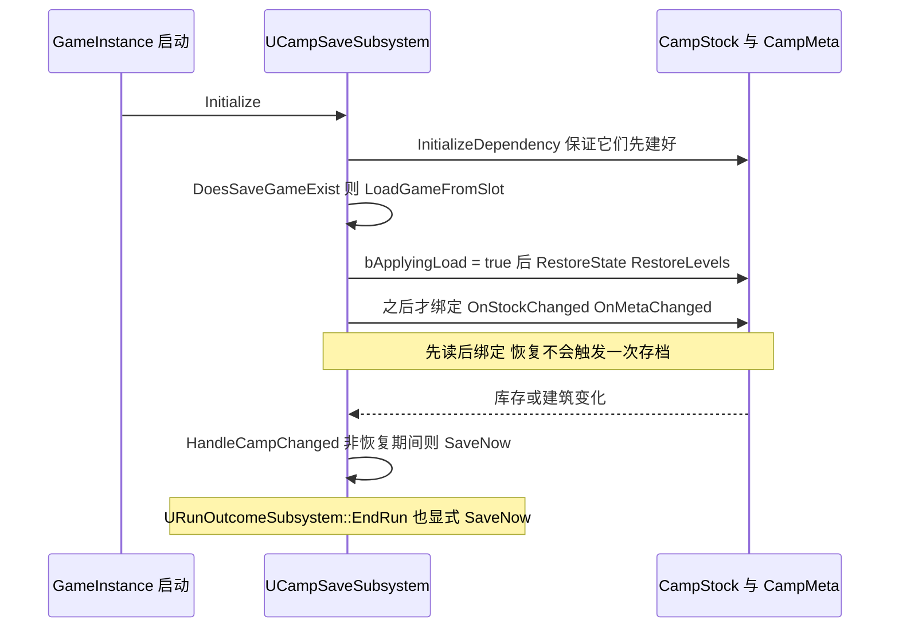

# 数据与存储

路径省略前缀 `Game_01 5.8/`。

## 1. 存档

单个存档槽，名字 `CampSave`，用户槽位 0。实现：[CampSaveSubsystem.cpp](../../Game_01%205.8/Source/Game_01/Private/Flow/CampSaveSubsystem.cpp)，数据类：[CampSaveGame.h](../../Game_01%205.8/Source/Game_01/Public/Flow/CampSaveGame.h)。

文件位置：`Saved/SaveGames/CampSave.sav`（已确认存在，约 2.5 KB）。`Saved/` 在 [.gitignore](../../.gitignore) 里，存档不进仓库。

### 1.1 内容

| 字段 | 类型 | 来源 | 恢复方式 |
|---|---|---|---|
| `SaveVersion` | `int32`，当前 1 | 常量 | **读取时不检查**，见 [known-issues.md](known-issues.md) |
| `Iron` | `int32` | `UCampStockSubsystem::GetIron()` | `RestoreState`，负数夹到 0 |
| `WarehouseRelics` | `TArray<ERelicType>` | `GetWarehouseRelics()` | `RestoreState` |
| `BuildingLevels` | `TMap<EBuildingType, int32>` | `UCampMetaSubsystem::GetLevels()` | `RestoreLevels`，每项夹到 0 到 `MaxLevel`，未知类型丢弃 |

**不存的**：局前选的胶片卡（`PendingFilmCards`，只在一次会话里跨关卡）、一局内的任何状态（背包、热度、XP、武器）。局内状态本来就按局清零，所以退出游戏等于放弃当前一局。

### 1.2 何时读写

- 触发存档的事件：Iron 变化、仓库变化（`OnStockChanged`）、建筑等级变化（`OnMetaChanged`）。升级会连续触发两次：`SpendIron` 先广播 `OnStockChanged`（此时 Iron 已扣、等级还没加），随后等级加一再广播 `OnMetaChanged`。所以升级一次写两次文件，第一次写下的是"已扣钱、没升级"的中间状态，第二次才是完整状态。两次写之间进程被杀，存档里会是少了 Iron 却没升级（见 [known-issues.md](known-issues.md)）。
- 一局结束时 `EndRun` 再显式写一次，因为死亡且背包没有 Iron 时库存不变，不会有事件。
- 存档损坏或读不出来：只打警告日志，从全新营地开始，不删除坏文件，下一次变化会覆盖它。
- `DeleteSaveAndReset()`：删除槽并把库存和建筑清零，**目前没有任何界面或按键调用它**（"新游戏"按钮属于 Should 级，不在当前范围）。

### 1.3 版本兼容性

最近的发布标签是 `jam-start`（提交 `44589d2`，2026-11-12），它早于 UE 工程本身（该提交里没有 `Game_01` 的任何文件），所以没有"已发布版本"可以对比存档格式。当前仓库里只有一个存档格式，`SaveVersion = 1`，没有迁移代码。

| 数据 | 发布版本 | 当前代码 | 后果 |
|---|---|---|---|
| 存档格式 | 无发布 | `SaveVersion = 1` | 以后改字段布局时必须自己加版本检查，目前读取不看这个字段 |

## 2. 调参数据表

所有数值表放在 `Content/Data/`（LFS），由项目设置"Director Tuning"引用。引用路径记在 [DefaultGame.ini](../../Game_01%205.8/Config/DefaultGame.ini) 的 `[/Script/Game_01.DirectorTuningSettings]`。表或行缺失时，C++ 里的成员初始值照常工作，不会报错。

| 设置项 | 表 | 行名 | 行结构 | 使用者 |
|---|---|---|---|---|
| `EnemyTuningTable` | `DT_EnemyTuning` | `Grunt`、`Boss` | `FEnemyTuning` | `UEnemySpawnSubsystem` |
| `SpawnTuningTable` | `DT_SpawnTuning` | `Spawn` | `FSpawnTuning` | `UEnemySpawnSubsystem` |
| `SwarmTuningTable` | `DT_SwarmTuning` | `Swarm` | `FSwarmTuning` | `UEnemyManagerSubsystem` |
| `HealthTuningTable` | `DT_HealthTuning` | `Hero` | `FHealthTuning` | `UHealthComponent` |
| `ProgressionTable` | `DT_Progression` | `Progression` | `FXpCurveRow` | `URunProgressionSubsystem` |
| `WeaponTable` | `DT_Weapons` | `Blade`、`Bolt`、`Nova` | `FWeaponRow` | `URunProgressionSubsystem` |
| `PassiveTable` | `DT_Passives` | `Swiftness`、`Might`、`Vitality`、`Greed` | `FPassiveRow` | `URunProgressionSubsystem` |
| `FilmCardTable` | `DT_FilmCards` | `HordeNight`、`CutKnight` | `FFilmCardRow` | `UFilmCardSubsystem`（行键就是卡的 id，所有行都可选） |
| `BuildingTable` | `DT_Buildings` | `Smithy`、`Clinic` | `FBuildingRow` | `UCampMetaSubsystem` |

注意：

- 表里的 `Kind`、`BuildingType`、`WeaponType`、`PassiveType` 字段会被行名覆盖（行名是身份）。
- 热度参数（背包容量、每格 Iron、热度增减、刷怪压力）和遗物、容器数值**不在**这 9 张表里，它们来自 `ULootConfig` 数据资产，没有资产时用 [LootConfig.cpp](../../Game_01%205.8/Source/Game_01/Private/Loot/LootConfig.cpp) 构造函数里的内联默认值。当前工程里没有 `ULootConfig` 资产，所以实际跑的是内联默认值。
- 拆解一个遗物得到的 Iron（8）写死在 [`UCampMetaSubsystem`](../../Game_01%205.8/Source/Game_01/Public/Camp/CampMetaSubsystem.h)，不在任何表里。
- 这些 `.uasset` 是二进制，本 wiki 只核对了行名和字段（来自代码），没有逐个读出表里的具体数值，数值以编辑器里的表为准。

## 3. 配置文件

| 文件 | 与本项目相关的内容 |
|---|---|
| [DefaultEngine.ini](../../Game_01%205.8/Config/DefaultEngine.ini) | `GameDefaultMap` 和 `EditorStartupMap` 都是 `/Game/Maps/L_Camp.L_Camp`；渲染：Lumen（动态 GI 方法 1）、反射方法 1、Substrate 开、光追开、DX12 SM6 |
| [DefaultGame.ini](../../Game_01%205.8/Config/DefaultGame.ini) | `Director Tuning` 的 9 条表引用 |
| `DefaultEditorPerProjectUserSettings.ini` | 在 .gitignore 里，保存每个开发者本机的编辑器设置（如 MCP 端口） |

`EditorStartupMap` 是为了让编辑器每次直接打开营地：没设置时引擎默认值是 `/Engine/Maps/Templates/OpenWorld`，每次都开一个未命名的模板关卡。

## 4. 跨模块的单位与约定

| 项 | 约定 |
|---|---|
| 长度 | 厘米；`ContactRange`、`RingMinRadius`、武器 `Range` 都是厘米 |
| 平面运算 | 追击、推开、武器命中都在 XY 平面做，忽略 Z |
| 时间 | 游戏逻辑用 `World->GetTimeSeconds()`；`UHudMessageSubsystem` 用真实时间 |
| Iron 与槽位 | 背包里 Iron 每 `IronPerSlot`（10）占 1 槽，向上取整 |
| 下标 | 遗物下标在背包和仓库里都是 0 起，界面显示 `[1]` 起 |
